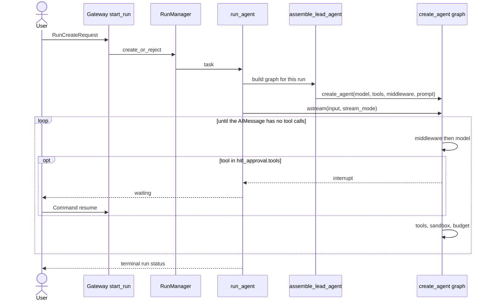

**English** · [中文](deer-flow.zh.md)

# deer-flow (`bytedance/deer-flow`)

> Studied at commit [`cf8c29c`](https://github.com/bytedance/deer-flow/tree/cf8c29c6b6920671075bd9010b94d89df2a273a8)
> (2026-11-10): backend package `deer-flow` / harness package `deerflow-harness`, both `2.3.0-dev`.
> `git describe` at that commit is `v2.1.0-rc0-1434-gcf8c29c`.
> Source paths below are relative to the repository root, and line numbers refer to that commit.
> **Fact** means read in source or pinned by a test in this study's reproduction.
> **Interpretation** means my reading of intent. This study did not run the upstream suite.

**Interactive diagrams (Archify, every node links to source):**
[architecture](../diagrams/deer-flow/architecture.html) ·
[execution flow](../diagrams/deer-flow/execution-flow.html) ·
[core abstractions](../diagrams/deer-flow/core-abstractions.html) ·
[context flow](../diagrams/deer-flow/context-flow.html) ·
[memory flow](../diagrams/deer-flow/memory-flow.html) ·
[tool runtime](../diagrams/deer-flow/tool-runtime.html) ·
[agent loop](../diagrams/deer-flow/agent-loop.html) ·
[sub-agent flow](../diagrams/deer-flow/sub-agent-flow.html)

**Minimal reproduction:** [`experiments/deer-flow/`](https://github.com/woaitqs/repo-research/tree/main/experiments/deer-flow)

---

## TL;DR

- **DeerFlow is a harness assembled around LangChain's `create_agent`, plus a run registry it does own.**
  `assemble_lead_agent` builds tools, a static system prompt and an ordered middleware list, then calls
  `create_agent(...)` (`backend/packages/harness/deerflow/agents/lead_agent/agent.py:1446-1453`).
  The model/tool cycle, interrupts and checkpoints belong to LangChain and LangGraph.
  What DeerFlow adds around that graph is the Gateway `RunManager`, `run_agent`'s `agent.astream` loop,
  a per-thread sandbox, IM channels, and the context policy below.
- **The system prompt is kept static on purpose.** The module docstring of `DynamicContextMiddleware`
  says the current date and per-user memory are injected once, as a `<system-reminder>`, so the
  prefix can be reused (`dynamic_context_middleware.py:1-7`). Skill *bodies* are not in that prefix:
  the prompt carries an index, and `/skill-name` loads `SKILL.md` for one model call
  (`skill_activation_middleware.py:566-580`).
- **Compaction is destructive, then re-injected.** `DeerFlowSummarizationMiddleware._maybe_summarize`
  replaces the message list with `RemoveMessage(id=REMOVE_ALL_MESSAGES)` plus the kept tail, and
  stores `summary_text` (`summarization_middleware.py:1040-1050`). `DurableContextMiddleware` renders
  that summary, the delegation ledger and loaded skills into a request-only message that is not
  written back (`durable_context_middleware.py:1-9`).
- **A sub-agent does not see the parent transcript and does not get a checkpointer.**
  `SubagentExecutor` builds a new message list (optional system, optional snapshot, then the task)
  and calls `create_agent(..., checkpointer=False)` (`executor.py:1666-1677`, `1281-1288`).
  It does copy the parent's `sandbox` into the child state (`executor.py:1686-1687`).
  The built-in general-purpose sub-agent disallows `task`, `ask_clarification` and `present_files`
  (`subagents/builtins/general_purpose.py:67`).
- **Human pauses are two different mechanisms.** Approval calls `interrupt()` from `after_model`
  (`hitl_approval_middleware.py:1-7`, `249`). The file's own comment says a rejection must not be
  done inside `wrap_tool_call`, because that path is bypassed. Clarification does not interrupt:
  it returns `Command(goto=END)` (`clarification_middleware.py:546-554`).
- **Compared with the other studies here:** like deepagents, the loop is borrowed. Unlike deepagents,
  summarization deletes messages instead of keeping a full history and rebuilding a view, and the
  Gateway runs the graph in-process instead of shelling out to `langgraph dev`. Unlike
  openai-agents-python, there is no owned `while True`. Unlike letta-code, memory is not compiled
  into the system prompt. Unlike open-pstack, skills are files plus a sandbox projection, not prose
  aimed at a host loop.

## Why This Repository Matters

DeerFlow 2 is the case of a team that kept LangGraph as the agent loop and spent the
repository on everything a long-running "super agent" needs *around* that loop:
who is allowed to start a run, where the shell executes, what survives compaction,
how a sub-agent borrows the parent's machine, and how an IM message becomes the
same run path as the web UI.

The README calls 2.0 a ground-up rewrite that shares no code with the 1.x research
framework. **That sentence is a README claim; this study did not diff the `1.x` branch.**
What is in the history is factual: the first commit is `03798de` on 2025-04-09,
"feat: lite deep researcher implementation", and the tree at `cf8c29c` is 4,769 commits
later. The harness that this study traces lives under `backend/packages/harness/deerflow/`.

It is a useful comparison point for the other five studies:

| Study | Who owns the loop | What this one does differently |
|---|---|---|
| deepagents | LangChain `create_agent`, middleware for context | Same delegation. DeerFlow's summary deletes messages; deepagents keeps them and rebuilds a view. DeerFlow's memory is a frozen reminder, not `AGENTS.md` inside the system prompt. |
| OpenHands | event log; `step()` is stateless; context is a projection | DeerFlow's checkpoint *is* the transcript. The extra projection (`durable_context`) is request-only and sits beside that transcript. |
| openai-agents-python | an owned `while True` over `NextStep` | DeerFlow never writes that loop. A human approval is still a serializable pause, but it is LangGraph's `interrupt()`, and clarification is a different control-flow trick. |
| letta-code | one model step per run, split across a protocol; memory compiled from git | DeerFlow runs the whole graph inside one Gateway worker. Memory is extracted after the run and injected once per conversation, outside the system prompt. |
| open-pstack | no loop; prose skills steer a host | DeerFlow's skills are `SKILL.md` files. The lead materializes a filesystem view into the sandbox; the model is not trusted to follow a prose pack unaided. |

## Repository Snapshot

| Item | Value (fact) |
|---|---|
| Layout | `backend/packages/harness` (`deerflow.*`), `backend/app` (Gateway + IM channels), `frontend/` (Next.js), `skills/public`, `docker/`, `contracts/` |
| Harness size | 797 Python files, 196,399 lines under `backend/packages/harness/deerflow/` |
| App size | 161 Python files, 65,035 lines under `backend/app/` |
| Backend tests | 1,498 Python files, 599,159 lines under `backend/tests/` |
| Versions | `backend/pyproject.toml` name `deer-flow`, `2.3.0-dev`, Python `>=3.12`. Harness package `deerflow-harness` `2.3.0-dev` |
| Loop dependencies | harness requires `langchain>=1.3`, `langgraph>=1.2.9,<1.3` (`backend/packages/harness/pyproject.toml`) |
| Graph entry | `backend/langgraph.json` maps `lead_agent` to `deerflow.agents:make_lead_agent` |
| History | 4,769 commits at this pin; first commit 2025-04-09 |
| This study's reproduction | 20 tests, demo 14/14, mutation check 8/8. The upstream suite was not executed. |

The largest harness files are the run worker (`runtime/runs/worker.py`, ~206 KB),
the sandbox tool surface, the AIO and E2B providers, the DeerMem updater, and
`subagents/executor.py`. **Interpretation:** the bulk of the code is lifecycle,
isolation and policy around a loop the project does not implement.

## Architecture

Three layers. The call graph supports this split; the harness/app import rule is
enforced by `backend/tests/test_harness_boundary.py` (stated in `backend/AGENTS.md:148`
and not re-run here).

```text
Gateway + channels   app/gateway, app/channels          (who may start a run, SSE, IM)
DeerFlow harness     deerflow.agents, runtime, sandbox  (assembly, context, sandbox, sub-agents)
LangChain / LangGraph  create_agent, Pregel, interrupt  (the model/tool cycle and checkpoints)
```

```mermaid
flowchart LR
  user([User]) --> web["Web UI / IM channel"]
  web --> gw["Gateway FastAPI<br/>start_run"]
  gw --> rm["RunManager<br/>run record"]
  rm --> worker["run_agent<br/>agent.astream"]
  worker --> asm["assemble_lead_agent"]
  asm --> graph["create_agent graph"]
  graph --> mw["Middleware stack"]
  graph --> model[(Chat model)]
  mw --> sbx["SandboxProvider<br/>per thread"]
  mw --> mem[(Memory store)]
  worker --> cp[(Checkpointer)]
```

Richer, source-linked version: [architecture.html](../diagrams/deer-flow/architecture.html).

**Module boundaries (fact):**

| Module | Owns | Does not own |
|---|---|---|
| `app/gateway/services.py` `start_run` | admission, `Command(resume=...)`, scheduling `run_agent` | the model loop |
| `runtime/runs/worker.py` `run_agent` | one run's stream, attaching the checkpointer, observing `__interrupt__` | assembling tools |
| `agents/lead_agent/agent.py` | the lead stack, the system prompt, the `create_agent` call | LangGraph's nodes |
| `agents/middlewares/*` | what each model call and tool call is allowed to see | |
| `sandbox/` | `Sandbox` / `SandboxProvider`, lazy acquire, skill projection | |
| `subagents/executor.py` | a child graph with `checkpointer=False` | the parent's transcript |
| `app/channels/` | ten IM adapters that re-enter `start_run` | a second agent loop |

`make_lead_agent` (`agents/__init__.py:20-31`) is the LangGraph Server entry: it
primes the skills cache and calls the real factory. Gateway HTTP runs do not use
that string directly. `resolve_agent_factory` returns `assemble_lead_agent`
(`app/gateway/services.py:1339-1355`), which also returns an assembly descriptor
so the worker does not have to recover "what was built" from LangGraph private
attributes (`agent.py:878-888`).

## Main Execution Flow

Entry traced: `POST /api/threads/{thread_id}/runs` (`app/gateway/routers/thread_runs.py:1054-1067`),
which calls `start_run`. A chat message from Slack, Feishu, Telegram and the other
adapters reaches the same function. The channel registry is ten providers
(`app/channels/service.py:33-44`): Buzz, DingTalk, Discord, Feishu, GitHub, QQ,
Slack, Telegram, WeChat, WeCom.



Step by step (fact unless marked):

1. **HTTP entry.** `create_run` returns as soon as `start_run` has admitted the run
   (`thread_runs.py:1054-1067`). `stream_run` is the SSE sibling (`:1072`).
2. **Factory.** `resolve_agent_factory` ignores `assistant_id` for routing and always
   returns `assemble_lead_agent` (`services.py:1339-1355`). Custom agents are an
   `agent_name` inside the run config, not a second graph.
3. **Resume is a command, not a new user message.** When `command.resume` is present,
   `graph_input` becomes `Command(resume=...)` (`services.py:2424-2425`).
4. **The worker.** `start_run` ends by awaiting `run_agent(...)` (`services.py:2804`).
   `run_agent` (`runtime/runs/worker.py:1004`) waits for a prior run on the same thread
   to finish finalizing, then `try_start` (`worker.py:1233`).
5. **Assembly.** `assemble_lead_agent` freezes the checkpoint channel mode so a client
   cannot retune it (`agent.py:894-916`), resolves the user, filters skills through
   authorization, builds tools, calls `build_middlewares`, optionally inserts
   `HitlApprovalMiddleware` at index 0, renders the prompt, and calls `create_agent`
   (`agent.py:1405-1453`).
6. **Checkpointer attachment is outside the factory.** The lead `create_agent` call
   does not receive a checkpointer. The worker assigns `agent.checkpointer` and
   `agent.store` after the graph exists (`worker.py:1596-1600`), then
   `agent.astream(...)` (`worker.py:1679` and `:1722`).
7. **Interrupts.** The stream watcher treats a chunk's `__interrupt__` as a pause
   and, when the payload's `kind` is `hitl_approval`, stores it on the run record
   (`worker.py:1628-1643`).
8. **IM policy.** Channels that are not interactive set `disable_clarification`
   (`app/channels/manager.py`, `_apply_channel_policy`). The lead assembly then
   drops `ask_clarification` via `interaction_policy.disabled_tool_names`
   (`agent.py:1027-1028`, `1380`). GitHub is the only webhook channel
   (`agent.py:92`); those runs also omit `update_agent` (`agent.py:1356-1358`).

**Interpretation:** the product's "agent loop" is a Gateway run wrapped around
one LangGraph invocation. Multi-turn chat is several runs sharing one checkpointed
thread, not an outer `while` in DeerFlow code.

## Core Abstractions

| Abstraction | Responsibility | Source |
|---|---|---|
| `LeadAgentAssembly` | compiled graph plus the descriptor of what was built | `agent.py:96-105`, `:878` |
| `ThreadState` | checkpoint channels: messages, sandbox, goal, summary, delegations | `agents/thread_state.py` |
| `RunStatus` | `pending`, `running`, `success`, `waiting_for_input`, `error`, `timeout`, `interrupted` | `runtime/runs/schemas.py:21-30` |
| `RunManager` | admission, one active run per thread, cancel, heartbeats | `runtime/runs/manager.py` (class) and `worker.py` call sites |
| `Sandbox` / `SandboxProvider` | thread-scoped shell and files | `sandbox/sandbox.py:45`, `sandbox/sandbox_provider.py:17` |
| `MemoryMiddleware` | queue a conversation after the agent finishes | `memory_middleware.py:160-167`, `:236-253` |
| `DynamicContextMiddleware` | inject the frozen reminder | `dynamic_context_middleware.py:1-12`, `:568-618` |
| `DurableContextMiddleware` | request-only projection of summary, ledger, skills | `durable_context_middleware.py:1-9` |
| `DeerFlowSummarizationMiddleware` | delete old messages, keep `summary_text` | `summarization_middleware.py:166`, `:1040-1050` |
| `SubagentExecutor` | child graph, isolated messages, shared sandbox | `subagents/executor.py` |
| `HitlApprovalMiddleware` | `interrupt()` for configured tools | `hitl_approval_middleware.py:131-137` |
| `ClarificationMiddleware` | `Command(goto=END)` for `ask_clarification` | `clarification_middleware.py:557-579` |

`RunManager` and the checkpointer are different stores. The run row answers
"is this invocation alive, paused, or done?". The checkpointer answers "what
is the thread's graph state?". A pause writes both: an interrupt sits in the
checkpoint, and the run status becomes the thing the client polls.

There is a second, smaller factory. `create_deerflow_agent` (`agents/factory.py:67-83`)
is the SDK entry that does not read YAML. Its docstring's middleware list is
shorter than `build_middlewares`. **Fact:** the production path is
`build_middlewares` (`agent.py:485`). **Interpretation:** the SDK factory is a
reduced surface for embedders (`DeerFlowClient`), not the diagram of a Gateway run.

## Agent Loop

DeerFlow does not contain the loop. `create_agent` compiles LangChain's graph:
`before_agent` hooks, then a model node, then a tools node, until the assistant
message has no tool calls. DeerFlow's control over that cycle is the middleware
list and the worker around `astream`.

`build_middlewares` (`agent.py:485-820`) starts from `build_lead_runtime_middlewares`
and then appends. The shared runtime builder (`tool_error_handling_middleware.py:378-571`)
documents three layers:

1. **Outermost `wrap_model_call`:** input sanitization, knowledge scope, tool-output
   budget, tool-result sanitization, and (if enabled) PII redaction. The comment
   at `:401-409` says sanitization is first so every inner middleware sees cleaned
   messages, and that PII redaction is listed last so it is the *innermost* of
   this layer: tool text is redacted before it is neutralized and before an
   oversized copy is written to disk.
2. **`before_agent` hooks:** `ThreadDataMiddleware`, `UploadsMiddleware` (lead only),
   `SandboxMiddleware`.
3. **Tool wrappers, first in list = outermost:** receipts, artifact handles,
   authorization guardrails, `SandboxAuditMiddleware`, optional read-before-write,
   harness guard, tool progress, `ToolErrorHandlingMiddleware`.

The lead builder then appends, in order: `DynamicContextMiddleware`,
`SkillActivationMiddleware`, `DurableContextMiddleware`, summarization, optional
todos, token usage, title, memory, vision, deferred-tool filtering,
`SystemMessageCoalescingMiddleware`, `SubagentLimitMiddleware`, loop detection,
token budget, model-content compatibility, caller and extension middleware,
terminal-response and safety finish-reason, and finally `ClarificationMiddleware`
(`agent.py:569-778`). The comment at `:777` says clarification should always be last.

`HitlApprovalMiddleware` is not part of that append. `_insert_hitl_approval_middleware`
inserts it at index 0 when `hitl_approval.enabled` (`agent.py:831-856`).
LangChain runs `after_model` in reverse registration order. Putting safety
*last* makes it run *first* (`agent.py:768-772`). Putting approval *first*
makes it run *after* the middlewares that may already have stripped tool calls.
Sub-agents get the same middleware with `supports_resume=False`
(`executor.py:1262-1268`).

`after_model` on approval (`hitl_approval_middleware.py:188-249`) either:

- calls `interrupt(payload)` when the run can resume, or
- returns artificial error `ToolMessage`s (or strips the calls) when the run
  cannot pause: sub-agent, no checkpointer, or a non-interactive policy
  (`:173-180`).

Clarification never uses `interrupt`. `wrap_tool_call` returns
`Command(update=..., goto=END)` (`clarification_middleware.py:546-554`).
When the policy disallows clarification, the same middleware returns a
"proceed" tool message and the graph continues (`:576-577` plus the disabled
handler). **Interpretation:** approval pauses *inside* a run; clarification
*ends* the run, and the user's answer is the next run's human message.
The reproduction tests that split: a clarification run rejects `resume`.

## Context Engineering

Four mechanisms, all DeerFlow middleware, none of them LangGraph features:

**1. A static prefix.** `apply_prompt_template` builds the system prompt once
per assembly (`agent.py:1427-1443`). Skills contribute an index. With
`skills.deferred_discovery`, that index is names rather than full metadata
(`agent.py:1190-1194`, `describe.py` via `build_skill_search_setup`). The
config field `memory.injection_enabled` is described as injecting memory "into
the system prompt" (`memory_config.py:125-128`). The middleware that actually
injects it says the opposite about the prompt: the prompt stays static and the
reminder is a separate message (`dynamic_context_middleware.py:1-7`).
**Fact:** both strings exist. **Interpretation:** the config description is
stale relative to the frozen-reminder design; the code path that runs is
`DynamicContextMiddleware._inject`.

**2. A frozen reminder.** On the first turn, `_inject` writes one full
`<system-reminder>` (memory + date) in front of the latest user message
(`dynamic_context_middleware.py:582-605`). If the stored date equals today,
it returns without changes (`:607-609`). If the date crossed midnight, it
writes a date-only reminder (`:611-618`) and does not rebuild the memory block.
So a fact extracted at the end of turn 1 is **not** visible in turn 2's
reminder. It becomes visible on a new thread, or after a process that
re-reads memory into a fresh injection. The reproduction pins this as
`FROZEN_SNAPSHOT`.

**3. Destructive summarization plus a request-only view.** When the trigger
fires, `_maybe_summarize` drops every message and writes back only
`preserved_messages`, plus `summary_text` (`summarization_middleware.py:1040-1050`).
This is the opposite of deepagents, whose summarization records an event and
rebuilds a view while the full history stays in state. DeerFlow then has to
put the summary back in front of the model somehow. `DurableContextMiddleware.wrap_model_call`
renders `summary_text`, delegations and skills into one hidden human message
for that call (`durable_context_middleware.py:1-9`). The authority contract in
that file tells the model to treat field values as data, with a single
exception: an `<active_goal>` element is the user's objective (`:43-64`).
**Fact:** the contract is a string in the middleware, not a separate policy
engine. **Interpretation:** it is a prompt-injection fence around text that
used to be conversation.

**4. Tool-output externalization.** `ToolOutputConfig.externalize_min_chars`
defaults to 12,000 (`config/tool_output_config.py:42-44`). `ToolOutputBudgetMiddleware`
writes the full output into the active sandbox and replaces the tool message
with a synopsis plus a path (`tool_output_budget_middleware.py:532` and the
module docstring at `:1-6`). If no sandbox can be resolved, it falls back to
head/tail truncation (`tool_output_config.py:54-56`). `read_file` of that path
is an ordinary tool call and can itself be budgeted again; the reproduction
checks the sandbox file, not a second model-visible copy.

`DanglingToolCallMiddleware` repairs tool calls that have no result, and orphan
results whose call was dropped, so a strict provider does not return 400.
The repair runs in `wrap_model_call` rather than `before_model`: a `before_model`
update would be appended at the end by the `add_messages` reducer, and the
middleware needs the synthetic `ToolMessage` to sit immediately after the
dangling `AIMessage` (`dangling_tool_call_middleware.py:1-18`). Same idea as
deepagents' `PatchToolCallsMiddleware` and letta-code's synthetic
"Turn did not complete", different placement.

`SystemMessageCoalescingMiddleware` folds every system message into one leading
message because vLLM, SGLang, Qwen and Anthropic reject a non-leading system
message (`agent.py:702-707`). Durable context adds a system-message contract,
so this middleware has to sit after it.

## Memory

`MemoryConfig.mode` is `"middleware"` or `"tool"` (`memory_config.py:119-123`).
`should_use_memory_tools` is `enabled and mode == "tool"` (`:194-196`).

- **Middleware mode (the default).** `MemoryMiddleware.after_agent` / `aafter_agent`
  queues the conversation (`memory_middleware.py:236-270`). The class docstring
  says the queue is debounced and the update is an async LLM summarization
  (`:163-167`). The lead builder skips this middleware in tool mode unless the
  backend's `backend_requires_passive_writes_in_tool_mode` says otherwise
  (`agent.py:654-677`).
- **Injection is a different middleware.** `DynamicContextMiddleware` calls
  `_get_memory_context` only while building the full reminder
  (`prompt.py:814` is the loader; the call site is `_build_full_reminder`).
  Because of the same-day no-op, injection is not "every turn".
- **DeerMem** is the default `manager_class` (`memory_config.py:146-157`).
  Facts are per user, with per-agent files under that user
  (`agents/memory/backends/deermem/deermem/core/paths.py`). Tool mode is
  documented, in the DeerMem manager, as injecting summaries only and leaving
  facts to `memory_search`. This study did not execute DeerMem's extractor.
- **PII.** `redact_queued_messages` redacts the payload at enqueue time,
  including tool arguments and the raw user text stashed in
  `additional_kwargs`, because request-scoped redaction leaves the originals
  in thread state (`memory_middleware.py:29-45`).

**Interpretation:** DeerFlow split "remember this" from "show the model its
notes" so the system prefix stays cacheable. The cost, visible in the
same-day branch, is that memory is stale inside a conversation until a new
injection happens. letta-code makes the opposite trade: the memory bytes *are*
the prefix, and a commit produces a one-shot delta so the cached prefix can stay.

## Tools

`get_available_tools` (`tools/tools.py`) assembles the lead tool list from
config groups, MCP, and host grants. `SUBAGENT_TOOLS` is the `task` tool
(`tools.py:43-46`). Scheduler tools are not registered by YAML path; the comment
at `:48-54` says a config entry cannot widen the host grant.

On top of that list, assembly adds or removes:

- `describe_skill` when deferred skill discovery is on (`agent.py:1382-1383`);
- memory tools when `should_use_memory_tools` (`:1384-1385`);
- `update_agent` only for a named custom agent that is not running from a
  webhook channel (`:1356-1358`);
- the interaction policy's `disabled_tool_names`, which includes
  `ask_clarification` when clarification is disallowed (`agent.py:1380`).

`assemble_deferred_tools` then hides schemas until `tool_search` promotes them
(`agent.py:1397-1398`). **Interpretation:** this is the same progressive-disclosure
idea as skills, applied to MCP tools. deepagents discloses skill metadata and
hides `execute` when there is no shell; DeerFlow hides whole tool schemas and
a skill body until something promotes them.

The tool *execution* order that matters:

1. `after_model` trims excess `task` calls (`SubagentLimitMiddleware`) and may
   `interrupt` for approval.
2. `wrap_tool_call`, outermost first: sandbox lazy-acquire, audit, read-before-write,
   error wrapping.
3. `ToolOutputBudgetMiddleware` rewrites the result.
4. Clarification, if the tool is `ask_clarification`, ends the graph instead of
   returning a normal observation.

`SandboxMiddleware` acquires on the first tool call when `lazy_init=True`
(the default; `sandbox/middleware.py:59-64`). `abefore_model` only *starts*
prewarm and does not await it (`:453-458`), so the model's first response
overlaps sandbox startup. A turn with no tool call never needs a sandbox.
The reproduction pins that.

## Runtime / Sandbox

`Sandbox` (`sandbox/sandbox.py:45`) is the execution surface: commands and files.
`SandboxProvider.acquire(thread_id)` returns an id (`sandbox_provider.py:31-36`).
Shipped providers, each a `SandboxProvider` subclass:

| Provider | Module |
|---|---|
| Local | `sandbox/local/local_sandbox_provider.py:36` |
| AIO (Kubernetes-style) | `community/aio_sandbox/aio_sandbox_provider.py:214` |
| E2B | `community/e2b_sandbox/e2b_sandbox_provider.py:304` |
| Boxlite | `community/boxlite/provider.py:203` |
| OpenSandbox | `community/opensandbox/provider.py:79` |
| Tenki | `community/tenki/provider.py:106` |

`supports_agent_skill_isolation` defaults to false (`sandbox_provider.py:22-25`).
The comment says host-backed providers must return false whenever a shell can
bypass the managed path map. When the provider can isolate, the lead's
`SandboxMiddleware._prepare_agent_skill_projection` materializes the agent's
skill set into a thread view (`sandbox/middleware.py:92-124`). Sub-agents set
`owns_agent_skill_projection=False` (`tool_error_handling_middleware.py:637`).
The middleware docstring says why: sub-agents share the lead thread sandbox and
must not rebuild the view (`sandbox/middleware.py:82-85`).

`persistent_shell_sessions` is tri-state and fails closed: `None` means the
provider did not declare whether the shell keeps state, and evidence consumers
must treat bash output as unverified (`sandbox.py:53-67`). AIO declares `True`;
per-call exec providers declare `False`.

**Interpretation:** the sandbox is the long-horizon workspace (uploads, skill
files, externalized tool output, sub-agent writes), not a fresh container per
tool call. Isolation between users is the provider's job. Isolation between
the lead and its sub-agent is deliberately *not* a second sandbox; it is a
second message list on the same sandbox. That is the opposite of "a sub-agent
is a fresh machine", and it is closer to deepagents' shared virtual filesystem
than to a process-per-child design like letta-code.

## Sub-Agents

`task` is a normal tool (`tools/builtins/task_tool.py`, `async def task_tool` at `:756`).
It constructs a `SubagentExecutor` and `execute_async` (`task_tool.py` around the
executor construction at `:1110`). The parent's model later sees a `ToolMessage`,
not the child's transcript.

The child's initial state is built in `_build_initial_state` (`executor.py:1666-1693`):

- messages: system pieces, optional parent snapshot, then one `HumanMessage` of the task;
- `sandbox` copied from the parent when present;
- uploads copied with `deepcopy` so the child cannot mutate the parent's list.

`context_mode` defaults to isolated. A snapshot is an explicit opt-in that
freezes a view; it is not a live share of `messages`. The child graph is
`create_agent(..., system_prompt=None, checkpointer=False)` (`executor.py:1281-1288`).
`system_prompt=None` is deliberate: the system text is already the first message,
because some providers reject a second system message (comment at `:1279-1280`).

`SubagentLimitMiddleware` truncates extra parallel `task` calls on the lead
(`subagent_limit_middleware.py`, class at `:95`). It does not govern `batch_task`.
Batch tools (`batch_task`, `batch_status`, `cancel_batch`, `read_batch_result`)
are a second path: they enqueue durable work and return an id. Item execution
still uses `SubagentExecutor` (`subagents/batch_service.py`). The reproduction
covers the synchronous `task` path only.

The built-in general-purpose sub-agent sets
`disallowed_tools=["task", "ask_clarification", "present_files"]`
(`general_purpose.py:67`). **Fact:** that list is the built-in's, not a global
rule in `create_agent`. **Interpretation:** nesting and clarification are
product defaults for the stock sub-agent, enforced by tool filtering rather
than by a depth counter in the loop.

Tests in the upstream tree that pin the isolation story (not executed here):
`backend/tests/test_subagent_checkpointer_isolation.py` and
`backend/tests/test_subagent_executor.py`. This study's reproduction checks the
same invariants against the miniature: the child transcript starts with the
brief, the parent tool message is only the final text, the sandbox id matches,
and `checkpointer is False`.

## Important Source Files

| Path | Why it matters |
|---|---|
| `backend/langgraph.json` | Studio/dev graph id `lead_agent` |
| `backend/packages/harness/deerflow/agents/__init__.py` | `make_lead_agent` wrapper |
| `backend/packages/harness/deerflow/agents/lead_agent/agent.py` | production assembly and `create_agent` |
| `backend/packages/harness/deerflow/agents/factory.py` | YAML-free SDK factory |
| `backend/packages/harness/deerflow/agents/middlewares/tool_error_handling_middleware.py` | shared runtime stack |
| `backend/packages/harness/deerflow/agents/middlewares/dynamic_context_middleware.py` | frozen reminder |
| `backend/packages/harness/deerflow/agents/middlewares/summarization_middleware.py` | destructive compaction |
| `backend/packages/harness/deerflow/agents/middlewares/durable_context_middleware.py` | request-only re-injection |
| `backend/packages/harness/deerflow/agents/middlewares/hitl_approval_middleware.py` | `interrupt()` approval |
| `backend/packages/harness/deerflow/agents/middlewares/clarification_middleware.py` | end-the-graph clarification |
| `backend/packages/harness/deerflow/sandbox/middleware.py` | lazy sandbox, skill projection |
| `backend/packages/harness/deerflow/subagents/executor.py` | child graph |
| `backend/packages/harness/deerflow/runtime/runs/worker.py` | `run_agent` / `astream` |
| `backend/app/gateway/services.py` | `start_run`, resume command |
| `backend/app/channels/service.py` | IM registry |

## 5+ Implementation Decisions Worth Learning From

**1. Keep the prefix stable and put volatile text beside it.**
Date and memory would bust a provider prompt cache if they lived in the system
prompt. DeerFlow writes them once into the transcript (`dynamic_context_middleware.py:1-12`).
The same-day branch (`:607-609`) is the part worth copying carefully: "inject
memory" here does **not** mean "inject on every turn". Anyone porting the idea
needs a test that a fact stored at the end of turn 1 is still absent from turn 2's
reminder. The reproduction has that test, and a mutation that disables the
same-day return is killed by it.

**2. Delete compacted messages, then project a view per call.**
deepagents keeps history and rebuilds a view, so a later tool can still point
at the original. DeerFlow removes the messages (`summarization_middleware.py:1044-1049`)
and depends on `summary_text` plus `DurableContextMiddleware` to show the model
anything about them. The durable message is not written back (`durable_context_middleware.py:4-8`).
That is a real choice: the checkpoint gets smaller, and the model cannot
`read` a dropped message unless some other store (sandbox file, memory, task
notes) kept it. The authority contract (`:43-64`) is how they stop the summary
from becoming a second system prompt.

**3. Put human approval in `after_model`, and do not confuse it with clarification.**
The middleware's own header says `wrap_tool_call` is the wrong hook because
DeerFlow's execution chain bypasses it (`hitl_approval_middleware.py:1-7`).
Approval uses `interrupt()` (`:249`) and resumes with `Command(resume=...)`
(`services.py:2424-2425`). Clarification uses `goto=END` (`clarification_middleware.py:551-554`).
Non-interactive runs deny instead of pausing (`hitl_approval_middleware.py:173-180`).
A client that treats every "the agent stopped" as a resume will wedge a
clarification. The reproduction rejects `resume` after clarification and
continues the loop after a non-interactive denial.

**4. Share the sandbox, do not share the transcript, and do not give the child a checkpointer.**
`checkpointer=False` (`executor.py:1287`) means a child cannot `interrupt()`
and resume. The lead's HITL middleware is still installed, with
`supports_resume=False`, so a gated tool is denied rather than pausing a graph
that cannot pause (`executor.py:1262-1268`). The sandbox id is copied
(`executor.py:1686-1687`) and the skill projection is lead-owned
(`sandbox/middleware.py:82-85`). **Interpretation:** files are the collaboration
channel; messages are the isolation boundary. deepagents merges a `files`
channel back into the parent. DeerFlow does not need that merge because there
is one sandbox object already.

**5. A run record is not a thread.**
`RunStatus` (`schemas.py:21-30`) is the Gateway's clock. The worker can be
`waiting_for_input` while the checkpoint holds an interrupt, or `interrupted`
because the user cancelled, which also tries to cancel the sandbox lease
(`worker.py:1131-1137`). Clients, IM channels and scheduled tasks all go through
`start_run`, so channel-specific policy is applied *before* assembly
(clarification off, `update_agent` withheld) instead of as a second loop.
openai-agents-python folds the pause into `RunState` inside the loop it owns.
DeerFlow can do that only for `interrupt()`, and it keeps a separate row so a
disconnected SSE client can reattach to a run that is still going.

**6. Disclose names first, bodies later.**
Skills in the prompt are an index. `/skill-name` inserts the escaped body into
the request and remembers the slash message so later model calls in the same
run do not re-inject it (`skill_activation_middleware.py:566-580`). Deferred
tool schemas work the same way (`agent.py:1397-1398`). open-pstack's skills
are the opposite shape: the prose *is* the control program, and the host loop
may follow it loosely. DeerFlow spends code on making the disclosure mechanical.

**7. Externalize large observations onto the same sandbox the agent can read.**
The threshold is a config field, default 12,000 characters
(`tool_output_config.py:42-44`), not a token fraction of the model window
(deepagents uses a token threshold and a virtual filesystem path). If the
sandbox cannot be resolved, the middleware truncates in place rather than
failing the tool (`tool_output_config.py:54-56`). The lead can then `read` the
file with the ordinary file tools, which is why the sandbox has to exist
before the budget wrapper looks it up (`tool_output_budget_middleware.py:502-511`
refuses to call `acquire` itself).

## Minimal Reproduction

[`experiments/deer-flow/`](https://github.com/woaitqs/repo-research/tree/main/experiments/deer-flow)
(`minideer`) is a stdlib-only scripted loop. It is not `create_agent`. It copies
the assembly rules that this study claims are DeerFlow's, and checks them with
a fake model:

- the system prompt is skill metadata and is identical on every request;
- memory is injected once; a same-day second turn does not refresh it; midnight
  adds a date line without the new fact;
- summarization deletes old messages; the next request contains `summary_text`
  in a message that is absent from the thread afterward;
- tool output at or above a threshold is stored on the thread sandbox;
- a sub-agent's transcript starts with the brief, returns only final text,
  writes through the parent's sandbox, and has `checkpointer is False`;
- approval pauses the run (`waiting_for_input`) and resumes with per-call
  decisions; a non-interactive run denies; clarification ends the turn and
  rejects `resume`;
- `/skill-name` is visible to the first model call of the run and not stored;
- the GitHub channel has no `update_agent`.

The miniature settles a dangling tool call by appending the synthetic result.
Upstream inserts it immediately after the `AIMessage` inside `wrap_model_call`
(`dangling_tool_call_middleware.py:16-18`). The reproduction checks that the
model sees the settlement, not the insertion index.

`mutation_check.py` flips eight of those rules one at a time. Each mutation
fails at least one test.

## Verification

Commands, from `experiments/deer-flow/`:

```bash
./run.sh
python3 mutation_check.py
```

| Check | Result |
|---|---|
| `./run.sh` pytest | 20 passed |
| `./run.sh` demo | 14/14 invariants held |
| `mutation_check.py` | 8/8 killed |

Upstream `backend/tests/` (1,498 files) was **not** run. Installing the harness
pulls LangGraph, Kubernetes, E2B and the rest of `deerflow-harness`'s dependency
list, and this study's claims were checked by reading the pinned tree rather
than by executing it. Where a comment and a config description disagree
(`memory.injection_enabled` versus `DynamicContextMiddleware`), both are quoted
above and the code path is the one cited.

No API keys were required. The reproduction does not read the environment for
secrets.

## What I Would Reuse

- The split between a static prefix and a frozen, persisted reminder, including
  the explicit same-day no-op. It is a concrete cache policy, not a slogan.
- Request-only durable context with an authority contract, if and only if
  compaction really deletes messages. Copying the contract without the delete
  just adds another prompt.
- Two named pause kinds. "The agent stopped" is not one state. Approval resumes;
  clarification starts a new run.
- Lead-owned skill projection on a shared sandbox. Sub-agents that can rewrite
  the parent's skill mount will widen their own tool surface.
- Attaching the checkpointer in the worker, not in the graph factory, and
  returning an assembly descriptor so the server does not scrape private graph
  attributes (`agent.py:878-888`).

## Limitations / Open Questions

- This study did not execute DeerFlow. Behaviors that depend on LangChain's
  exact middleware composition (the onion order, `after_model` reversal) are
  taken from DeerFlow's comments and from the reproduction's model of those
  comments. A scripted `create_agent` probe, of the kind the deepagents study
  ran, would close that gap.
- DeerMem's extraction quality, prompt-cache hit rate, and whether a real model
  obeys the durable-context contract were not measured. The contract is a
  string. open-pstack's study found that prose instructions are followed loosely;
  the same risk applies here.
- `create_deerflow_agent`'s comment lists a shorter stack than `build_middlewares`.
  Embedders who trust the comment and operators who trust the Gateway are not
  looking at the same chain.
- The 1.x versus 2.0 "shares no code" claim is unread. The history is one
  repository from the 2025 research framework through this commit.
- Batch sub-agents, MCP task leases, multi-instance scheduler fencing and
  provider-specific sandbox security are real subsystems. They are named where
  they change the lead path and otherwise left out. A follow-up that only read
  `subagents/batch_service.py` and `runtime/runs/manager.py` would still be a
  long study.

## Further Reading

- Upstream module guides: `AGENTS.md`, `backend/AGENTS.md` (harness/app split,
  middleware chain). Treat them as maps, then check the line they name.
- `backend/docs/summarization.md` and `backend/docs/RUN_INTERACTION_POLICY.md`,
  read next to the middleware, not instead of it.
- In this repository: [deepagents](deepagents.md) for the non-destructive
  alternative, [openai-agents-python](openai-agents-python.md) for an owned loop
  with a serializable pause, [letta-code](letta-code.md) for memory compiled
  into the prefix, [OpenHands](openhands.md) for context as a projection of an
  event log, [open-pstack](open-pstack.md) for skills as prose.
