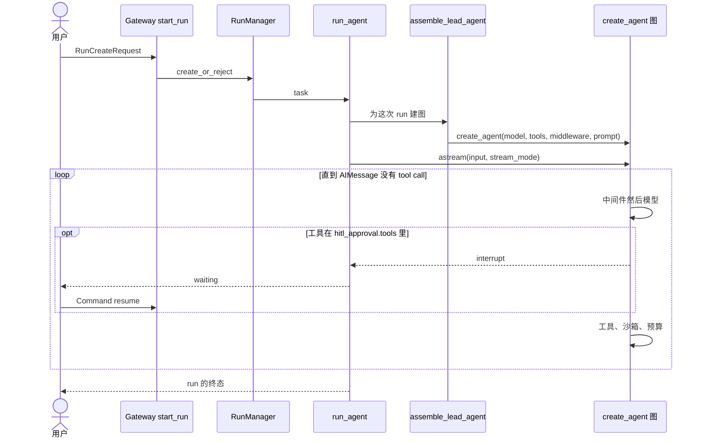

[English](deer-flow.md) · **中文**

# deer-flow（`bytedance/deer-flow`）

> 研究基于提交 [`cf8c29c`](https://github.com/bytedance/deer-flow/tree/cf8c29c6b6920671075bd9010b94d89df2a273a8)
> （2026-11-10）：后端包 `deer-flow` 与 harness 包 `deerflow-harness` 都是 `2.3.0-dev`。
> 该提交上 `git describe` 的结果是 `v2.1.0-rc0-1434-gcf8c29c`。
> 下文源码路径相对于仓库根目录，行号对应该提交。
> **事实**指在源码中读到，或被本研究的复现测试钉住。
> **解读**是我对作者意图的理解。本研究没有运行上游测试套件。

**交互式图表（Archify，每个节点都链接到源码）：**
[架构](../diagrams/deer-flow/architecture.html) ·
[执行流程](../diagrams/deer-flow/execution-flow.html) ·
[核心抽象](../diagrams/deer-flow/core-abstractions.html) ·
[上下文流](../diagrams/deer-flow/context-flow.html) ·
[记忆流](../diagrams/deer-flow/memory-flow.html) ·
[工具运行时](../diagrams/deer-flow/tool-runtime.html) ·
[Agent 循环](../diagrams/deer-flow/agent-loop.html) ·
[子 Agent 流程](../diagrams/deer-flow/sub-agent-flow.html)
（图表为英文，中英文版共用）

**最小复现：**[`experiments/deer-flow/`](https://github.com/woaitqs/repo-research/tree/main/experiments/deer-flow)（[中文说明](https://github.com/woaitqs/repo-research/blob/main/experiments/deer-flow/README.zh.md)）

---

## 结论

- **DeerFlow 是套在 LangChain `create_agent` 外面的 harness，外加它自己拥有的 run 登记。**
  `assemble_lead_agent` 组装工具、一份静态 system prompt 和一条有序中间件链，然后调用
  `create_agent(...)`（`backend/packages/harness/deerflow/agents/lead_agent/agent.py:1446-1453`）。
  model/tool 循环、中断和检查点属于 LangChain 与 LangGraph。
  DeerFlow 加在这张图外面的，是 Gateway 的 `RunManager`、`run_agent` 里的 `agent.astream`、
  按线程分配的沙箱、IM 渠道，以及下面这套上下文策略。
- **system prompt 被故意保持静态。** `DynamicContextMiddleware` 的模块文档写明：当前日期和
  每个用户的记忆只注入一次，形式是一条 `<system-reminder>`，这样前缀可以被复用
  （`dynamic_context_middleware.py:1-7`）。技能 *正文* 不在这个前缀里：prompt 只带索引，
  `/skill-name` 为一次模型调用装入 `SKILL.md`（`skill_activation_middleware.py:566-580`）。
- **压缩是破坏性的，然后再注入。** `DeerFlowSummarizationMiddleware._maybe_summarize`
  用 `RemoveMessage(id=REMOVE_ALL_MESSAGES)` 加上保留的尾巴替换消息列表，并把摘要放进
  `summary_text`（`summarization_middleware.py:1040-1050`）。`DurableContextMiddleware`
  把摘要、委托账本和已加载技能渲染成一条只存在于本次请求的消息，不写回状态
  （`durable_context_middleware.py:1-9`）。
- **子 Agent 看不到父对话，也没有 checkpointer。** `SubagentExecutor` 新建一份消息列表
  （可选的 system、可选的快照、然后是任务本身），并调用
  `create_agent(..., checkpointer=False)`（`executor.py:1666-1677`、`1281-1288`）。
  它会把父级的 `sandbox` 拷进子状态（`executor.py:1686-1687`）。
  内置的 general-purpose 子 Agent 禁用 `task`、`ask_clarification` 和 `present_files`
  （`subagents/builtins/general_purpose.py:67`）。
- **人的暂停是两种机制。** 审批从 `after_model` 调用 `interrupt()`
  （`hitl_approval_middleware.py:1-7`、`249`）。文件自己的注释说，拒绝不能放在
  `wrap_tool_call` 里，因为那条路径会被绕过。澄清并不中断：它返回
  `Command(goto=END)`（`clarification_middleware.py:546-554`）。
- **和本仓库另外五项研究的对照：** 和 deepagents 一样，循环是借来的。和 deepagents 不同，
  摘要会删掉消息，而不是保留完整历史再重建视图；Gateway 在进程内跑图，而不是拉起
  `langgraph dev`。和 openai-agents-python 不同，这里没有自己的 `while True`。
  和 letta-code 不同，记忆不会被编译进 system prompt。和 open-pstack 不同，技能是文件
  加上沙箱投影，不是拿去引导宿主循环的散文。

## 为什么这个仓库值得读

DeerFlow 2 是一个把 LangGraph 留作 agent 循环、把仓库花在循环 *周围* 的例子：
谁可以发起一次 run，shell 在哪里执行，压缩之后什么还在，子 Agent 怎样借用父级的机器，
以及一条 IM 消息怎样走进和网页相同的 run 路径。

README 说 2.0 是一次从零重写，和 1.x 研究框架没有共享代码。**这句话是 README 的声明；
本研究没有 diff `1.x` 分支。** 历史里能核实的是：第一次提交是 2025-04-09 的 `03798de`，
说明是 “feat: lite deep researcher implementation”，而 `cf8c29c` 这棵树在 4,769 次提交之后。
本研究所追踪的 harness 位于 `backend/packages/harness/deerflow/`。

它适合拿来对照另外五项研究：

| 研究 | 谁拥有循环 | 这一项做得不一样的地方 |
|---|---|---|
| deepagents | LangChain `create_agent`，用中间件做上下文 | 同样把循环交出去。DeerFlow 的摘要删除消息；deepagents 保留消息并重建视图。DeerFlow 的记忆是一条冻结的提醒，不是放进 system prompt 的 `AGENTS.md`。 |
| OpenHands | 事件日志；`step()` 无状态；上下文是投影 | DeerFlow 的检查点 *就是* 对话记录。额外的投影（`durable_context`）只存在于请求里，贴在这份记录旁边。 |
| openai-agents-python | 自己的 `while True`，在四种 `NextStep` 上转 | DeerFlow 没有写下这个循环。人工审批仍然是可序列化的暂停，但它是 LangGraph 的 `interrupt()`，澄清则是另一种控制流。 |
| letta-code | 每个 run 只走一步模型，循环拆在协议两侧；记忆从 git 编译而来 | DeerFlow 在一个 Gateway worker 里跑完整张图。记忆在 run 结束后抽取，每个会话只注入一次，而且在 system prompt 之外。 |
| open-pstack | 没有循环；用散文技能引导宿主 | DeerFlow 的技能是 `SKILL.md` 文件。lead 把一份文件系统视图物化进沙箱；它不把“模型会遵守一包散文”当作机制。 |

## 仓库快照

| 项 | 值（事实） |
|---|---|
| 布局 | `backend/packages/harness`（`deerflow.*`）、`backend/app`（Gateway + IM 渠道）、`frontend/`（Next.js）、`skills/public`、`docker/`、`contracts/` |
| Harness 体积 | `backend/packages/harness/deerflow/` 下 797 个 Python 文件、196,399 行 |
| App 体积 | `backend/app/` 下 161 个 Python 文件、65,035 行 |
| 后端测试 | `backend/tests/` 下 1,498 个 Python 文件、599,159 行 |
| 版本 | `backend/pyproject.toml` 名称 `deer-flow`，`2.3.0-dev`，Python `>=3.12`。Harness 包 `deerflow-harness` `2.3.0-dev` |
| 循环依赖 | harness 要求 `langchain>=1.3`、`langgraph>=1.2.9,<1.3`（`backend/packages/harness/pyproject.toml`） |
| 图入口 | `backend/langgraph.json` 把 `lead_agent` 映射到 `deerflow.agents:make_lead_agent` |
| 历史 | 这个 pin 上 4,769 次提交；第一次提交在 2025-04-09 |
| 本研究的复现 | 20 个测试，demo 14/14，变异检查 8/8。上游套件没有执行。 |

Harness 里最大的文件是 run worker（`runtime/runs/worker.py`，约 206 KB）、沙箱工具面、
AIO 与 E2B provider、DeerMem 的 updater，以及 `subagents/executor.py`。
**解读：** 代码的大头是循环周围的生命周期、隔离和策略，而这个项目并不实现那个循环。

## 架构

三层。调用关系支持这个切分；harness 不得 import app 的规则由
`backend/tests/test_harness_boundary.py` 执行（`backend/AGENTS.md:148` 如此声明，
本研究没有重跑该测试）。

```text
Gateway + channels   app/gateway, app/channels          （谁可以发起 run、SSE、IM）
DeerFlow harness     deerflow.agents, runtime, sandbox  （组装、上下文、沙箱、子 Agent）
LangChain / LangGraph  create_agent, Pregel, interrupt  （model/tool 循环和检查点）
```

```mermaid
flowchart LR
  user([用户]) --> web["Web UI / IM 渠道"]
  web --> gw["Gateway FastAPI<br/>start_run"]
  gw --> rm["RunManager<br/>run 记录"]
  rm --> worker["run_agent<br/>agent.astream"]
  worker --> asm["assemble_lead_agent"]
  asm --> graph["create_agent 图"]
  graph --> mw["中间件栈"]
  graph --> model[(聊天模型)]
  mw --> sbx["SandboxProvider<br/>按线程"]
  mw --> mem[(记忆存储)]
  worker --> cp[(Checkpointer)]
```

带源码链接的版本：[architecture.html](../diagrams/deer-flow/architecture.html)。

**模块边界（事实）：**

| 模块 | 拥有 | 不拥有 |
|---|---|---|
| `app/gateway/services.py` 的 `start_run` | 准入、`Command(resume=...)`、调度 `run_agent` | 模型循环 |
| `runtime/runs/worker.py` 的 `run_agent` | 一次 run 的流、挂上 checkpointer、观察 `__interrupt__` | 组装工具 |
| `agents/lead_agent/agent.py` | lead 栈、system prompt、`create_agent` 调用 | LangGraph 的节点 |
| `agents/middlewares/*` | 每次模型调用和工具调用允许看到什么 | |
| `sandbox/` | `Sandbox` / `SandboxProvider`、懒获取、技能投影 | |
| `subagents/executor.py` | `checkpointer=False` 的子图 | 父级对话记录 |
| `app/channels/` | 十条重新进入 `start_run` 的 IM 适配器 | 第二个 agent 循环 |

`make_lead_agent`（`agents/__init__.py:20-31`）是 LangGraph Server 的入口：它预热技能缓存，
再调用真正的工厂。Gateway 的 HTTP run 不直接用那条字符串。`resolve_agent_factory`
返回 `assemble_lead_agent`（`app/gateway/services.py:1339-1355`）。后者同时返回组装描述，
这样 worker 就不必从 LangGraph 的私有属性里反推“当初建成了什么”
（`agent.py:878-888`）。

## 主执行流

追踪的入口是 `POST /api/threads/{thread_id}/runs`
（`app/gateway/routers/thread_runs.py:1054-1067`），它调用 `start_run`。
来自 Slack、飞书、Telegram 以及其他适配器的聊天消息走到同一个函数。渠道登记有十个
provider（`app/channels/service.py:33-44`）：Buzz、钉钉、Discord、飞书、GitHub、QQ、
Slack、Telegram、微信、企业微信。



逐步说明（除非标明，否则是事实）：

1. **HTTP 入口。** `create_run` 在 `start_run` 准入之后就返回
   （`thread_runs.py:1054-1067`）。`stream_run` 是它的 SSE 兄弟（`:1072`）。
2. **工厂。** `resolve_agent_factory` 不用 `assistant_id` 做路由，始终返回
   `assemble_lead_agent`（`services.py:1339-1355`）。自定义 agent 是 run 配置里的
   `agent_name`，不是第二张图。
3. **恢复是一条命令，不是一条新的用户消息。** 当 `command.resume` 存在时，
   `graph_input` 变成 `Command(resume=...)`（`services.py:2424-2425`）。
4. **Worker。** `start_run` 最后 await `run_agent(...)`（`services.py:2804`）。
   `run_agent`（`runtime/runs/worker.py:1004`）会等同一线程上先前的 run 结束收尾，
   然后 `try_start`（`worker.py:1233`）。
5. **组装。** `assemble_lead_agent` 冻结检查点通道模式，避免客户端改它
   （`agent.py:894-916`），解析用户，按授权过滤技能，构建工具，调用
   `build_middlewares`，按需把 `HitlApprovalMiddleware` 插到下标 0，渲染 prompt，
   再调用 `create_agent`（`agent.py:1405-1453`）。
6. **Checkpointer 挂在工厂外面。** lead 的 `create_agent` 调用不接收 checkpointer。
   Worker 在图存在之后赋值 `agent.checkpointer` 和 `agent.store`
   （`worker.py:1596-1600`），然后 `agent.astream(...)`（`worker.py:1679` 与 `:1722`）。
7. **中断。** 流观察者把 chunk 里的 `__interrupt__` 当成暂停；当载荷的 `kind`
   是 `hitl_approval` 时，把它记到 run 记录上（`worker.py:1628-1643`）。
8. **IM 策略。** 非交互渠道会设置 `disable_clarification`
   （`app/channels/manager.py:2291` 的 `_apply_channel_policy`）。lead 组装随后通过
   `interaction_policy.disabled_tool_names` 丢掉 `ask_clarification`
   （`agent.py:1027-1028`、`1380`）。GitHub 是唯一的 webhook 渠道（`agent.py:92`）；
   这些 run 也不提供 `update_agent`（`agent.py:1356-1358`）。

**解读：** 产品所说的 “agent 循环” 是包着一次 LangGraph 调用的 Gateway run。
多轮聊天是共享同一个检查点线程的多次 run，不是 DeerFlow 代码里的一层外层 `while`。

## 核心抽象

| 抽象 | 职责 | 源码 |
|---|---|---|
| `LeadAgentAssembly` | 编译后的图，加上“建成了什么”的描述 | `agent.py:96-105`、`:878` |
| `ThreadState` | 检查点通道：消息、沙箱、目标、摘要、委托 | `agents/thread_state.py` |
| `RunStatus` | `pending`、`running`、`success`、`waiting_for_input`、`error`、`timeout`、`interrupted` | `runtime/runs/schemas.py:21-30` |
| `RunManager` | 准入、每线程一个活跃 run、取消、心跳 | `runtime/runs/manager.py`（类）以及 `worker.py` 的调用点 |
| `Sandbox` / `SandboxProvider` | 按线程划分的 shell 和文件 | `sandbox/sandbox.py:45`、`sandbox/sandbox_provider.py:17` |
| `MemoryMiddleware` | agent 结束后把对话入队 | `memory_middleware.py:160-167`、`:236-253` |
| `DynamicContextMiddleware` | 注入冻结的提醒 | `dynamic_context_middleware.py:1-12`、`:568-618` |
| `DurableContextMiddleware` | 摘要、账本、技能的只读请求投影 | `durable_context_middleware.py:1-9` |
| `DeerFlowSummarizationMiddleware` | 删除旧消息，留下 `summary_text` | `summarization_middleware.py:166`、`:1040-1050` |
| `SubagentExecutor` | 子图、隔离的消息、共享的沙箱 | `subagents/executor.py` |
| `HitlApprovalMiddleware` | 对配置的工具调用 `interrupt()` | `hitl_approval_middleware.py:131-137` |
| `ClarificationMiddleware` | 对 `ask_clarification` 返回 `Command(goto=END)` | `clarification_middleware.py:557-579` |

`RunManager` 和 checkpointer 是两套存储。run 行回答“这次调用是活着、暂停了，还是结束了？”。
checkpointer 回答“线程的图状态是什么？”。一次暂停会写两边：中断留在检查点里，
run 状态则是客户端轮询的那个东西。

还有一个更小的工厂。`create_deerflow_agent`（`agents/factory.py:67-83`）是不读 YAML 的
SDK 入口。它文档里的中间件列表比 `build_middlewares` 短。**事实：** 生产路径是
`build_middlewares`（`agent.py:485`）。**解读：** SDK 工厂是给嵌入者（`DeerFlowClient`）
的缩小表面，不是一张 Gateway run 的图。

## Agent 循环

DeerFlow 不含这个循环。`create_agent` 编译的是 LangChain 的图：`before_agent` 钩子，
然后是模型节点，然后是工具节点，直到助手消息不再有工具调用。DeerFlow 对这个周期的
控制，是中间件列表，以及 `astream` 外面的 worker。

`build_middlewares`（`agent.py:485-820`）从 `build_lead_runtime_middlewares` 起步，再追加。
共享的运行时构建器（`tool_error_handling_middleware.py:378-571`）写了三层：

1. **最外层 `wrap_model_call`：** 输入清洗、知识范围、工具输出预算、工具结果清洗，
   以及（若启用）PII 脱敏。`:401-409` 的注释说清洗放在最前，让里面的每个中间件都看到
   干净的消息；PII 脱敏列在最后，因此它是这一层的 *最内层*：工具文本先脱敏，再中和标签，
   然后才把超长副本写到磁盘。
2. **`before_agent` 钩子：** `ThreadDataMiddleware`、`UploadsMiddleware`（仅 lead）、
   `SandboxMiddleware`。
3. **工具包装，列表中靠前者为最外层：** 回执、artifact 句柄、授权护栏、
   `SandboxAuditMiddleware`、可选的先读后写、harness 守卫、工具进度、
   `ToolErrorHandlingMiddleware`。

lead 构建器随后按顺序追加：`DynamicContextMiddleware`、`SkillActivationMiddleware`、
`DurableContextMiddleware`、摘要、可选的待办、token 用量、标题、记忆、视觉、
延迟工具过滤、`SystemMessageCoalescingMiddleware`、`SubagentLimitMiddleware`、
循环检测、token 预算、模型内容兼容、调用方和扩展中间件、终态回复与安全结束原因，
最后是 `ClarificationMiddleware`（`agent.py:569-778`）。`:777` 的注释说澄清应该永远在最后。

`HitlApprovalMiddleware` 不在这次追加里。`_insert_hitl_approval_middleware` 在
`hitl_approval.enabled` 时把它插到下标 0（`agent.py:831-856`）。LangChain 按注册的
逆序跑 `after_model`。把安全中间件放在 *最后*，它就会 *最先* 跑（`agent.py:768-772`）。
把审批放在 *最前*，它就会跑在那些可能已经剥掉工具调用的中间件 *之后*。
子 Agent 装的是同一个中间件，但 `supports_resume=False`（`executor.py:1262-1268`）。

审批的 `after_model`（`hitl_approval_middleware.py:188-249`）要么：

- 在这次 run 可以恢复时调用 `interrupt(payload)`，要么
- 在不能暂停时返回人造的错误 `ToolMessage`（或直接剥掉这些调用）：子 Agent、
  没有 checkpointer，或非交互策略（`:173-180`）。

澄清从不用 `interrupt`。`wrap_tool_call` 返回
`Command(update=..., goto=END)`（`clarification_middleware.py:546-554`）。
当策略不允许澄清时，同一个中间件返回一条“继续做”的工具消息，图继续走
（`:576-577` 以及禁用分支）。**解读：** 审批暂停在一次 run *内部*；澄清 *结束*
这次 run，用户的回答是下一次 run 的人类消息。复现把这个分裂测了出来：
澄清之后的 run 会拒绝 `resume`。

## 上下文工程

四套机制，都是 DeerFlow 的中间件，没有一件是 LangGraph 的功能：

**1. 静态前缀。** `apply_prompt_template` 每次组装建一次 system prompt
（`agent.py:1427-1443`）。技能贡献的是索引。打开 `skills.deferred_discovery` 时，
索引是名字而不是完整元数据（`agent.py:1190-1194`，经 `build_skill_search_setup`）。
配置字段 `memory.injection_enabled` 的描述是把记忆注入 “system prompt”
（`memory_config.py:125-128`）。真正注入的中间件对 prompt 的说法相反：prompt 保持静态，
提醒是另一条消息（`dynamic_context_middleware.py:1-7`）。
**事实：** 两段文字都在。**解读：** 配置描述相对于冻结提醒的设计已经过时；
实际跑的路径是 `DynamicContextMiddleware._inject`。

**2. 冻结的提醒。** 第一轮 `_inject` 在最近一条用户消息前写下一条完整的
`<system-reminder>`（记忆 + 日期）（`dynamic_context_middleware.py:582-605`）。
若存下的日期等于今天，它直接返回、不做修改（`:607-609`）。若过了午夜，它写一条
只有日期的提醒（`:611-618`），不重建记忆块。因此第 1 轮结束时抽出的事实，**不会**
出现在第 2 轮的提醒里。它会在新线程上可见，或者在某次重新把记忆读进一份新注入时可见。
复现把这一点钉成 `FROZEN_SNAPSHOT`。

**3. 破坏性摘要，加上每次请求一份视图。** 触发之后，`_maybe_summarize` 丢掉全部消息，
只写回 `preserved_messages` 和 `summary_text`（`summarization_middleware.py:1040-1050`）。
这和 deepagents 相反：后者记下一个事件并重建视图，完整历史留在状态里。DeerFlow 随后
必须把摘要重新放到模型面前。`DurableContextMiddleware.wrap_model_call` 把
`summary_text`、委托和技能渲染成这一次调用的一条隐藏人类消息
（`durable_context_middleware.py:1-9`）。文件里的权威契约要求模型把字段值当数据，
只有一个例外：`<active_goal>` 元素是用户的目标（`:43-64`）。
**事实：** 契约是中间件里的一段字符串，不是一个单独的策略引擎。
**解读：** 它是围在“曾经是对话的文本”外面的一道提示注入栅栏。

**4. 工具输出外置。** `ToolOutputConfig.externalize_min_chars` 默认 12,000
（`config/tool_output_config.py:42-44`）。`ToolOutputBudgetMiddleware` 把完整输出写进
当前沙箱，并把工具消息换成一份提要加路径（`tool_output_budget_middleware.py:532`
以及模块文档 `:1-6`）。若解析不到沙箱，就退回首尾截断（`tool_output_config.py:54-56`）。
对那个路径的 `read_file` 是一次普通工具调用，自己也可能再次被预算；复现检查的是
沙箱里的文件，不是第二份给模型看的副本。

`DanglingToolCallMiddleware` 修补没有结果的工具调用，以及调用已被丢掉的孤儿结果，
避免严格的提供商返回 400。修补发生在 `wrap_model_call` 而不是 `before_model`：
`before_model` 的更新会被 `add_messages` reducer 追加到末尾，而这个中间件需要把
合成的 `ToolMessage` 放在悬空 `AIMessage` 的紧后面（`dangling_tool_call_middleware.py:1-18`）。
想法与 deepagents 的 `PatchToolCallsMiddleware`、letta-code 的合成
“Turn did not complete” 相同，放置方式不同。

`SystemMessageCoalescingMiddleware` 把每条 system 消息折成一条放在最前，因为
vLLM、SGLang、Qwen 和 Anthropic 会拒绝不在最前的 system 消息（`agent.py:702-707`）。
Durable context 会再加一条 system 契约，所以这个中间件必须排在它后面。

## 记忆

`MemoryConfig.mode` 是 `"middleware"` 或 `"tool"`（`memory_config.py:119-123`）。
`should_use_memory_tools` 为 `enabled and mode == "tool"`（`:194-196`）。

- **中间件模式（默认）。** `MemoryMiddleware.after_agent` / `aafter_agent` 把对话入队
  （`memory_middleware.py:236-270`）。类文档说队列会去抖，更新是一次异步的 LLM 摘要
  （`:163-167`）。lead 构建器在 tool 模式下会跳过这个中间件，除非后端的
  `backend_requires_passive_writes_in_tool_mode` 要求保留（`agent.py:654-677`）。
- **注入是另一个中间件。** `DynamicContextMiddleware` 只在构建完整提醒时调用
  `_get_memory_context`（加载器在 `prompt.py:814`，调用点在 `_build_full_reminder`）。
  因为有“同一天什么都不做”的分支，注入并不是“每一轮”。
- **DeerMem** 是默认的 `manager_class`（`memory_config.py:146-157`）。事实按用户存放，
  用户之下再按 agent 分文件（`agents/memory/backends/deermem/deermem/core/paths.py`）。
  DeerMem 管理器把 tool 模式写成：只注入摘要，事实留给 `memory_search`。
  本研究没有执行 DeerMem 的抽取器。
- **PII。** `redact_queued_messages` 在入队时脱敏载荷，包括工具参数和藏在
  `additional_kwargs` 里的原始用户文本，因为请求范围内的脱敏会把原文留在线程状态里
  （`memory_middleware.py:29-45`）。

**解读：** DeerFlow 把“记住这个”和“给模型看它的笔记”拆开，好让系统前缀可以被缓存。
代价写在同一天的分支里：一段对话内部，记忆是过时的，直到下一次注入发生。
letta-code 做的是相反的交换：记忆的字节 *就是* 前缀，一次提交产生一条一次性的增量，
这样被缓存的前缀可以不动。

## 工具

`get_available_tools`（`tools/tools.py`）按配置分组、MCP 和宿主授权组装 lead 的工具列表。
`SUBAGENT_TOOLS` 就是 `task` 工具（`tools.py:43-46`）。调度工具不靠 YAML 路径登记；
`:48-54` 的注释说，一条配置项不能放宽宿主授权。

在这份列表之上，组装还会增减：

- 打开延迟技能发现时加入 `describe_skill`（`agent.py:1382-1383`）；
- `should_use_memory_tools` 为真时加入记忆工具（`:1384-1385`）；
- 只有具名的自定义 agent、且不是从 webhook 渠道跑起来时，才有 `update_agent`
  （`:1356-1358`）；
- 交互策略的 `disabled_tool_names`；不允许澄清时其中包含 `ask_clarification`
  （`agent.py:1380`）。

`assemble_deferred_tools` 随后把 schema 藏起来，直到 `tool_search` 提升它们
（`agent.py:1397-1398`）。**解读：** 这和技能是同一种渐进披露，用在 MCP 工具上。
deepagents 披露技能元数据，并在没有 shell 时藏起 `execute`；DeerFlow 藏起整个工具
schema 和技能正文，直到某个东西把它们提升出来。

工具 *执行* 上要紧的顺序是：

1. `after_model` 截掉多余的 `task` 调用（`SubagentLimitMiddleware`），并可能为审批
   `interrupt`。
2. `wrap_tool_call`，最外层先跑：沙箱懒获取、审计、先读后写、错误包装。
3. `ToolOutputBudgetMiddleware` 改写结果。
4. 若工具是 `ask_clarification`，澄清结束这张图，而不是返回一条普通观察。

`SandboxMiddleware` 在 `lazy_init=True`（默认；`sandbox/middleware.py:59-64`）时于
第一次工具调用获取沙箱。`abefore_model` 只 *启动* 预热，不等它（`:453-458`），
于是模型的第一次回复可以和沙箱启动重叠。没有工具调用的一轮根本不需要沙箱。
复现钉住了这一点。

## 运行时 / 沙箱

`Sandbox`（`sandbox/sandbox.py:45`）是执行面：命令和文件。
`SandboxProvider.acquire(thread_id)` 返回一个 id（`sandbox_provider.py:31-36`）。
随仓库提供的 provider，每一个都是 `SandboxProvider` 的子类：

| Provider | 模块 |
|---|---|
| Local | `sandbox/local/local_sandbox_provider.py:36` |
| AIO（Kubernetes 风格） | `community/aio_sandbox/aio_sandbox_provider.py:214` |
| E2B | `community/e2b_sandbox/e2b_sandbox_provider.py:304` |
| Boxlite | `community/boxlite/provider.py:203` |
| OpenSandbox | `community/opensandbox/provider.py:79` |
| Tenki | `community/tenki/provider.py:106` |

`supports_agent_skill_isolation` 默认是 false（`sandbox_provider.py:22-25`）。
注释说，只要 shell 能绕过托管的路径映射，宿主上的 provider 就必须返回 false。
当 provider 能够隔离时，lead 的 `SandboxMiddleware._prepare_agent_skill_projection`
把该 agent 的技能集物化成一份线程视图（`sandbox/middleware.py:92-124`）。
子 Agent 设置 `owns_agent_skill_projection=False`（`tool_error_handling_middleware.py:637`）。
中间件文档说明了原因：子 Agent 共享 lead 的线程沙箱，不得重建这份视图
（`sandbox/middleware.py:82-85`）。

`persistent_shell_sessions` 是三态，并且失败时关闭：`None` 表示 provider 没有声明
shell 是否保留状态，证据的消费者必须把 bash 输出当成未验证
（`sandbox.py:53-67`）。AIO 声明 `True`；每次单独 exec 的 provider 声明 `False`。

**解读：** 沙箱是长程工作区（上传、技能文件、外置的工具输出、子 Agent 的写入），
不是每次工具调用一个新容器。用户之间的隔离是 provider 的事。lead 和它的子 Agent
之间的隔离故意 *不是* 第二个沙箱；它是同一个沙箱上的第二份消息列表。这和
“子 Agent 是一台新机器”相反，更接近 deepagents 共享的虚拟文件系统，而不是
letta-code 那种每个子进程一台机器的设计。

## 子 Agent

`task` 是一个普通工具（`tools/builtins/task_tool.py`，`async def task_tool` 在 `:756`）。
它构造 `SubagentExecutor` 并 `execute_async`（构造点在 `task_tool.py:1110` 附近）。
父模型后来看到的是一条 `ToolMessage`，不是子对话。

子级的初始状态在 `_build_initial_state` 里建成（`executor.py:1666-1693`）：

- 消息：system 片段、可选的父级快照，然后一条任务 `HumanMessage`；
- 若父级有 `sandbox`，则拷贝过来；
- 上传用 `deepcopy`，这样子级不能改父级的列表。

`context_mode` 默认是隔离。快照是显式打开的，它冻结一份视图；它不是 `messages`
的实时共享。子图是 `create_agent(..., system_prompt=None, checkpointer=False)`
（`executor.py:1281-1288`）。`system_prompt=None` 是故意的：system 文本已经是第一条消息，
因为有的提供商会拒绝第二条 system 消息（`:1279-1280` 的注释）。

`SubagentLimitMiddleware` 在 lead 上截掉多余的并行 `task` 调用
（`subagent_limit_middleware.py`，类在 `:95`）。它不管 `batch_task`。
批处理工具（`batch_task`、`batch_status`、`cancel_batch`、`read_batch_result`）
是第二条路径：它们把持久工作入队并返回一个 id。条目的执行仍然用 `SubagentExecutor`
（`subagents/batch_service.py`）。复现只覆盖同步的 `task` 路径。

内置的 general-purpose 子 Agent 设置
`disallowed_tools=["task", "ask_clarification", "present_files"]`
（`general_purpose.py:67`）。**事实：** 这份列表属于这个内置体，不是 `create_agent`
里的全局规则。**解读：** 嵌套和澄清是库存子 Agent 的产品默认，靠工具过滤执行，
而不是靠循环里的深度计数器。

上游树里钉住隔离故事的测试（本研究没有执行）：
`backend/tests/test_subagent_checkpointer_isolation.py` 和
`backend/tests/test_subagent_executor.py`。本研究的复现对着缩小版检查同样的不变量：
子对话以任务说明开头，父级的工具消息只有最终文本，沙箱 id 一致，并且
`checkpointer is False`。

## 重要源码文件

| 路径 | 为什么重要 |
|---|---|
| `backend/langgraph.json` | Studio/开发用的图 id `lead_agent` |
| `backend/packages/harness/deerflow/agents/__init__.py` | `make_lead_agent` 包装 |
| `backend/packages/harness/deerflow/agents/lead_agent/agent.py` | 生产组装和 `create_agent` |
| `backend/packages/harness/deerflow/agents/factory.py` | 不读 YAML 的 SDK 工厂 |
| `backend/packages/harness/deerflow/agents/middlewares/tool_error_handling_middleware.py` | 共享的运行时栈 |
| `backend/packages/harness/deerflow/agents/middlewares/dynamic_context_middleware.py` | 冻结的提醒 |
| `backend/packages/harness/deerflow/agents/middlewares/summarization_middleware.py` | 破坏性压缩 |
| `backend/packages/harness/deerflow/agents/middlewares/durable_context_middleware.py` | 只在请求里重新注入 |
| `backend/packages/harness/deerflow/agents/middlewares/hitl_approval_middleware.py` | `interrupt()` 审批 |
| `backend/packages/harness/deerflow/agents/middlewares/clarification_middleware.py` | 结束图的澄清 |
| `backend/packages/harness/deerflow/sandbox/middleware.py` | 懒沙箱、技能投影 |
| `backend/packages/harness/deerflow/subagents/executor.py` | 子图 |
| `backend/packages/harness/deerflow/runtime/runs/worker.py` | `run_agent` / `astream` |
| `backend/app/gateway/services.py` | `start_run`、resume 命令 |
| `backend/app/channels/service.py` | IM 登记 |

## 值得学的实现决定

**1. 让前缀稳定，把易变的文本放在旁边。**
日期和记忆若住在 system prompt 里，会打掉提供商的 prompt 缓存。DeerFlow 把它们写进
对话记录一次（`dynamic_context_middleware.py:1-12`）。值得小心照搬的是同一天的分支
（`:607-609`）：这里的“注入记忆” **不是** “每一轮都注入”。移植这个想法的人需要一个测试：
第 1 轮结束时存下的事实，在第 2 轮的提醒里仍然不存在。复现有这个测试，关掉同一天返回的
变异会被它杀掉。

**2. 删掉被压缩的消息，然后每次调用投影一份视图。**
deepagents 保留历史并重建视图，于是后面的工具仍然可以指向原文。DeerFlow 移除消息
（`summarization_middleware.py:1044-1049`），并依赖 `summary_text` 加上
`DurableContextMiddleware` 来让模型看到关于它们的任何东西。这条 durable 消息不写回
（`durable_context_middleware.py:4-8`）。这是一个真实的选择：检查点变小，而模型不能
`read` 一条已经被丢掉的消息，除非别的存储（沙箱文件、记忆、任务笔记）留着它。
权威契约（`:43-64`）是他们阻止摘要变成第二份 system prompt 的办法。

**3. 把人工审批放在 `after_model`，并且不要把它和澄清混成一件事。**
中间件自己的文件头说 `wrap_tool_call` 是错误的钩子，因为 DeerFlow 的执行链会绕过它
（`hitl_approval_middleware.py:1-7`）。审批使用 `interrupt()`（`:249`），并用
`Command(resume=...)` 恢复（`services.py:2424-2425`）。澄清使用 `goto=END`
（`clarification_middleware.py:551-554`）。非交互运行拒绝，而不是暂停
（`hitl_approval_middleware.py:173-180`）。把每一次“agent 停了”都当成 resume 的客户端，
会把一次澄清卡死。复现在澄清之后拒绝 `resume`，并在非交互拒绝之后让循环继续。

**4. 共享沙箱，不共享对话，也不给子级 checkpointer。**
`checkpointer=False`（`executor.py:1287`）意味着子级不能 `interrupt()` 再恢复。
lead 的 HITL 中间件仍然装上，但 `supports_resume=False`，于是被门控的工具会被拒绝，
而不是去暂停一张不能暂停的图（`executor.py:1262-1268`）。沙箱 id 被拷贝
（`executor.py:1686-1687`），技能投影归 lead 所有（`sandbox/middleware.py:82-85`）。
**解读：** 文件是协作通道；消息是隔离边界。deepagents 把 `files` 通道合并回父级。
DeerFlow 不需要那次合并，因为沙箱对象本来就只有一个。

**5. run 记录不是线程。**
`RunStatus`（`schemas.py:21-30`）是 Gateway 的时钟。worker 可以是 `waiting_for_input`，
同时检查点里持有一个中断；也可以是 `interrupted`，因为用户取消了，这时还会尝试取消
沙箱租约（`worker.py:1131-1137`）。客户端、IM 渠道和定时任务都经过 `start_run`，
所以渠道策略在组装 *之前* 施加（关掉澄清、收回 `update_agent`），而不是另写一个循环。
openai-agents-python 把暂停折进它自己拥有的循环里的 `RunState`。DeerFlow 只有对
`interrupt()` 能这样做，并且它另留一行，好让断开的 SSE 客户端重新接上一个还在跑的 run。

**6. 先披露名字，再披露正文。**
prompt 里的技能是一份索引。`/skill-name` 把转义后的正文插进请求，并记住这条斜杠消息，
这样同一次 run 里后来的模型调用不会再次注入（`skill_activation_middleware.py:566-580`）。
延迟的工具 schema 是同一套做法（`agent.py:1397-1398`）。open-pstack 的技能形状相反：
散文 *就是* 控制程序，宿主循环可能只是松散地遵守。DeerFlow 把代码花在让披露变成机械动作。

**7. 把大块观察外置到 agent 自己能读的那个沙箱上。**
阈值是一个配置字段，默认 12,000 个字符（`tool_output_config.py:42-44`），不是模型窗口的
某个 token 比例（deepagents 用 token 阈值和一条虚拟文件系统路径）。若解析不到沙箱，
中间件就地截断，而不是让工具失败（`tool_output_config.py:54-56`）。lead 随后可以用普通的
文件工具 `read` 那个文件，所以沙箱必须在预算包装器去找它之前就已经存在
（`tool_output_budget_middleware.py:502-511` 拒绝自己调用 `acquire`）。

## 最小复现

[`experiments/deer-flow/`](https://github.com/woaitqs/repo-research/tree/main/experiments/deer-flow)
（`minideer`）是一个只用标准库的脚本循环。它不是 `create_agent`。它复制本研究声称属于
DeerFlow 的组装规则，并用一个假模型检查它们：

- system prompt 是技能元数据，并且在每一次请求上都相同；
- 记忆只注入一次；同一天的第二轮不会刷新它；午夜追加一行日期，不含新事实；
- 摘要删除旧消息；下一次请求在一条消息里带上 `summary_text`，而这条消息事后不在线程里；
- 达到阈值的工具输出存在线程沙箱上；
- 子 Agent 的对话以任务说明开头，只返回最终文本，通过父级沙箱写文件，并且
  `checkpointer is False`；
- 审批把 run 暂停成 `waiting_for_input`，并用逐调用的决定恢复；非交互运行拒绝；
  澄清结束本回合并拒绝 `resume`；
- `/skill-name` 对这次 run 的第一次模型调用可见，并且不被存储；
- GitHub 渠道没有 `update_agent`。

缩小版对悬空工具调用的处理是在末尾追加一条合成结果。上游在 `wrap_model_call` 里把它
插到 `AIMessage` 的紧后面（`dangling_tool_call_middleware.py:16-18`）。复现检查的是
模型看得到这次补齐，而不是插入的下标。

`mutation_check.py` 一次翻转上面八条规则中的一条。每一次变异都至少让一个测试失败。

## 验证

命令，在 `experiments/deer-flow/` 下：

```bash
./run.sh
python3 mutation_check.py
```

| 检查 | 结果 |
|---|---|
| `./run.sh` 的 pytest | 20 通过 |
| `./run.sh` 的 demo | 14/14 条不变量成立 |
| `mutation_check.py` | 8/8 被杀掉 |

上游 `backend/tests/`（1,498 个文件）**没有** 运行。安装 harness 会拉上 LangGraph、
Kubernetes、E2B 以及 `deerflow-harness` 依赖列表的其余部分；本研究的断言是对着
钉住的树读出来的，不是执行出来的。注释和配置描述不一致的地方
（`memory.injection_enabled` 对 `DynamicContextMiddleware`），上面两段都引了，
并以所引的代码路径为准。

不需要 API key。复现不会为了密钥去读环境变量。

## 我会复用的部分

- 静态前缀和一条冻结的、被持久化的提醒之间的分裂，包括明确的“同一天什么都不做”。
  这是一条具体的缓存策略，不是一句口号。
- 带权威契约的、只存在于请求里的 durable context，而且仅当压缩真的会删消息时。
  只抄契约、不抄删除，只是多了一段 prompt。
- 两种有名字的暂停。“agent 停了”不是一种状态。审批会 resume；澄清开始一次新的 run。
- 共享沙箱上由 lead 拥有的技能投影。能改写父级技能挂载的子 Agent，会放宽它自己的工具面。
- 在 worker 里挂 checkpointer，而不是在图工厂里挂，并返回组装描述，这样服务器就不必
  去刮私有的图属性（`agent.py:878-888`）。

## 局限 / 未决问题

- 本研究没有执行 DeerFlow。依赖 LangChain 中间件精确组合的行为（洋葱顺序、
  `after_model` 的逆序）取自 DeerFlow 的注释，以及复现对这些注释的模型。
  像 deepagents 研究那样，用脚本模型驱动一次真正的 `create_agent`，可以把这个缺口补上。
- 没有测量 DeerMem 的抽取质量、prompt 缓存命中率，以及真实模型是否遵守 durable context
  契约。契约是一段字符串。open-pstack 的研究发现散文指令被遵守得很松；同样的风险在这里也在。
- `create_deerflow_agent` 的注释列出的栈比 `build_middlewares` 短。相信注释的嵌入者和
  相信 Gateway 的运维看的不是同一条链。
- 1.x 与 2.0 “没有共享代码”的说法没有读过 diff。历史是同一个仓库，从 2025 年的研究框架
  一直走到这次提交。
- 批量子 Agent、MCP 任务租约、多实例调度器的围栏，以及各个 provider 的沙箱安全，
  都是真实的子系统。它们只在改变 lead 路径的地方被点名，其余留下。只读
  `subagents/batch_service.py` 和 `runtime/runs/manager.py` 的后续研究，仍然会很长。

## 延伸阅读

- 上游的模块指南：`AGENTS.md`、`backend/AGENTS.md`（harness/app 分裂、中间件链）。
  把它们当地图，然后核对它们点名的那一行。
- `backend/docs/summarization.md` 和 `backend/docs/RUN_INTERACTION_POLICY.md`，
  和中间件一起读，而不是代替中间件。
- 本仓库内：[deepagents](deepagents.md) 是非破坏性摘要的对照，
  [openai-agents-python](openai-agents-python.md) 是自有循环加可序列化暂停，
  [letta-code](letta-code.md) 是编译进前缀的记忆，
  [OpenHands](openhands.md) 是事件日志的投影作为上下文，
  [open-pstack](open-pstack.md) 是作为散文的技能。
