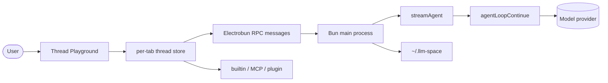
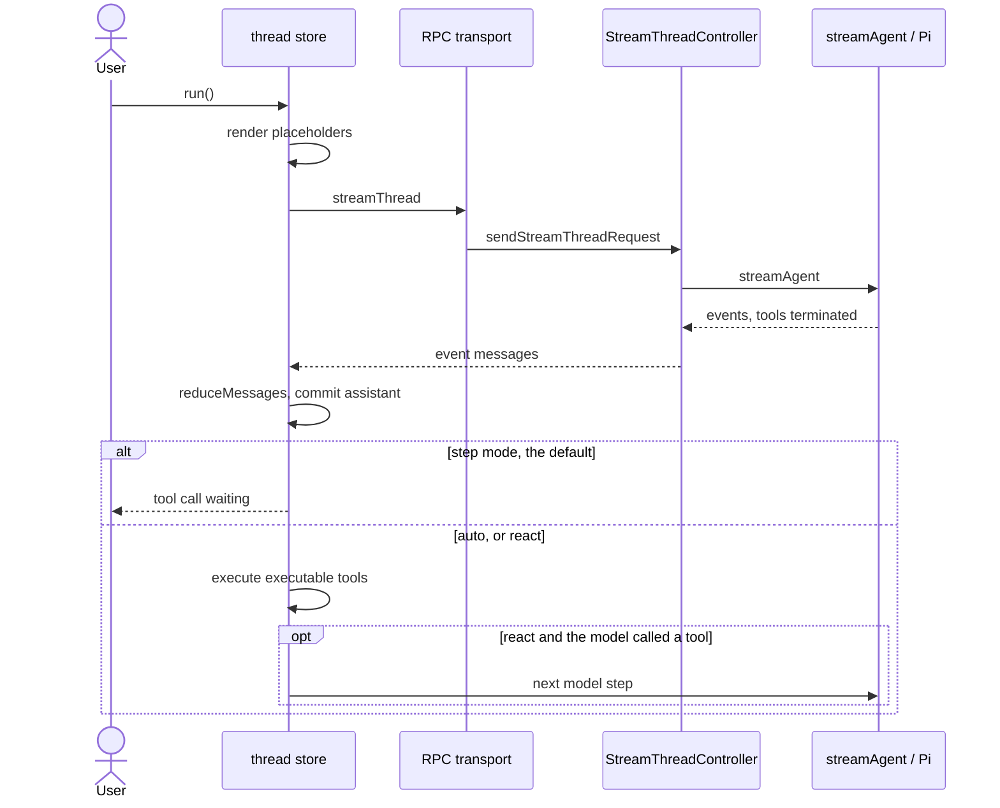

**English** · [中文](llm-space.zh.md)

# llm-space (`deer-flow/llm-space`)

> Studied at commit [`342c9f5`](https://github.com/deer-flow/llm-space/tree/342c9f5761f969247e971eb36317aadf0bcc9daf)
> (2026-11-09): desktop package `@llm-space/desktop` `4.20.0`, domain packages
> `@llm-space/core` and `@llm-space/runtime` `4.0.1`.
> `git describe` at that commit is `v4.20.0-3-g342c9f5`.
> The lockfile pins `@earendil-works/pi-agent-core@1.1.0` and `@earendil-works/pi-ai@1.1.0`.
> Source paths below are relative to the llm-space repository root, and line numbers refer to that commit.
> **Fact** means read in that tree, checked in the published Pi 1.1.0 tarball, or pinned by a test in this study's reproduction.
> **Interpretation** means my reading of intent. This study did not run the upstream suite.

**Interactive diagrams (Archify, every node links to source):**
[architecture](../diagrams/llm-space/architecture.html) ·
[execution flow](../diagrams/llm-space/execution-flow.html) ·
[core abstractions](../diagrams/llm-space/core-abstractions.html) ·
[context flow](../diagrams/llm-space/context-flow.html) ·
[memory flow](../diagrams/llm-space/memory-flow.html) ·
[tool runtime](../diagrams/llm-space/tool-runtime.html) ·
[agent loop](../diagrams/llm-space/agent-loop.html) ·
[sub-agent flow](../diagrams/llm-space/sub-agent-flow.html)

**Minimal reproduction:** [`experiments/llm-space/`](https://github.com/woaitqs/repo-research/tree/main/experiments/llm-space)

---

## TL;DR

- **LLM Space is a desktop workbench that inspects a harness one model step at a time.**
  The README describes it as the place to prototype, trace, debug, and evaluate an agent
  (`README.md:19-23`). The code matches that shape: a Thread file is the experiment, and a run
  is something you can stop between the model's tool request and the tool's result.
- **Pi Agent Core is called, and then immediately stopped.** `streamAgent` passes every tool to
  `agentLoopContinue` with an `execute` that resolves `{ terminate: true }`
  (`packages/core/src/server/agent/stream.ts:105-108`, `:231-242`). In the published
  `pi-agent-core@1.1.0` tarball, the inner loop sets `hasMoreToolCalls = !executedToolBatch.terminate`
  (`dist/agent-loop.js:167`) and treats a batch as terminal when every result has
  `terminate === true` (`:465-466`). **Fact:** LLM Space never runs a tool inside that loop.
- **The continuation the product actually has lives in the Thread Playground.** `run()` always
  takes a model turn, then looks at two persisted flags (`thread-store.ts:1452-1486`).
  The default is to stop. "Auto run tools" executes the turn's tools once.
  "ReAct loop" keeps alternating, and the loop is capped at `MAX_AUTO_TOOL_TURNS = 50`
  (`thread-store.ts:106`). Both flags default to false and are app preferences, not fields of the thread
  (`run-mode.ts:10-22`, `:47-48`).
- **What the model sees is a render, not the file.** `renderThreadPromptVariables` resolves
  placeholders on every model-facing surface and returns a new context. Its comment says existing
  snapshot values win, so old messages keep the same rendered bytes (`prompt-variables.ts:463-467`,
  `:521-531`). `withPromptVariableSnapshot` attaches that snapshot and leaves the editable templates
  (`:289-300`).
- **Compaction is a preview that becomes a sibling file.** Planning, the checkpoint message, and
  progressive updates live in `packages/core/src/thread/compaction.ts`. Applying the preview does
  not overwrite the source thread: `nextCompactedThreadPath` picks `name-compact-N.json`
  (`packages/ui/src/lib/thread-file.ts:62-83`). The docs state the same rule (`docs/compaction.md:12-14`).
- **Run evidence is not the thread file.** `createLocalFileSystem` roots threads at
  `~/.llm-space/workspace` and run snapshots at `~/.llm-space/history`
  (`packages/runtime/src/storage/index.ts:6-9`). Deleting a thread keeps the history
  (`file-system.ts:139-146`). Evaluations are human records on the thread
  (`thread-store.ts:1613-1628`). A Langfuse import becomes a separate `workbench.json` and does not
  rewrite `raw.json` (`trace-manager.ts:462-465`, `:535-536`).
- **Compared with deer-flow (study 06):** both are DeerFlow-family code, and both borrow a loop
  (LangChain there, Pi here). DeerFlow's lead agent runs tools inside the graph and deletes
  compacted messages from the thread. LLM Space stops at the tool request, writes compaction to a
  new file, and treats `spawn_agent` as a paused sibling thread rather than a running child.

## Why This Repository Matters

DeerFlow (study 06) is a long-running super agent: a Gateway, a sandbox, and a lead graph that
is allowed to keep going. LLM Space is the bench that team says it uses while building that
agent. The README calls it a sister project and says every DeerFlow version is built and
debugged here (`README.md:23`). **That sentence is a README claim; this checkout cannot show
who opened which DeerFlow thread.** What the tree does show is a workbench whose unit of work
is a saved Thread, plus a parser that can turn a DeerFlow run-event JSONL file into one
(`packages/core/src/parsers/deerflow-jsonl-thread-parser.ts:14-16`).

The git history of this pin starts later than the README's origin story. The README says the
project started in March 2023 and that v4 is the fourth major iteration (`README.md:23`).
**Fact from `git log`:** the first commit in this clone is `61bcb79` on 2026-06-25, "chore: init",
and `342c9f5` is commit 788. **Interpretation:** v4 is a new repository history, not a continuous
line back to 2023. This study did not inspect other remotes or the pre-v4 apps.

It is a useful comparison point for the earlier harness studies, because the loop is borrowed
and then deliberately broken open:

| Study | Who owns the loop | What LLM Space does |
|---|---|---|
| deepagents | LangChain `create_agent`, middleware for context | Also borrows the cycle. The extra policy is in the playground and in prompt rendering, not in a middleware stack around the model node. |
| OpenHands | event log; `step()` is stateless; context is a projection | The durable object is the Thread JSON. Streaming events are folded into messages by `reduceMessages` and are not the system of record. |
| openai-agents-python | an owned `while True` over `NextStep` | The `for` loop exists, in `thread-store.ts`, and only runs when the user turns the ReAct flag on. The default run is one model step. |
| letta-code | one model step per run; the client executes tools | The same split, both sides on one machine: the Bun process calls the model, the renderer executes tools, and a human is the default between them. |
| open-pstack | prose skills steer a host loop | Skills are `SKILL.md` files. A `skill` tool loads one body. A prompt variable can also inject the index. |
| deer-flow | `create_agent` runs the tools; compaction deletes messages; a sub-agent runs | Pi is stopped before tools. Compaction clones the thread. `spawn_agent` creates a thread and does not run it. A LangGraph generator can emit a Python project from the thread afterwards. |

## Repository Snapshot

| Item | Value (fact) |
|---|---|
| Layout | Bun workspaces `packages/*` and `apps/*` (`package.json:4-7`). `packages/core`, `packages/runtime`, `packages/ui`, `apps/desktop`, `apps/server`, `apps/web` |
| TypeScript size | core 140 files / 21,599 lines; runtime 103 / 22,711; ui 179 / 31,790; desktop 285 / 51,351; server 17 / 1,633; web 27 / 3,624 |
| Tests | 157 `*.test.ts` files under `packages/` and `apps/`. This study did not run them |
| Versions | desktop `4.20.0` (`apps/desktop/package.json:3`); core and runtime `4.0.1`; Electrobun `^1.18.1`; MCP SDK `1.30.0` in the runtime package |
| Loop dependency | `@earendil-works/pi-agent-core` catalog `^1.1.0`, locked at `1.1.0` (`package.json:40`, `bun.lock`) |
| Desktop entry | `apps/desktop/src/bun/index.ts` hydrates the shell, seeds workspace, skills, and plugins, then calls `startDesktopApp` (`:6-23`) |
| Data root | `getLlmSpaceHomePath()` is `LLM_SPACE_HOME` or `~/.llm-space` (`packages/core/src/server/paths.ts:5-8`) |
| History | 788 commits at this pin; first commit 2026-06-25 |
| This study's reproduction | 25 tests, demo 21/21, mutation check 9/9. The upstream suite was not executed |

`AGENTS.md` still says the built-in tool registry "is not a public plugin SDK"
(`AGENTS.md:118-124`). **That paragraph is stale relative to this commit.** `packages/runtime/src/plugins/`
is a real plugin host: discovery under `~/.llm-space/plugins`, a Bun subprocess per plugin, and
contributions for skills, MCP, models, commands, tools, and thread storage. The study below follows
the code, not that paragraph.

## Architecture

Four layers. The desktop process is the composition root. The renderer does not import Electrobun
from inside `packages/ui`; it receives a `HostServices` object (`packages/ui/src/host/types.ts:26-30`).

```text
Electrobun shell     apps/desktop/src/bun          window, RPC, process lifetime
Workbench UI         packages/ui Thread Playground one store per open thread
Domain + runtime     packages/core, packages/runtime   thread semantics, models, tools, MCP, plugins
Borrowed loop        pi-agent-core agentLoopContinue  one model step, then terminate
```



Richer, source-linked version: [architecture.html](../diagrams/llm-space/architecture.html).

**Module boundaries (fact):**

| Module | Owns | Does not own |
|---|---|---|
| `apps/desktop/src/bun/app/start-desktop-app.ts` | constructing managers and the window | the model/tool cycle |
| `packages/ui` Thread Playground | the run's continuation, undo, and the editor | filesystem and provider HTTP |
| `packages/core/src/server/agent/stream.ts` | validating a request and driving Pi | executing tools |
| `packages/core/src/client/reducer.ts` | folding `AgentEvent`s into an assistant message | when the next turn starts |
| `packages/runtime` | models, skills, MCP, plugins, traces, the local runtime client | the Electrobun window |
| `apps/server` | an HTTP server in front of the same runtime, for a remote machine | a second agent loop |
| `apps/web` | a static landing page and a read-only shared-thread viewer | `executeTool` (it is `null`, `apps/web/src/host/web-host.ts:17`) |

`startDesktopApp` builds the object graph in one function (`start-desktop-app.ts:58-260`): home path,
analytics, model manager, MCP, skills, a `PluginManager`, a `TraceManager`, a `StreamThreadController`,
a `DesktopHost` whose only module is the built-in tools module, then a `RuntimeRouter` with a local
client and an optional remote runtime. **Interpretation:** the desktop app is a host for the
workbench. The workbench's rules live in `packages/ui` and `packages/core`, so the same Thread
Playground can render in the static viewer with the host methods stubbed.

Two editions share that data root. `electrobun.config.ts` forks the app name, the macOS identifier,
and the update feed when `LLM_SPACE_DESKTOP_RENDERER=cef` (`:6-13`, `:45-53`). The comment says
`getLlmSpaceHomePath()` does not depend on the app name, so both editions read `~/.llm-space`.
A CDP port is added only when `LLM_SPACE_DESKTOP_CDP_PORT` is set (`:74-83`).

## Main Execution Flow

Entry traced: the user presses run in a thread tab. `ThreadPlayground` builds the store with the
desktop transport, `getAutoRunTools`, `getReactLoop`, and `executeTool`
(`thread-playground.tsx:205-227`).



Step by step (fact unless marked):

1. **The store claims the run before any await.** Status becomes `"preparing"` and `activeRunId`
   is set so the tab is not torn down while skills and files load (`thread-store.ts:1090-1093`).
2. **The model is resolved, then the message list is checked.** A rerun from a message truncates
   after that message. `getRunValidationIssue` can refuse the run before anything is truncated
   (`:1114-1136`). Separately, `isRunnableConversation` requires the list to be empty, to end on
   a user message, or to end on an assistant message that has tool calls
   (`run-eligibility.ts:13-21`). A plain assistant reply cannot start a run. `streamAgent` repeats
   the check on the converted Pi messages and throws the same error if the last Pi message is an
   assistant (`stream.ts:62-67`).
3. **Placeholders are rendered into a request context.** The stored thread is not replaced with
   that render. The snapshot from the render is kept for the end of the run (`:1139-1151`).
4. **Status becomes `"running"` and one model turn is streamed.** `streamThread` converts the
   thread context and calls the injected transport (`packages/core/src/client/api.ts:14-43`).
   The desktop transport is `createRpcTransport`: a `streamId`, fire-and-forget RPC messages,
   and an async iterator on the renderer (`apps/desktop/src/client/rpc-transport.ts:18-70`).
   Electrobun RPC has no native streaming; the comment in `AGENTS.md:95` matches this code.
5. **The Bun side calls `streamAgent`.** `StreamThreadController.run` resolves the provider
   connection and forwards events (`packages/runtime/src/streaming/stream-thread.ts:22-54`).
   `streamAgent` looks the model up, applies a per-run base URL, and restores the shared model's
   `baseUrl` in `finally` because Pi's registry object is process-global (`stream.ts:80-88`,
   `:164-166`). **Interpretation:** that restore is there because a workbench runs many threads
   in one process, and a custom endpoint must not leak into the next run.
6. **Pi stops when the assistant requests tools.** The tools passed into `agentLoopContinue`
   ignore their arguments and return `terminate: true` (`stream.ts:231-242`). The reducer records
   text, thinking, and tool-call deltas. On `agent_end`, an assistant `errorMessage` is thrown
   (`reducer.ts:111-116`). `tool_execution_start` is ignored (`:118-120`), which fits a loop that
   does not execute.
7. **The playground commits the assistant message and looks at the mode.** With both flags false,
   the `for` loop breaks. The tool call sits on the message with no output. The user can fill a
   function tool by hand, or press the tool's run button (`use-tool-call-runner.ts` calls
   `executeTool` for one call).
8. **Auto and ReAct execute a whole trailing batch, or they execute nothing.**
   `executePendingToolCalls` returns `null` if any call is missing, non-executable, or a dangerous
   `bash` (`thread-store.ts:564-592`). A `null` stops the loop. Otherwise the calls run with
   `Promise.all`, outputs are written onto the same assistant message, and ReAct iterates.
   After 50 model turns the loop ends even if the last turn still called tools (`:1452-1486`).
9. **A successful run is snapshotted.** If any event was seen and the run did not fail,
   `recordRun` appends a snapshot and, when the host provides it, `archiveRunSnapshot` replaces
   the inline body with a reference (`:1235-1286`). A transport failure before the first event,
   or a model error, is not recorded (`:1195-1204`).

## Core Abstractions

| Object | Responsibility | Lives in |
|---|---|---|
| `Thread` | The saved experiment: model, system prompt, variables, tools, messages, run index, evaluations | `packages/core` thread types, a JSON file |
| `Thread` store | One Zustand store per open tab. `run()`, undo, tool outputs, evaluations | `packages/ui/.../stores/thread-store.ts` |
| `AgentTransport` | The only HTTP-vs-RPC seam in `streamThread` | `packages/core/src/client/api.ts:38-43` |
| `streamAgent` | One Pi invocation with step-by-step tools | `packages/core/src/server/agent/stream.ts` |
| `reduceMessages` | Events to an `AssistantMessage` | `packages/core/src/client/reducer.ts` |
| `Tool` | `function`, `builtin`, `mcp`, `plugin`, or `provider-hosted` | `packages/core/src/types/tools/index.ts:165-177` |
| `ToolRegistry` | Built-in contributions, frozen for the process | `packages/runtime/src/tools/tool-registry.ts` |
| `PluginManager` | Subprocess plugins and their contributions | `packages/runtime/src/plugins/plugin-manager.ts` |
| `RunHistoryStore` | Run snapshots outside the workspace | `packages/core/src/server/storage/local/run-history-store.ts` |
| `TraceManager` | Langfuse projects and a debug `workbench.json` | `packages/runtime/src/traces/trace-manager.ts` |
| `RuntimeRouter` | `"local"` plus optional remote runtimes. Local cannot be unregistered | `runtime-router.ts:11-18` |

`provider-hosted` tools are not sent as Pi tools. `convertToPiContext` splits them out and the
stream injects the raw config into the provider payload through `onPayload`
(`converters.ts:12-28`, `stream.ts:134-154`). **Interpretation:** those are the provider's own
tools (the Responses API shape). LLM Space does not pretend to execute them locally.

Richer diagram: [core-abstractions.html](../diagrams/llm-space/core-abstractions.html).

## Agent Loop

There are two clocks, and they must not be confused.

**Pi's clock is one assistant message.** `agentLoopContinue` is documented, in the 1.1.0
tarball, as "continue from the current context without adding a new message"
(`dist/agent-loop.js:21-28`). It then loops internally while tool results say to continue
(`:88-90`, `:167`). LLM Space's tool adapter makes that inner loop exit. The empty tool content
is intentional: the real result does not exist yet.

**The workbench clock is `run()`.** The comment above the loop states the product rule
(`thread-store.ts:1453-1459`):

- a model turn always runs;
- when tools are auto-run, execute the trailing calls unless one needs a hand-written result;
- only ReAct continues to the next model turn;
- plain auto-run executes once and stays step-by-step.

The flags live in renderer local storage under `llm-space-react-loop` and the auto-run key
(`packages/ui/src/lib/local-storage.ts:14`, `run-mode.ts:38-48`). Enabling ReAct forces auto-run
in the effective read (`run-mode.ts:55-61`) without requiring the stored auto-run flag to be
rewritten. The playground passes the getters into the store (`thread-playground.tsx:215-216`).

Human gates, all of which return `null` from `executePendingToolCalls` and therefore end the
run's loop:

| Gate | Where it is decided |
|---|---|
| `function` tool | `isExecutableTool` is false for that kind (`types/tools/index.ts:250-261`) |
| `builtin` with `terminate: true` | same function; `ask_user_question` and `spawn_agent` are named even if an old file omitted the flag (`:197-201`) |
| dangerous `bash` | `isDangerousBashCommand` (`:311-313`), checked before execute (`thread-store.ts:576-592`) |
| a missing executor | `executePendingToolCalls` returns `null` (`:547-549`) |

A plugin tool on a non-local runtime is different. `executeTool` throws
`"Plugin Tools are available only in the local runtime."` (`apps/desktop/src/client/tool-execution.ts:33-36`).
The store's `catch` turns that throw into an error tool result (`thread-store.ts:630-638`).
The plugin function is not called. If ReAct is on, the next model step can see the error text.
**Fact:** "local only" is an error result, not a silent skip.

Failed model calls set `failed` and are omitted from run history (`thread-store.ts:1199-1204`,
`:1235`). Abort keeps a partial assistant message when it already has content (`:1316-1318`).

Diagram: [agent-loop.html](../diagrams/llm-space/agent-loop.html).

## Context Engineering

### Templates and the snapshot

The editable system prompt, user text, and tool-result text may contain doubled-brace names.
`renderThreadPromptVariables` (`prompt-variables.ts:468-532`) builds the context that
`streamThread` will convert. The stored strings stay in the thread. The returned `snapshot`
records the rendered text per place (`systemPrompt`, `message:<id>:text`, tool-result places).
On the next run, a place that already has a snapshot entry is reused (`:463-466`).

**Interpretation, tied to the code:** a `current_date` value with day granularity should not
rewrite yesterday's user message when you continue the thread tomorrow. A new message, which
has no snapshot place yet, renders with today's value. The reproduction tests that split.

The render also loads skills and files. `loadSkills`, `loadFile`, and `fileExists` are injected
by the host (`thread-playground.tsx:220-226`). Included files are memoized for one render
(`prompt-variables.ts:748-759`). The template scanner at line 122 recognizes both doubled-brace
expressions and brace-percent tags; this study did not reimplement the Nunjucks subset.

Compaction uses the same render before it serializes the span, so raw placeholders are not
what the summarizer reads (`compaction.ts:201-227`). The docs say the same thing
(`docs/compaction.md:136-138`).

### What is a system prompt, and what is a meta user message

The thread's `systemPrompt` is a field, sent as Pi's system prompt via `convertToPiContext`
(`converters.ts:15-16`). Separately, the first user message is often a "meta" turn: a
`<system-reminder>` block of runtime context. There is no schema flag. `scoreMetaUserMessage`
scores the text (`meta-user-message.ts:5-8`, `:17-29`). Compaction keeps that message ahead of
the checkpoint (`compaction.ts:99-105`, `applyCompactionPreview` at `:245-248`).

### Compaction

`planCompaction` splits on user-message boundaries. A previous checkpoint is merged into the
next summary and does not count as one of the kept turns (`compaction.ts:89-135`). Tool results
in the summarizer prompt are capped at 2,000 characters (`:14`, `:265-267`). The checkpoint
written back is a synthetic user message wrapped in `<system-reminder>` (`:16-20`, `:231-249`).
When a checkpoint already exists, its id is reused (`:130-132`, `:236`).

The UI wizard can stream a preview through the normal transport. Apply builds the message list
only after confirmation (`thread-compaction-dialog.tsx:258-275`). The desktop host writes that
list to a new path from `nextCompactedThreadPath`. Re-compacting `task-compact-2.json` continues
as `task-compact-3.json` rather than nesting suffixes (`thread-file.ts:57-83`).

**Compared with deer-flow:** DeerFlow's summarizer deletes messages inside the same thread and
re-injects the summary on later calls. LLM Space's checkpoint becomes an ordinary user message
in a new file, and the source file remains. Both use a `<system-reminder>` so the model does not
treat the summary as a fresh user request. The reminder text is LLM Space's
(`compaction.ts:16-18`). DeerFlow's is a different middleware.

Diagram: [context-flow.html](../diagrams/llm-space/context-flow.html).

## Memory, Replay, and Evaluation

LLM Space's "memory" is mostly files, and the files are split by who is allowed to see them.

| Path under `~/.llm-space` | What it holds | Fact |
|---|---|---|
| `workspace/` | Thread JSON, and nothing derived | `LocalFileSystem` comment (`file-system.ts:56-57`); `createLocalFileSystem` (`storage/index.ts:6-8`) |
| `history/<sha256(resource)>/` | `index.json` plus one file per run | `RunHistoryStore` (`run-history-store.ts:30-40`) |
| `settings/` | providers, window, MCP, skills, reminders | `getSettingsDir` (`paths.ts:12-14`); `AGENTS.md:166` lists the files |
| `traces/projects/` | Langfuse imports and a debug workbench | `TraceManager` (`trace-manager.ts:142-157`) |
| `plugins/` | installed plugins | `PluginManager` (`plugin-manager.ts:190`) |
| `data/plugins/@llm-space/memory/` | the bundled memory plugin's JSONL | `apps/desktop/src/bun/memory/index.ts:4-10`, `:39-50` |

**Replay of a local run** is "restore", not a second simulator. The history list loads the
snapshot and calls `restoreThread` (`run-history-list-view.tsx:202-205`). The restored thread
is the saved message list, so the user can edit it and run again from a chosen message
(`thread-store.ts:1114-1125` truncates on `fromMessageId`). **Interpretation:** "replay a
failure" in the README means "open the exact saved thread and step from there", which the
default run mode already does one model call at a time. There is no separate time-travel
executor.

**Externalization.** On read and write, inline run snapshots are copied into the history folder
and the thread file keeps `runHistoryVersion: 2` plus `runHistoryIndex` references
(`file-system.ts:434-455`). `recordRun` itself still stores the thread by reference until that
archive happens (`history.ts:600-621`). Moving or copying a thread re-keys the history folder.
`rm` does not delete it (`file-system.ts:139-146`). `maintainRunHistory` reclaims an orphan
after 30 days (`run-history-store.ts:17`, `file-system.ts:299-307`). Startup fires that sweep
and does not wait for it (`start-desktop-app.ts:112-118`).

**Evaluation does not call a model.** `saveEvaluation` upserts a record onto the thread while
the store is idle (`thread-store.ts:1613-1628`). Rubrics have ordered criteria; scores are
validated as integers 1 through 5 in the utils (`run-evaluation-utils.ts:124-131`). The saved
evaluation keeps its own rubric snapshot: `initialRubricForEvaluation` returns the evaluation's
rubric when one is already saved (`:11-15`). `MAX_EVALUATIONS` is 50 (`history.ts:28`).
The docs say editing the reusable rubric does not rewrite historical evaluations
(`docs/core-concepts.md:33`). The record stays in the thread JSON, so it remains in `workspace/`
after run bodies have been externalized.

**Traces.** `TraceManager.readOrCreateWorkbench` derives `workbench.json` from `raw.json` the
first time, then keeps the workbench edits (`trace-manager.ts:462-493`). `updateTraceTitle`
and the save path do not mutate `raw.json` (`:535-536`). The class comment says the workbench
uses the normal Thread shape so the existing playground can debug it (`:145-146`).
**Interpretation:** a production Langfuse trace is pulled into the same editor as a hand-written
experiment. That is the "inspect every harness step" story applied to someone else's run.

**The memory plugin** is a bundled plugin whose store the desktop can also read, under a
shared lock, without importing the plugin's sources into the Bun process
(`bun/memory/index.ts:4-11`). Cap: `MAX_TOTAL_MEMORIES = 1000` (`:34`). This is not compiled
into the system prompt the way letta-code compiles a git memory. Whether a thread's prompt
mentions those memories is up to the prompt the user wrote, or up to a plugin tool the model
calls. This study did not trace a forced injection on every run.

Diagram: [memory-flow.html](../diagrams/llm-space/memory-flow.html).

## Tools, Skills, MCP, and Plugins

A tool definition on the thread is what the model is allowed to ask for. Who answers is a
different object.

| Kind | Model sees | Who produces the result |
|---|---|---|
| `function` | name, description, JSON schema | the user, or something outside the app. `isExecutableTool` is false |
| `builtin` | the same shape | `ToolRegistry` in the Bun process, unless `terminate` or a dangerous `bash` |
| `mcp` | a normalized name `mcp__{server}__{tool}` | `McpManager.callTool` (`mcp-manager.ts:443-459`) |
| `plugin` | the same shape, plus `pluginId` and `toolId` | a plugin subprocess, and only for `runtimeId === "local"` |
| `provider-hosted` | injected into the provider payload | the provider, during the model call |

`executeTool` in the desktop client is the single dispatch (`tool-execution.ts:27-71`).
Built-in failures throw and become `isError` in the store. MCP can return `isError` itself.

**Built-ins are a frozen registry.** `DesktopHost.start` lets each module `register`, then
calls `tools.freeze()` (`desktop-host.ts:31-45`). `ToolRegistry.register` throws if it is
called after freeze (`tool-registry.ts:56-60`). The built-in module id is
`llm-space.built-in-tools` (`built-in-tools-module.ts:28`). It registers web, filesystem,
media, speech on macOS only, and misc (`:32-59`). Filesystem tools include `read`, `write`,
`edit`, `bash`, and `skill` (`fs.ts` name fields). `ask_user_question` is `terminate: true`
with a comment that neither auto-run nor ReAct may call it (`misc.ts:85-91`).

**Skills** are directories of `SKILL.md`. `SkillsManager` parses frontmatter with gray-matter
and validates names through `skills-handler` (`skills-manager.ts:39-46`). The `skill` tool
returns the base directory plus the file body (`fs.ts:731-759`). A prompt variable named for
the enabled-skill index is a separate channel: it lists names and descriptions, it does not
inline every body. **Interpretation:** this is the same "index in the prompt, body on demand"
split deer-flow uses, implemented here as a variable plus a tool rather than as middleware.

**MCP.** `McpManager.callTool` connects if needed and calls `tools/call` with a timeout
(`mcp-manager.ts:443-459`). Plugin-provided servers are registered with `setPluginServers`
(`:208`). The desktop re-exports this class (`apps/desktop/src/bun/mcp/index.ts:1`).

**Plugins** are packages under `~/.llm-space/plugins` with `engines["llm-space"]`
(`plugin-types.ts:11-20`). `PluginManager.create` discovers and activates them
(`plugin-manager.ts:144-147`). Each active plugin gets a `PluginSubprocessHost` that
`Bun.spawn`s the runner and speaks JSON lines on stdin (`plugin-subprocess-host.ts:82-89`,
`:52-68`). The host can notify, open a link, pick a file, and read or write a workspace file,
but only through the methods `startDesktopApp` allows (`start-desktop-app.ts:154-195`).
**Interpretation:** the frozen built-in registry and the plugin host are separate on purpose.
Third-party code does not register into the process that owns `bash`.

Diagram: [tool-runtime.html](../diagrams/llm-space/tool-runtime.html).

## Desktop Shell and the Remote Runtime

The shell is Electrobun: a Bun main process plus a webview. `apps/desktop/package.json` scripts
build the Vite renderer and then run `electrobun dev` or `electrobun build` (`:5-12`).
The typed RPC contract is `DesktopRPCType` in `apps/desktop/src/shared/rpc.ts`. Requests cover
models, filesystem, and prompt-file helpers. Agent streaming is messages, correlated by
`streamId`, as described above.

`apps/server` is the same runtime behind HTTP, for a machine you SSH to. `main` builds a
runtime with `createServerRuntime` and serves it with a token (`apps/server/src/index.ts:22-39`).
`RuntimeRouter.get` selects local or a registered remote id (`runtime-router.ts:34-40`).
Plugin tools stay on local, as the throw above shows. **This study did not open an SSH session
or a packaged DMG.** The edition split is from `electrobun.config.ts`, cited above.

## Sub-Agents

`spawn_agent` is a built-in tool with `terminate: true`. Its description says the current run
pauses so the user can click "Create subtask", the child inherits the system prompt, the meta
user prompt, the model, and selected tools, and it does not inherit the conversation. It is
saved and opened, and it is not executed (`packages/core/src/thread/spawn-agent.ts:34-68`).

`buildSubagentThread` implements that (`:145-182`): optional meta message, then one user message
that quotes the task, then `filterSubagentTools`. Every role drops `spawn_agent`. `researcher`
keeps a read-only set. `code-reviewer` may keep `bash` and `exec_code` and is told not to edit
(`:107-143`). Roles are `general-purpose`, `researcher`, and `code-reviewer` (`:7-12`).

**Compared with deer-flow:** DeerFlow's `task` tool runs a child graph in the parent's sandbox
and returns the child's final text. LLM Space's tool returns no child work, because the child
has not run. The parent stops (the tool is non-executable), and a person decides whether to
open the new thread and press run. That matches a workbench better than it matches an
unattended super agent.

Diagram: [sub-agent-flow.html](../diagrams/llm-space/sub-agent-flow.html).

## How This Relates to DeerFlow

Three concrete links, plus the README's sister-project sentence already flagged above.

1. **Import.** `DeerFlowJsonlThreadParser` accepts `.jsonl` and recognizes `llm.human.input`,
   `llm.ai.response` / `ai_message`, and `llm.tool.result` (`deerflow-jsonl-thread-parser.ts:10-16`,
   `:109-120`). Rows whose category is present and not `"message"` are skipped (`:93-95`).
   The parser is registered with the other thread parsers (`thread-parser-registry.ts:90`).
   **Fact:** a DeerFlow run log can become a Thread the playground can open. **This study did
   not diff the event names against the deer-flow pin `cf8c29c`.** Study 06 describes DeerFlow's
   persisted events; the parser is the consumer side.
2. **An example, not a port.** The "General Agent" example is described as a DeerFlow-like
   assistant and ships with the file/web tools plus `spawn_agent`
   (`packages/ui/src/components/thread-playground/examples/prompts.ts:196-223`). The prompt file
   starts with an agent tag named DeerFlow. That is sample content for the workbench.
3. **A generator that emits LangGraph, not DeerFlow.** `langgraphGenerator` scaffolds a uv
   project: model factory, rendered prompt, built-in tools, function-tool stubs, an MCP
   scaffold, and `PLAN.md`. The comment says it makes no LLM call
   (`packages/core/src/generator/langgraph/index.ts:99-109`). Dependencies it writes include
   `langchain` and `langgraph` (`:63-64`). **Interpretation:** this is the reverse direction
   from the importer. You debug a thread in the workbench, then export a Python agent you can
   run somewhere else. It is not the DeerFlow harness, and it does not import
   `deerflow`.

DeerFlow's own compaction, sandbox, and Gateway run manager do not appear in this repository.
LLM Space will happily display a DeerFlow transcript; it will not resume a DeerFlow checkpoint.

## Important Source Files

| Path | Why it matters |
|---|---|
| `packages/core/src/server/agent/stream.ts` | the only call into `agentLoopContinue`, and the terminate adapter |
| `packages/ui/src/components/thread-playground/stores/thread-store.ts` | the run loop the user actually gets |
| `packages/ui/src/components/thread-playground/stores/run-mode.ts` | step vs auto vs ReAct, stored outside the thread |
| `packages/core/src/thread/prompt-variables.ts` | render vs snapshot |
| `packages/core/src/thread/compaction.ts` | checkpoint planning |
| `packages/core/src/types/tools/index.ts` | tool kinds and `isExecutableTool` |
| `packages/runtime/src/streaming/stream-thread.ts` | Bun-side streaming and per-connection auth |
| `apps/desktop/src/bun/app/start-desktop-app.ts` | composition root |
| `apps/desktop/src/client/rpc-transport.ts` | RPC standing in for a stream |
| `packages/core/src/server/storage/local/file-system.ts` | workspace vs history |
| `packages/runtime/src/plugins/plugin-subprocess-host.ts` | plugin isolation |
| `packages/runtime/src/traces/trace-manager.ts` | debug a trace as a thread |
| `packages/core/src/thread/spawn-agent.ts` | a child that does not run |
| `packages/core/src/parsers/deerflow-jsonl-thread-parser.ts` | DeerFlow logs as threads |
| `packages/core/src/generator/langgraph/index.ts` | thread to a Python project |

## 5+ Implementation Decisions Worth Learning From

1. **Stop the borrowed loop on purpose.** A workbench that wants to show every tool call cannot
   let the framework run the tools and return a final answer. Returning `terminate: true` from
   every executor is a small adapter with a large effect: Pi's streaming, provider quirks, and
   message conversion stay, and the product's control flow moves to code the team owns
   (`stream.ts:231-242`, `thread-store.ts:1452-1486`). The reproduction's `PiStep.executed`
   stays empty unless that adapter is removed.

2. **Make the autonomous loop a flag, and cap it.** The default run is one model step
   (`run-mode.ts:12-14`). ReAct is opt-in, forces tool execution, and stops after 50 model turns
   (`thread-store.ts:106`). A prototype that calls tools forever should fail closed. The cap is
   in the playground, so it applies to every provider.

3. **Render into the request, and freeze the bytes you already showed the model.** Writing the
   rendered date back into the thread would make old turns drift. Keeping the template, and a
   snapshot per place, lets the editor still show `current_date` while the provider sees a
   stable string (`prompt-variables.ts:463-467`, `:289-300`).

4. **Compaction is a new experiment, not an edit of the old one.** The source thread remains,
   the preview does nothing until Apply, and a second compaction updates the checkpoint instead
   of stacking summaries (`docs/compaction.md:148-155`, `compaction.ts:89-92`, `thread-file.ts:57-61`).
   That is the right default when the file is the thing you are comparing.

5. **Put derived run data beside the user's files, and let it outlive a delete.** The workspace
   stays something a person can read. History is keyed by a hash of the path, deleted threads
   become orphans, and orphans last 30 days so a file restored from the trash still has its runs
   (`file-system.ts:139-146`, `run-history-store.ts:17`). Evaluations stay on the thread because
   they are the user's judgment, not a log line.

6. **Encode "who may run this" in the tool kind, and add a denylist for the shell.** Function
   tools have no backend. `terminate` tools and a short list of dangerous `bash` fragments drop
   out of both auto-run and ReAct (`types/tools/index.ts:284-313`). The denylist is explicitly
   biased toward false positives. A false positive means the user runs the command by hand.

7. **Freeze the in-process tool registry, and put third-party code in a subprocess.**
   `DesktopHost` freezes contributions at startup (`desktop-host.ts:41-45`). Plugins speak JSON
   lines to a child Bun process (`plugin-subprocess-host.ts:82-89`) and cannot run when the
   thread's runtime is remote (`tool-execution.ts:33-36`). The stale `AGENTS.md` paragraph that
   denies a plugin SDK is a reminder to re-read the composition root after a large feature lands.

8. **Do not run a sub-agent from the tool that asks for one.** `spawn_agent` pauses the parent
   and builds a thread (`spawn-agent.ts:40-44`, `:145-148`). The workbench's job is to show the
   child before it spends a model call. DeerFlow's `task` tool makes the opposite choice, and
   both are coherent for their product.

9. **Restore process-global model fields after each run.** A custom base URL is written onto the
   shared Pi model and put back in `finally` (`stream.ts:80-88`, `:164-166`). In a long-lived
   desktop process, "set it on the model object" is a cross-thread bug unless you undo it.

## Minimal Reproduction

[`experiments/llm-space/`](https://github.com/woaitqs/repo-research/tree/main/experiments/llm-space)
(`minispace`) is stdlib Python. `ScriptedModel` records requests. `PiStep` refuses to execute
tools. `Workbench.run` implements step, auto, and a 50-turn ReAct cap, including the human gates.
`render_thread` leaves templates in place and prefers an existing snapshot. Compaction returns a
new list and a sibling path. `Home` externalizes run bodies and expires orphans. `build_subagent_thread`
drops the parent transcript and does not run the child. `save_evaluation` copies the rubric and
does not touch the model.

## Verification

Commands run in this study, from `experiments/llm-space`:

```bash
./run.sh
.venv/bin/python mutation_check.py
```

| Check | Result |
|---|---|
| `./run.sh` | 25 passed; demo 21/21 |
| `mutation_check.py` | 9/9 mutations killed |
| Upstream `bun test` | not run. Bun was not installed in the study environment. Claims are from the pinned tree and from the `pi-agent-core@1.1.0` tarball |
| Real model / packaged app | not run. The reproduction uses no API key |

The Pi terminate behavior was checked by unpacking the locked tarball and reading
`package/dist/agent-loop.js` at the lines cited above. That file is not part of the llm-space
commit; the lockfile is.

## What I Would Reuse

- The terminate adapter, whenever a UI must sit between a framework's tool loop and the real side effect.
- Snapshot-stable prompt rendering, so a date or a skill index does not rewrite history.
- A workspace directory that is only user content, with derived runs beside it.
- Human evaluation as data on the experiment, with the rubric copied into the record.
- A frozen in-process tool registry plus a subprocess for anything third-party.
- A child agent that is a file you can open, when the product is a workbench.

## Limitations / Open Questions

- The upstream test suite was not executed, so a behavior that tests contradict could have been missed. The citations are from reading, and from the reproduction's own tests.
- Pi is cited from the published 1.1.0 JavaScript, not from llm-space's tree. A future bump of the catalog can move those line numbers. The llm-space adapter at `stream.ts:231-242` is the stable fact.
- `AGENTS.md` and the README's March 2023 origin were not treated as architecture. The plugin system and the git history disagree with parts of both.
- This study did not prove that the DeerFlow JSONL event names still match `bytedance/deer-flow` at `cf8c29c`. The parser accepts the names it lists. Study 06 is the producer-side description.
- Remote runtimes, code signing, and the two macOS editions were read from source and not launched.
- Provider-hosted tools and the Nunjucks include/conditional subset are described only at the boundary where they enter a request.
- The memory plugin's effect on a run depends on the prompt and on plugin tools. There is no core middleware that injects `memories.jsonl` into every model call. That was checked by searching the core stream path; a plugin could still add text through a tool or a command.

## Further Reading

- Upstream: [`deer-flow/llm-space`](https://github.com/deer-flow/llm-space) at `342c9f5`, especially `docs/core-concepts.md`, `docs/compaction.md`, and `docs/plugins.md`.
- The borrowed loop: `@earendil-works/pi-agent-core@1.1.0`, `dist/agent-loop.js`.
- Study 06, the producer this workbench is aimed at: [`research/deer-flow.md`](deer-flow.md).
- The reproduction: [`experiments/llm-space/`](https://github.com/woaitqs/repo-research/tree/main/experiments/llm-space).
