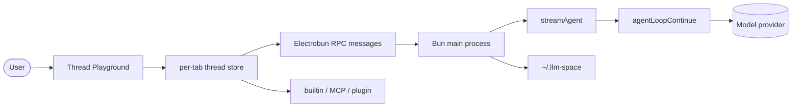
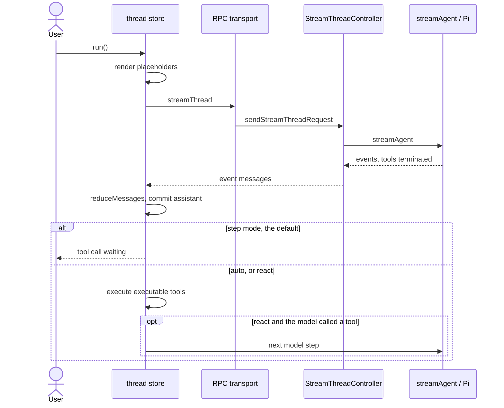

[English](llm-space.md) · **中文**

# llm-space（`deer-flow/llm-space`）

> 研究基于提交 [`342c9f5`](https://github.com/deer-flow/llm-space/tree/342c9f5761f969247e971eb36317aadf0bcc9daf)
> （2026-11-09）：桌面包 `@llm-space/desktop` `4.20.0`，领域包
> `@llm-space/core` 与 `@llm-space/runtime` 都是 `4.0.1`。
> 该提交上 `git describe` 的结果是 `v4.20.0-3-g342c9f5`。
> 锁文件把 `@earendil-works/pi-agent-core` 和 `@earendil-works/pi-ai` 定在 `1.1.0`。
> 下文源码路径相对于 llm-space 仓库根目录，行号对应该提交。
> **事实**指在那棵树里读到、在已发布的 Pi 1.1.0 压缩包里核对过，或被本研究复现的测试钉住。
> **解读**是我对作者意图的理解。本研究没有运行上游测试套件。

**交互式图表（Archify，每个节点都链接到源码）：**
[架构](../diagrams/llm-space/architecture.html) ·
[执行流程](../diagrams/llm-space/execution-flow.html) ·
[核心抽象](../diagrams/llm-space/core-abstractions.html) ·
[上下文流](../diagrams/llm-space/context-flow.html) ·
[记忆流](../diagrams/llm-space/memory-flow.html) ·
[工具运行时](../diagrams/llm-space/tool-runtime.html) ·
[Agent 循环](../diagrams/llm-space/agent-loop.html) ·
[子 Agent 流程](../diagrams/llm-space/sub-agent-flow.html)
（图表为英文，中英文版共用）

**最小复现：**[`experiments/llm-space/`](https://github.com/woaitqs/repo-research/tree/main/experiments/llm-space)（[中文说明](https://github.com/woaitqs/repo-research/blob/main/experiments/llm-space/README.zh.md)）

---

## 结论

- **LLM Space 是一个桌面工作台，它把 harness 拆成一步一步的模型调用让人看。**
  README 把它写成原型、追踪、调试和评估 agent 的地方（`README.md:19-23`）。代码就是这个形状：
  Thread 文件是一次实验，一次 run 可以停在“模型请求了工具”和“工具给出结果”之间。
- **它调用了 Pi Agent Core，然后立刻让它停下。** `streamAgent` 把每个工具交给
  `agentLoopContinue`，而 `execute` 解析出来的是 `{ terminate: true }`
  （`packages/core/src/server/agent/stream.ts:105-108`、`:231-242`）。在已发布的
  `pi-agent-core@1.1.0` 压缩包里，内层循环写的是
  `hasMoreToolCalls = !executedToolBatch.terminate`（`dist/agent-loop.js:167`），
  并且只有每个结果都是 `terminate === true` 时才把这一批当作结束（`:465-466`）。
  **事实：** LLM Space 不会在这个循环里面真正执行工具。
- **产品真正拥有的续跑在 Thread Playground 里。** `run()` 总会先走一轮模型，再看两个持久化开关
  （`thread-store.ts:1452-1486`）。默认是停下。“自动运行工具”把这一轮的工具执行一次。
  “ReAct 循环”继续交替，上限是 `MAX_AUTO_TOOL_TURNS = 50`（`thread-store.ts:106`）。
  两个开关默认都是 false，而且是应用偏好，不是线程上的字段（`run-mode.ts:10-22`、`:47-48`）。
- **模型看到的是一次渲染，不是文件本身。** `renderThreadPromptVariables` 在每个面向模型的文本表面上
  解析占位符，并返回一份新的 context。它的注释写明：已有的快照值优先，所以旧消息保持同一串已渲染的字节
  （`prompt-variables.ts:463-467`、`:521-531`）。`withPromptVariableSnapshot` 把这份快照挂上，
  可编辑的模板留在原地（`:289-300`）。
- **压缩是一次预览，预览会变成旁边的一个文件。** 规划、检查点消息和渐进更新都在
  `packages/core/src/thread/compaction.ts`。应用预览不会覆盖源线程：`nextCompactedThreadPath`
  选择 `name-compact-N.json`（`packages/ui/src/lib/thread-file.ts:62-83`）。文档说的是同一条规则
  （`docs/compaction.md:12-14`）。
- **Run 的证据不是线程文件。** `createLocalFileSystem` 把线程放在 `~/.llm-space/workspace`，
  把 run 快照放在 `~/.llm-space/history`（`packages/runtime/src/storage/index.ts:6-9`）。
  删除线程会留下历史（`file-system.ts:139-146`）。评估是线程上的人工记录
  （`thread-store.ts:1613-1628`）。一次 Langfuse 导入变成单独的 `workbench.json`，不改写 `raw.json`
  （`trace-manager.ts:462-465`、`:535-536`）。
- **和 deer-flow（研究 06）对照：** 两者都是 DeerFlow 家族的代码，也都借用了一个循环
  （那边是 LangChain，这边是 Pi）。DeerFlow 的 lead agent 在图里面跑工具，并从线程里删掉被压缩的消息。
  LLM Space 停在工具请求上，把压缩写进一个新文件，并把 `spawn_agent` 当成一个暂停的兄弟线程，而不是一个正在跑的子进程。

## 为什么这个仓库值得读

DeerFlow（研究 06）是一个长程超级 agent：Gateway、沙箱，以及一张被允许一直跑下去的 lead 图。
LLM Space 是那个团队说自己在造这个 agent 时使用的工作台。README 称它为姊妹项目，并说每个 DeerFlow
版本都在这里构建和调试（`README.md:23`）。**这句话是 README 的声明；这次检出无法证明谁打开过哪一份
DeerFlow 线程。** 这棵树里能看到的，是一个以保存下来的 Thread 为工作单位的工作台，外加一个能把
DeerFlow 的 run 事件 JSONL 变成 Thread 的解析器
（`packages/core/src/parsers/deerflow-jsonl-thread-parser.ts:14-16`）。

这个 pin 的 git 历史比 README 的起源故事更晚。README 说项目始于 2023 年 3 月，v4 是第四次大迭代
（`README.md:23`）。**`git log` 里的事实：** 本次克隆的第一次提交是 2026-06-25 的 `61bcb79`，
说明是 “chore: init”，`342c9f5` 是第 788 次提交。**解读：** v4 是一段新的仓库历史，不是一条一直连回
2023 年的线。本研究没有查看其他远程仓库，也没有查看 v4 之前的应用。

它适合拿来对照更早的 harness 研究，因为循环是借来的，然后被故意拆开：

| 研究 | 谁拥有循环 | LLM Space 做了什么 |
|---|---|---|
| deepagents | LangChain `create_agent`，用中间件做上下文 | 同样借用循环。额外的策略在 playground 和 prompt 渲染里，不在模型节点周围的中间件栈里。 |
| OpenHands | 事件日志；`step()` 无状态；上下文是投影 | 持久对象是 Thread JSON。流式事件被 `reduceMessages` 折进消息，事件本身不是记录系统。 |
| openai-agents-python | 自己的 `while True`，围绕 `NextStep` | `for` 循环存在，在 `thread-store.ts` 里，而且只在用户打开 ReAct 开关时才跑。默认的 run 是一步模型调用。 |
| letta-code | 每个 run 一步模型；客户端执行工具 | 同样的拆分，两边都在一台机器上：Bun 进程调用模型，渲染进程执行工具，人是两者之间的默认。 |
| open-pstack | 用散文技能引导宿主循环 | 技能是 `SKILL.md` 文件。`skill` 工具装入一份正文。一个 prompt 变量也可以注入索引。 |
| deer-flow | `create_agent` 跑工具；压缩删消息；子 agent 会运行 | Pi 在工具之前停下。压缩克隆线程。`spawn_agent` 创建线程，并不运行它。之后一个 LangGraph 生成器可以把线程导出成 Python 项目。 |

## 仓库快照

| 项 | 值（事实） |
|---|---|
| 布局 | Bun workspace：`packages/*` 与 `apps/*`（`package.json:4-7`）。`packages/core`、`packages/runtime`、`packages/ui`、`apps/desktop`、`apps/server`、`apps/web` |
| TypeScript 规模 | core 140 个文件 / 21,599 行；runtime 103 / 22,711；ui 179 / 31,790；desktop 285 / 51,351；server 17 / 1,633；web 27 / 3,624 |
| 测试 | `packages/` 与 `apps/` 下 157 个 `*.test.ts`。本研究没有运行它们 |
| 版本 | desktop `4.20.0`（`apps/desktop/package.json:3`）；core 与 runtime `4.0.1`；Electrobun `^1.18.1`；runtime 包里的 MCP SDK `1.30.0` |
| 循环依赖 | `@earendil-works/pi-agent-core` catalog `^1.1.0`，锁定在 `1.1.0`（`package.json:40`，`bun.lock`） |
| 桌面入口 | `apps/desktop/src/bun/index.ts` 注入 shell 环境，播种 workspace、skills 和 plugins，然后调用 `startDesktopApp`（`:6-23`） |
| 数据根 | `getLlmSpaceHomePath()` 是 `LLM_SPACE_HOME` 或 `~/.llm-space`（`packages/core/src/server/paths.ts:5-8`） |
| 历史 | 这个 pin 上 788 次提交；第一次提交 2026-06-25 |
| 本研究的复现 | 25 个测试，demo 21/21，变异检查 9/9。上游套件没有执行 |

`AGENTS.md` 仍写着内置工具注册表“不是公开的 plugin SDK”（`AGENTS.md:118-124`）。
**相对这个提交，那段话已经过时。** `packages/runtime/src/plugins/` 是一个真正的 plugin 宿主：
在 `~/.llm-space/plugins` 下发现，每个 plugin 一个 Bun 子进程，贡献包括 skills、MCP、模型、命令、
工具和线程存储。下面的研究跟着代码走，不跟着那段话走。

## 架构

四层。桌面进程是组合根。渲染器不会从 `packages/ui` 里面引用 Electrobun；它收到一个 `HostServices`
对象（`packages/ui/src/host/types.ts:26-30`）。

```text
Electrobun shell     apps/desktop/src/bun          窗口、RPC、进程生命周期
Workbench UI         packages/ui Thread Playground 每个打开的线程一个 store
Domain + runtime     packages/core, packages/runtime   线程语义、模型、工具、MCP、plugins
Borrowed loop        pi-agent-core agentLoopContinue  一步模型调用，然后 terminate
```



带源码链接的版本：[architecture.html](../diagrams/llm-space/architecture.html)。

**模块边界（事实）：**

| 模块 | 拥有 | 不拥有 |
|---|---|---|
| `apps/desktop/src/bun/app/start-desktop-app.ts` | 构造各个 manager 和窗口 | 模型/工具循环 |
| `packages/ui` Thread Playground | run 的续跑、撤销，以及编辑器 | 文件系统和供应商 HTTP |
| `packages/core/src/server/agent/stream.ts` | 校验请求并驱动 Pi | 执行工具 |
| `packages/core/src/client/reducer.ts` | 把 `AgentEvent` 折成一条 assistant 消息 | 下一回合何时开始 |
| `packages/runtime` | 模型、skills、MCP、plugins、traces、本地 runtime 客户端 | Electrobun 窗口 |
| `apps/server` | 同一套 runtime 前面的 HTTP 服务，给远程机器用 | 第二个 agent 循环 |
| `apps/web` | 静态落地页和只读的分享线程查看器 | `executeTool`（它是 `null`，`apps/web/src/host/web-host.ts:17`） |

`startDesktopApp` 在一个函数里建好对象图（`start-desktop-app.ts:58-260`）：home 路径、analytics、
model manager、MCP、skills、一个 `PluginManager`、一个 `TraceManager`、一个 `StreamThreadController`、
一个只挂了内置工具模块的 `DesktopHost`，然后是带本地客户端和可选远程 runtime 的 `RuntimeRouter`。
**解读：** 桌面应用是工作台的宿主。工作台的规则在 `packages/ui` 和 `packages/core` 里，所以同一个
Thread Playground 可以在静态查看器里渲染，宿主方法换成空实现。

两个发行版共用这个数据根。当 `LLM_SPACE_DESKTOP_RENDERER=cef` 时，`electrobun.config.ts` 分叉应用名、
macOS identifier 和更新源（`:6-13`、`:45-53`）。注释写明 `getLlmSpaceHomePath()` 不依赖应用名，
所以两个发行版都读 `~/.llm-space`。只有设置了 `LLM_SPACE_DESKTOP_CDP_PORT` 才会加上 CDP 端口（`:74-83`）。

## 主执行流

追踪的入口：用户在一个线程标签里按下运行。`ThreadPlayground` 用桌面传输、`getAutoRunTools`、
`getReactLoop` 和 `executeTool` 创建 store（`thread-playground.tsx:205-227`）。



逐步说明（未标注的都是事实）：

1. **store 在任何 await 之前先占住这次 run。** 状态变成 `"preparing"`，并设置 `activeRunId`，
   这样在加载 skills 和文件时标签不会被拆掉（`thread-store.ts:1090-1093`）。
2. **先解析模型，再检查消息列表。** 从某条消息重跑会在那条消息之后截断。`getRunValidationIssue`
   可以在任何截断发生之前拒绝这次 run（`:1114-1136`）。另外，`isRunnableConversation` 要求列表为空、
   以用户消息结尾，或以带工具调用的 assistant 消息结尾（`run-eligibility.ts:13-21`）。一条普通的
   assistant 回复不能开始 run。`streamAgent` 在转换后的 Pi 消息上再查一次，如果最后一条 Pi 消息是
   assistant 就抛出同一个错误（`stream.ts:62-67`）。
3. **占位符被渲染进一份请求 context。** 存档里的线程不会被这份渲染替换。渲染得到的快照留到 run 结束
   （`:1139-1151`）。
4. **状态变成 `"running"`，并流式走一轮模型。** `streamThread` 转换线程 context，然后调用注入的传输
   （`packages/core/src/client/api.ts:14-43`）。桌面传输是 `createRpcTransport`：一个 `streamId`、
   即发即忘的 RPC 消息，以及渲染侧的异步迭代器（`apps/desktop/src/client/rpc-transport.ts:18-70`）。
   Electrobun RPC 没有原生流；`AGENTS.md:95` 的注释和这段代码一致。
5. **Bun 侧调用 `streamAgent`。** `StreamThreadController.run` 解析供应商连接并转发事件
   （`packages/runtime/src/streaming/stream-thread.ts:22-54`）。`streamAgent` 查找模型，应用本次 run
   的 base URL，并在 `finally` 里恢复共享模型的 `baseUrl`，因为 Pi 的注册表对象是进程全局的
   （`stream.ts:80-88`、`:164-166`）。**解读：** 这个恢复存在，是因为工作台在一个进程里跑很多线程，
   自定义端点不能漏到下一次 run。
6. **assistant 请求工具时 Pi 停下。** 传进 `agentLoopContinue` 的工具忽略参数并返回 `terminate: true`
   （`stream.ts:231-242`）。reducer 记录文本、思考和工具调用增量。在 `agent_end` 上，assistant 的
   `errorMessage` 会被抛出（`reducer.ts:111-116`）。`tool_execution_start` 被忽略（`:118-120`），
   这和一个不执行工具的循环是匹配的。
7. **playground 提交 assistant 消息，然后看模式。** 两个开关都是 false 时，`for` 循环退出。工具调用
   留在消息上，没有输出。用户可以手工填一个 function 工具，或者按下这个工具的运行按钮
   （`use-tool-call-runner.ts` 对单次调用走 `executeTool`）。
8. **Auto 和 ReAct 要么执行整批末尾调用，要么一个都不执行。** `executePendingToolCalls` 在任一调用
   缺失、不可执行，或是危险 `bash` 时返回 `null`（`thread-store.ts:564-592`）。`null` 会停掉循环。
   否则这些调用用 `Promise.all` 跑，输出写回同一条 assistant 消息，ReAct 再迭代。50 次模型回合之后
   循环结束，即使最后一轮仍然调用了工具（`:1452-1486`）。
9. **成功的 run 会被做成快照。** 如果看到过事件且 run 没有失败，`recordRun` 追加一份快照；宿主提供
   归档函数时，`archiveRunSnapshot` 用引用替换内联正文（`:1235-1286`）。第一个事件之前的传输失败，
   或模型错误，不会被记录（`:1195-1204`）。

## 核心抽象

| 对象 | 职责 | 所在 |
|---|---|---|
| `Thread` | 保存下来的实验：模型、system prompt、变量、工具、消息、run 索引、评估 | `packages/core` 的线程类型，一个 JSON 文件 |
| `Thread` store | 每个打开的标签一个 Zustand store。`run()`、撤销、工具输出、评估 | `packages/ui/.../stores/thread-store.ts` |
| `AgentTransport` | `streamThread` 里唯一的 HTTP 与 RPC 接缝 | `packages/core/src/client/api.ts:38-43` |
| `streamAgent` | 一次带逐步工具的 Pi 调用 | `packages/core/src/server/agent/stream.ts` |
| `reduceMessages` | 事件变成 `AssistantMessage` | `packages/core/src/client/reducer.ts` |
| `Tool` | `function`、`builtin`、`mcp`、`plugin` 或 `provider-hosted` | `packages/core/src/types/tools/index.ts:165-177` |
| `ToolRegistry` | 内置贡献，在进程内冻结 | `packages/runtime/src/tools/tool-registry.ts` |
| `PluginManager` | 子进程 plugin 及其贡献 | `packages/runtime/src/plugins/plugin-manager.ts` |
| `RunHistoryStore` | 工作区之外的 run 快照 | `packages/core/src/server/storage/local/run-history-store.ts` |
| `TraceManager` | Langfuse 项目和一份调试用的 `workbench.json` | `packages/runtime/src/traces/trace-manager.ts` |
| `RuntimeRouter` | `"local"` 加上可选的远程 runtime。local 不能注销 | `runtime-router.ts:11-18` |

`provider-hosted` 工具不会作为 Pi 工具送出。`convertToPiContext` 把它们拆开，stream 再通过
`onPayload` 把原始配置注入供应商的请求体（`converters.ts:12-28`，`stream.ts:134-154`）。
**解读：** 这些是供应商自己的工具（Responses API 的形状）。LLM Space 不假装在本地执行它们。

更完整的图：[core-abstractions.html](../diagrams/llm-space/core-abstractions.html)。

## Agent 循环

有两只钟，不能混在一起。

**Pi 的钟是一条 assistant 消息。** 在 1.1.0 压缩包里，`agentLoopContinue` 的说明是“从当前 context
继续，不追加新消息”（`dist/agent-loop.js:21-28`）。然后它在工具结果说还要继续时在内部循环
（`:88-90`、`:167`）。LLM Space 的工具适配器让这个内层循环退出。空的工具内容是故意的：真正的结果还不存在。

**工作台的钟是 `run()`。** 循环上面的注释写明了产品规则（`thread-store.ts:1453-1459`）：

- 一轮模型调用总会发生；
- 工具处于自动运行时，执行末尾的调用，除非其中有一个需要手写结果；
- 只有 ReAct 会进入下一次模型调用；
- 普通的自动运行执行一次，然后保持逐步。

开关放在渲染器的 local storage 里，键是 `llm-space-react-loop` 和自动运行的键
（`packages/ui/src/lib/local-storage.ts:14`，`run-mode.ts:38-48`）。打开 ReAct 会在有效读取里强制
自动运行（`run-mode.ts:55-61`），不要求改写已经存下的自动运行开关。playground 把这些 getter 传进
store（`thread-playground.tsx:215-216`）。

人工关卡都会让 `executePendingToolCalls` 返回 `null`，从而结束这次 run 的循环：

| 关卡 | 在哪里决定 |
|---|---|
| `function` 工具 | 这种 kind 的 `isExecutableTool` 为 false（`types/tools/index.ts:250-261`） |
| `terminate: true` 的 `builtin` | 同一个函数；即使旧文件漏了这个标志，`ask_user_question` 和 `spawn_agent` 也会被点名（`:197-201`） |
| 危险的 `bash` | `isDangerousBashCommand`（`:311-313`），在执行前检查（`thread-store.ts:576-592`） |
| 缺少执行器 | `executePendingToolCalls` 返回 `null`（`:547-549`） |

非本地 runtime 上的 plugin 工具不一样。`executeTool` 抛出
`"Plugin Tools are available only in the local runtime."`
（`apps/desktop/src/client/tool-execution.ts:33-36`）。store 的 `catch` 把这个异常变成一条错误工具结果
（`thread-store.ts:630-638`）。plugin 函数不会被调用。如果开了 ReAct，下一步模型可以看到这段错误文本。
**事实：** “仅本地”是一条错误结果，不是静默跳过。

失败的模型调用会设置 `failed`，并且不进入 run 历史（`thread-store.ts:1199-1204`、`:1235`）。
中止时，如果部分 assistant 消息已经有内容，会把它留下（`:1316-1318`）。

图：[agent-loop.html](../diagrams/llm-space/agent-loop.html)。

## 上下文工程

### 模板和快照

可编辑的 system prompt、用户文本和工具结果文本可以包含双花括号名字。`renderThreadPromptVariables`
（`prompt-variables.ts:468-532`）构造 `streamThread` 将要转换的 context。存档里的字符串留在线程上。
返回的 `snapshot` 按位置记录渲染后的文本（`systemPrompt`、`message:<id>:text`、工具结果的位置）。
下一次 run 时，已经有快照条目的位置会被复用（`:463-466`）。

**和代码绑在一起的解读：** 按天粒度的 `current_date` 不应该在你明天继续这个线程时改写昨天的用户消息。
一条新消息还没有快照位置，会用今天的值渲染。复现的测试钉住了这个分叉。

渲染还会加载 skills 和文件。`loadSkills`、`loadFile` 和 `fileExists` 由宿主注入
（`thread-playground.tsx:220-226`）。被包含的文件在一次渲染里做了记忆化（`prompt-variables.ts:748-759`）。
第 122 行的模板扫描器同时认识双花括号表达式和花括号百分号标签；本研究没有重写 Nunjucks 的那个子集。

压缩在序列化那段对话之前使用同一次渲染，所以摘要模型读到的不是原始占位符（`compaction.ts:201-227`）。
文档说的是同一件事（`docs/compaction.md:136-138`）。

### 什么是 system prompt，什么是 meta 用户消息

线程的 `systemPrompt` 是一个字段，经 `convertToPiContext` 作为 Pi 的 system prompt 送出
（`converters.ts:15-16`）。另外，第一条用户消息常常是一个 “meta” 回合：一块 `<system-reminder>`
运行时上下文。没有 schema 标志。`scoreMetaUserMessage` 给这段文本打分（`meta-user-message.ts:5-8`、
`:17-29`）。压缩把这条消息留在检查点前面（`compaction.ts:99-105`，`applyCompactionPreview` 在 `:245-248`）。

### 压缩

`planCompaction` 按用户消息的边界切开。上一个检查点会并进下一次摘要，并且不算作保留的回合之一
（`compaction.ts:89-135`）。摘要提示里的工具结果上限是 2,000 个字符（`:14`、`:265-267`）。写回去的
检查点是一条包在 `<system-reminder>` 里的合成用户消息（`:16-20`、`:231-249`）。检查点已经存在时，
它的 id 会被复用（`:130-132`、`:236`）。

UI 向导可以通过正常传输流式生成预览。只有确认之后才会组装消息列表
（`thread-compaction-dialog.tsx:258-275`）。桌面宿主用 `nextCompactedThreadPath` 把这份列表写到新路径。
再次压缩 `task-compact-2.json` 会继续成 `task-compact-3.json`，而不是叠一层后缀
（`thread-file.ts:57-83`）。

**和 deer-flow 对照：** DeerFlow 的摘要器在同一个线程里删除消息，并在之后的调用上重新注入摘要。
LLM Space 的检查点变成新文件里的一条普通用户消息，源文件还在。两者都用 `<system-reminder>`，
以免模型把摘要当成一条新的用户请求。这段提醒文本是 LLM Space 的（`compaction.ts:16-18`）。
DeerFlow 的是另一套中间件。

图：[context-flow.html](../diagrams/llm-space/context-flow.html)。

## 记忆、重放和评估

LLM Space 的“记忆”主要是文件，而且文件按谁可以看见来分开。

| `~/.llm-space` 下的路径 | 放什么 | 事实 |
|---|---|---|
| `workspace/` | 线程 JSON，没有派生数据 | `LocalFileSystem` 的注释（`file-system.ts:56-57`）；`createLocalFileSystem`（`storage/index.ts:6-8`） |
| `history/<sha256(resource)>/` | `index.json` 加上每个 run 一个文件 | `RunHistoryStore`（`run-history-store.ts:30-40`） |
| `settings/` | 供应商、窗口、MCP、skills、提醒 | `getSettingsDir`（`paths.ts:12-14`）；`AGENTS.md:166` 列出了这些文件 |
| `traces/projects/` | Langfuse 导入和一份调试工作台 | `TraceManager`（`trace-manager.ts:142-157`） |
| `plugins/` | 已安装的 plugin | `PluginManager`（`plugin-manager.ts:190`） |
| `data/plugins/@llm-space/memory/` | 捆绑的 memory plugin 的 JSONL | `apps/desktop/src/bun/memory/index.ts:4-10`、`:39-50` |

**重放一次本地 run** 是“恢复”，不是第二个模拟器。历史列表加载快照并调用 `restoreThread`
（`run-history-list-view.tsx:202-205`）。恢复出来的线程就是保存的消息列表，所以用户可以编辑它，
并从选定的消息再跑（`thread-store.ts:1114-1125` 按 `fromMessageId` 截断）。**解读：** README 里的
“重放一次失败”意思是“打开那份精确保存的线程，并从那里逐步走”，而默认的运行模式本来就是一次只走
一步模型调用。没有一个单独的时间旅行执行器。

**外置。** 读和写的时候，内联的 run 快照被复制进 history 目录，线程文件只保留 `runHistoryVersion: 2`
和 `runHistoryIndex` 引用（`file-system.ts:434-455`）。`recordRun` 自己在归档发生之前仍然按引用保存
线程（`history.ts:600-621`）。移动或复制线程会重键 history 目录。`rm` 不删除它
（`file-system.ts:139-146`）。`maintainRunHistory` 在 30 天后回收孤儿（`run-history-store.ts:17`，
`file-system.ts:299-307`）。启动时发出这次清扫，并且不等它（`start-desktop-app.ts:112-118`）。

**评估不调用模型。** `saveEvaluation` 在 store 空闲时把一条记录 upsert 到线程上
（`thread-store.ts:1613-1628`）。Rubric 有有序的标准；工具函数把分数校验为 1 到 5 的整数
（`run-evaluation-utils.ts:124-131`）。保存的评估保留自己的 rubric 快照：已经保存过时，
`initialRubricForEvaluation` 返回评估自己的 rubric（`:11-15`）。`MAX_EVALUATIONS` 是 50
（`history.ts:28`）。文档说编辑可复用的 rubric 不会改写历史评估（`docs/core-concepts.md:33`）。
记录留在线程 JSON 里，所以 run 正文被外置之后，它仍然在 `workspace/` 里。

**Traces。** `TraceManager.readOrCreateWorkbench` 第一次从 `raw.json` 派生 `workbench.json`，
之后保留工作台上的编辑（`trace-manager.ts:462-493`）。改标题和保存路径都不改 `raw.json`
（`:535-536`）。类注释说工作台使用普通的 Thread 形状，这样现有的 playground 可以调试它
（`:145-146`）。**解读：** 一条生产环境的 Langfuse trace 被拉进和手写实验相同的编辑器。这就是把
“检查 harness 的每一步”用到别人的 run 上。

**memory plugin** 是一个捆绑 plugin。桌面也可以在共享锁下读它的存储，而不把 plugin 源码引进 Bun 进程
（`bun/memory/index.ts:4-11`）。上限：`MAX_TOTAL_MEMORIES = 1000`（`:34`）。这不是 letta-code 那种
把 git 记忆编译进 system prompt。一个线程的 prompt 会不会提到这些记忆，取决于用户写的 prompt，
或者取决于模型调用的 plugin 工具。本研究没有在每次 run 上追踪一次强制注入。

图：[memory-flow.html](../diagrams/llm-space/memory-flow.html)。

## 工具、Skills、MCP 和 Plugins

线程上的工具定义是模型被允许请求的东西。谁来回答是另一个对象。

| 种类 | 模型看到 | 谁产生结果 |
|---|---|---|
| `function` | 名字、描述、JSON schema | 用户，或应用之外的东西。`isExecutableTool` 为 false |
| `builtin` | 同样的形状 | Bun 进程里的 `ToolRegistry`，除非 `terminate` 或危险的 `bash` |
| `mcp` | 规范化的名字 `mcp__{server}__{tool}` | `McpManager.callTool`（`mcp-manager.ts:443-459`） |
| `plugin` | 同样的形状，外加 `pluginId` 和 `toolId` | plugin 子进程，而且只在 `runtimeId === "local"` 时 |
| `provider-hosted` | 注入供应商的请求体 | 供应商，在模型调用期间 |

桌面客户端的 `executeTool` 是唯一的分发点（`tool-execution.ts:27-71`）。内置失败会抛出，并在 store 里
变成 `isError`。MCP 自己可以返回 `isError`。

**内置工具是一个冻结的注册表。** `DesktopHost.start` 让每个模块 `register`，然后调用 `tools.freeze()`
（`desktop-host.ts:31-45`）。冻结之后 `ToolRegistry.register` 会抛出（`tool-registry.ts:56-60`）。
内置模块的 id 是 `llm-space.built-in-tools`（`built-in-tools-module.ts:28`）。它注册 web、文件系统、
媒体、仅 macOS 的语音，以及 misc（`:32-59`）。文件系统工具包括 `read`、`write`、`edit`、`bash` 和
`skill`（`fs.ts` 的 name 字段）。`ask_user_question` 是 `terminate: true`，注释写明自动运行和 ReAct
都不能调用它（`misc.ts:85-91`）。

**Skills** 是一目录一目录的 `SKILL.md`。`SkillsManager` 用 gray-matter 解析 frontmatter，并通过
`skills-handler` 校验名字（`skills-manager.ts:39-46`）。`skill` 工具返回基目录加上文件正文
（`fs.ts:731-759`）。一个列出已启用技能索引的 prompt 变量是另一条通道：它列出名字和描述，不会把每份
正文内联进去。**解读：** 这和 deer-flow “prompt 里是索引，正文按需加载”是同一种拆分，这里实现成一个
变量加一个工具，而不是中间件。

**MCP。** `McpManager.callTool` 在需要时连接，并带超时调用 `tools/call`（`mcp-manager.ts:443-459`）。
plugin 提供的服务器用 `setPluginServers` 注册（`:208`）。桌面重新导出这个类
（`apps/desktop/src/bun/mcp/index.ts:1`）。

**Plugins** 是 `~/.llm-space/plugins` 下的包，带 `engines["llm-space"]`（`plugin-types.ts:11-20`）。
`PluginManager.create` 发现并激活它们（`plugin-manager.ts:144-147`）。每个活动的 plugin 得到一个
`PluginSubprocessHost`，它 `Bun.spawn` runner，并在 stdin 上说 JSON 行（`plugin-subprocess-host.ts:82-89`、
`:52-68`）。宿主可以通知、打开链接、挑选文件、读写工作区文件，但只能通过 `startDesktopApp` 允许的方法
（`start-desktop-app.ts:154-195`）。**解读：** 冻结的内置注册表和 plugin 宿主是故意分开的。第三方代码
不会注册进拥有 `bash` 的那个进程。

图：[tool-runtime.html](../diagrams/llm-space/tool-runtime.html)。

## 桌面壳和远程 Runtime

壳是 Electrobun：一个 Bun 主进程加一个 webview。`apps/desktop/package.json` 的脚本先构建 Vite 渲染器，
再运行 `electrobun dev` 或 `electrobun build`（`:5-12`）。类型化的 RPC 契约是
`apps/desktop/src/shared/rpc.ts` 里的 `DesktopRPCType`。请求覆盖模型、文件系统和 prompt 文件辅助。
Agent 流是消息，用 `streamId` 关联，如上所述。

`apps/server` 是同一套 runtime 前面的 HTTP，给一台你 SSH 过去的机器用。`main` 用 `createServerRuntime`
建 runtime，并用一个 token 提供服务（`apps/server/src/index.ts:22-39`）。`RuntimeRouter.get` 选择
local 或一个已注册的远程 id（`runtime-router.ts:34-40`）。Plugin 工具留在本地，如上面的抛出所示。
**本研究没有打开 SSH 会话，也没有启动打包好的 DMG。** 发行版分叉来自上面引用的 `electrobun.config.ts`。

## 子 Agent

`spawn_agent` 是一个 `terminate: true` 的内置工具。它的描述说当前 run 会暂停，以便用户点击
“Create subtask”；子线程继承 system prompt、meta 用户提示、模型和选定的工具，不继承对话。它会被保存
并打开，并且不会被执行（`packages/core/src/thread/spawn-agent.ts:34-68`）。

`buildSubagentThread` 实现了这一点（`:145-182`）：可选的 meta 消息，然后一条引用任务的用户消息，
然后 `filterSubagentTools`。每个角色都丢掉 `spawn_agent`。`researcher` 保留一组只读工具。
`code-reviewer` 可以保留 `bash` 和 `exec_code`，并被告知不要编辑（`:107-143`）。角色是
`general-purpose`、`researcher` 和 `code-reviewer`（`:7-12`）。

**和 deer-flow 对照：** DeerFlow 的 `task` 工具在父级沙箱里跑一张子图，并返回子级的最终文本。
LLM Space 的工具不返回子级的工作，因为子级还没有跑。父级停下（这个工具不可执行），然后由人决定要不要
打开新线程并按下运行。这更像一个工作台，而不是一个无人值守的超级 agent。

图：[sub-agent-flow.html](../diagrams/llm-space/sub-agent-flow.html)。

## 它和 DeerFlow 的关系

三条具体的链接，加上上面已经标出的 README 姊妹项目那句话。

1. **导入。** `DeerFlowJsonlThreadParser` 接受 `.jsonl`，并认识 `llm.human.input`、
   `llm.ai.response` / `ai_message` 和 `llm.tool.result`（`deerflow-jsonl-thread-parser.ts:10-16`、
   `:109-120`）。category 存在且不是 `"message"` 的行会被跳过（`:93-95`）。这个解析器和别的线程解析器
   一起注册（`thread-parser-registry.ts:90`）。**事实：** 一份 DeerFlow 的 run 日志可以变成 playground
   能打开的 Thread。**本研究没有把这些事件名和 deer-flow 的 pin `cf8c29c` 做 diff。** 研究 06 描述的是
   DeerFlow 持久化的事件；这个解析器是消费侧。
2. **一个例子，不是移植。** “General Agent” 例子被描述成一个类似 DeerFlow 的助手，并带上文件/网页工具
   以及 `spawn_agent`（`packages/ui/src/components/thread-playground/examples/prompts.ts:196-223`）。
   提示文件以一个名叫 DeerFlow 的 agent 标签开头。那是给工作台用的示例内容。
3. **一个生成器，它发出的是 LangGraph，不是 DeerFlow。** `langgraphGenerator` 搭一个 uv 项目：模型工厂、
   渲染后的 prompt、内置工具、function 工具的桩、一份 MCP 脚手架，以及 `PLAN.md`。注释说它不调用 LLM
   （`packages/core/src/generator/langgraph/index.ts:99-109`）。它写进去的依赖包括 `langchain` 和
   `langgraph`（`:63-64`）。**解读：** 这是导入的反方向。你在工作台里调试一个线程，然后导出一个可以在
   别处运行的 Python agent。它不是 DeerFlow 的 harness，也不会 import `deerflow`。

DeerFlow 自己的压缩、沙箱和 Gateway run manager 没有出现在这个仓库里。LLM Space 可以展示一份 DeerFlow
的记录；它不会恢复一个 DeerFlow 的检查点。

## 重要源码文件

| 路径 | 为什么重要 |
|---|---|
| `packages/core/src/server/agent/stream.ts` | 唯一进入 `agentLoopContinue` 的调用，以及 terminate 适配器 |
| `packages/ui/src/components/thread-playground/stores/thread-store.ts` | 用户实际得到的 run 循环 |
| `packages/ui/src/components/thread-playground/stores/run-mode.ts` | step、auto 与 ReAct，存在线程之外 |
| `packages/core/src/thread/prompt-variables.ts` | 渲染与快照 |
| `packages/core/src/thread/compaction.ts` | 检查点规划 |
| `packages/core/src/types/tools/index.ts` | 工具种类和 `isExecutableTool` |
| `packages/runtime/src/streaming/stream-thread.ts` | Bun 侧的流和按连接的认证 |
| `apps/desktop/src/bun/app/start-desktop-app.ts` | 组合根 |
| `apps/desktop/src/client/rpc-transport.ts` | 用 RPC 代替一条流 |
| `packages/core/src/server/storage/local/file-system.ts` | workspace 与 history |
| `packages/runtime/src/plugins/plugin-subprocess-host.ts` | plugin 隔离 |
| `packages/runtime/src/traces/trace-manager.ts` | 把一条 trace 当成线程来调试 |
| `packages/core/src/thread/spawn-agent.ts` | 一个不运行的子线程 |
| `packages/core/src/parsers/deerflow-jsonl-thread-parser.ts` | DeerFlow 日志变成线程 |
| `packages/core/src/generator/langgraph/index.ts` | 线程变成一个 Python 项目 |

## 值得学的实现决定

1. **故意停下借来的循环。** 一个想展示每一次工具调用的工作台，不能让框架把工具跑完再交回最终答案。
   每个执行器都返回 `terminate: true`，适配器很小，效果很大：Pi 的流、供应商的怪癖和消息转换都留下，
   产品的控制流挪到团队自己的代码里（`stream.ts:231-242`，`thread-store.ts:1452-1486`）。复现里的
   `PiStep.executed` 一直是空的，除非把这个适配器拿掉。

2. **把自主循环做成一个开关，并加上限。** 默认的 run 是一步模型调用（`run-mode.ts:12-14`）。ReAct 是
   可选的，它强制执行工具，并在 50 次模型回合后停下（`thread-store.ts:106`）。一个会永远调用工具的原型
   应该失败关闭。上限在 playground 里，所以它对每个供应商都生效。

3. **渲染进请求，并冻住已经给模型看过的字节。** 把渲染后的日期写回线程会让旧回合漂移。保留模板，再按位置
   留一份快照，编辑器仍然可以显示 `current_date`，而供应商看到的是一段稳定的字符串
   （`prompt-variables.ts:463-467`、`:289-300`）。

4. **压缩是一次新实验，不是对旧实验的修改。** 源线程还在，Apply 之前预览什么都不做，第二次压缩更新检查点，
   而不是把摘要叠起来（`docs/compaction.md:148-155`，`compaction.ts:89-92`，`thread-file.ts:57-61`）。
   当文件本身就是你要比较的东西时，这是正确的默认。

5. **把派生的 run 数据放在用户文件旁边，并让它比删除活得更久。** workspace 保持成人能读的东西。History
   用路径的哈希做键，删掉的线程变成孤儿，孤儿保留 30 天，这样从废纸篓恢复的文件仍然有它的 run
   （`file-system.ts:139-146`，`run-history-store.ts:17`）。评估留在线程上，因为它们是用户的判断，不是一行日志。

6. **把“谁可以运行这个”编进工具种类，再给 shell 加一份拒绝名单。** function 工具没有后端。`terminate`
   工具和一小段危险的 `bash` 片段会同时退出自动运行和 ReAct（`types/tools/index.ts:284-313`）。这份名单
   明确偏向误报。一次误报的意思是用户手工运行这条命令。

7. **冻结进程内的工具注册表，把第三方代码放进子进程。** `DesktopHost` 在启动时冻结贡献
   （`desktop-host.ts:41-45`）。Plugin 用 JSON 行和一个子 Bun 进程说话（`plugin-subprocess-host.ts:82-89`），
   并且当线程的 runtime 是远程时不能运行（`tool-execution.ts:33-36`）。`AGENTS.md` 里那段否认 plugin SDK
   的过时文字，提醒人在大功能落地之后要重读组合根。

8. **不要从那个请求子 agent 的工具里把子 agent 跑起来。** `spawn_agent` 暂停父级并建立一份线程
   （`spawn-agent.ts:40-44`、`:145-148`）。工作台的工作是在花钱调用模型之前把子级展示出来。DeerFlow 的
   `task` 工具做了相反的选择，对它们各自的产品都说得通。

9. **每次 run 之后恢复进程全局的模型字段。** 自定义 base URL 被写到共享的 Pi 模型上，并在 `finally` 里放回去
   （`stream.ts:80-88`、`:164-166`）。在一个长寿命的桌面进程里，“设到模型对象上”如果没有撤销，就是跨线程的 bug。

## 最小复现

[`experiments/llm-space/`](https://github.com/woaitqs/repo-research/tree/main/experiments/llm-space)
（`minispace`）是标准库 Python。`ScriptedModel` 记录请求。`PiStep` 拒绝执行工具。`Workbench.run`
实现 step、auto 和 50 回合的 ReAct 上限，包括那些人工关卡。`render_thread` 把模板留在原地，并优先使用
已有的快照。压缩返回一份新列表和一个兄弟路径。`Home` 外置 run 正文并让孤儿过期。
`build_subagent_thread` 丢掉父对话，并且不运行子级。`save_evaluation` 复制 rubric，不碰模型。

## 验证

本研究在 `experiments/llm-space` 里跑过的命令：

```bash
./run.sh
.venv/bin/python mutation_check.py
```

| 检查 | 结果 |
|---|---|
| `./run.sh` | 25 passed；demo 21/21 |
| `mutation_check.py` | 9/9 个变异被杀死 |
| 上游 `bun test` | 没有跑。研究环境里没有安装 Bun。结论来自这个 pin 的树，以及 `pi-agent-core@1.1.0` 压缩包 |
| 真实模型 / 打包后的应用 | 没有跑。复现不使用 API key |

Pi 的 terminate 行为是通过解开锁定的压缩包、阅读上面引用的 `package/dist/agent-loop.js` 行来核对的。
那个文件不属于 llm-space 的提交；锁文件属于。

## 我会复用的部分

- terminate 适配器：每当 UI 必须坐在框架的工具循环和真实副作用之间。
- 快照稳定的 prompt 渲染，这样日期或技能索引不会改写历史。
- 一个只放用户内容的 workspace 目录，派生的 run 放在旁边。
- 把人工评估当作实验上的数据，并把 rubric 复制进记录。
- 一个冻结的进程内工具注册表，加上给第三方用的子进程。
- 当产品是工作台时，子 agent 是一份你可以打开的文件。

## 局限 / 未决问题

- 上游测试套件没有执行，所以和测试相矛盾的行为可能被漏掉。引用来自阅读，以及复现自己的测试。
- Pi 引用的是已发布的 1.1.0 JavaScript，不是 llm-space 的树。以后 catalog 升级会挪动那些行号。
  llm-space 在 `stream.ts:231-242` 的适配器才是稳定的事实。
- `AGENTS.md` 和 README 的 2023 年 3 月起源没有被当成架构。plugin 系统和 git 历史与两者的部分说法不一致。
- 本研究没有证明 DeerFlow JSONL 的事件名仍然匹配 `bytedance/deer-flow` 的 `cf8c29c`。解析器接受它列出的名字。
  研究 06 是生产侧的描述。
- 远程 runtime、代码签名和两个 macOS 发行版是从源码读的，没有启动。
- provider-hosted 工具和 Nunjucks 的包含/条件子集只在它们进入请求的边界上被描述。
- memory plugin 对一次 run 的影响取决于 prompt 和 plugin 工具。没有核心中间件把 `memories.jsonl` 注入每一次
  模型调用。这一点是通过搜索 core 的 stream 路径核对的；plugin 仍然可以通过工具或命令加入文本。

## 延伸阅读

- 上游：[`deer-flow/llm-space`](https://github.com/deer-flow/llm-space) 的 `342c9f5`，尤其是
  `docs/core-concepts.md`、`docs/compaction.md` 和 `docs/plugins.md`。
- 借来的循环：`@earendil-works/pi-agent-core@1.1.0`，`dist/agent-loop.js`。
- 研究 06，这个工作台所对准的生产侧：[`research/deer-flow.zh.md`](deer-flow.zh.md)。
- 复现：[`experiments/llm-space/`](https://github.com/woaitqs/repo-research/tree/main/experiments/llm-space)。
