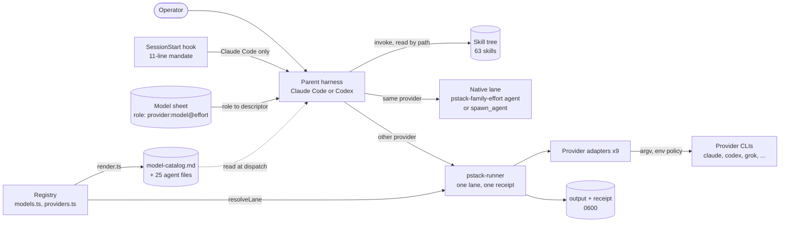
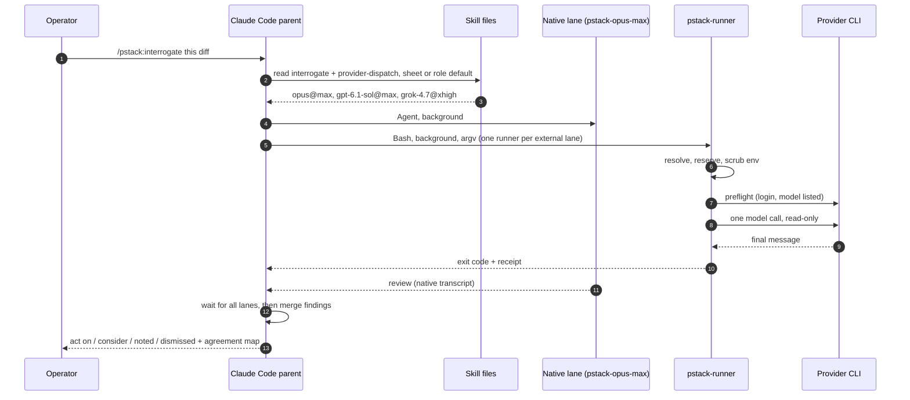
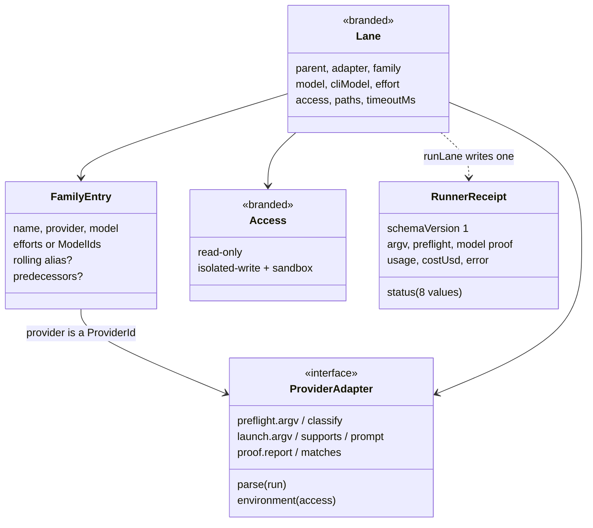
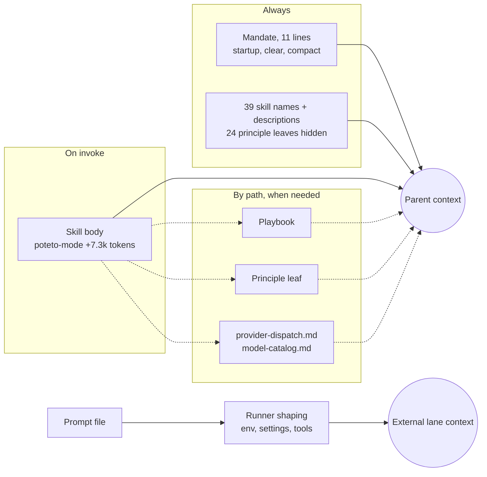
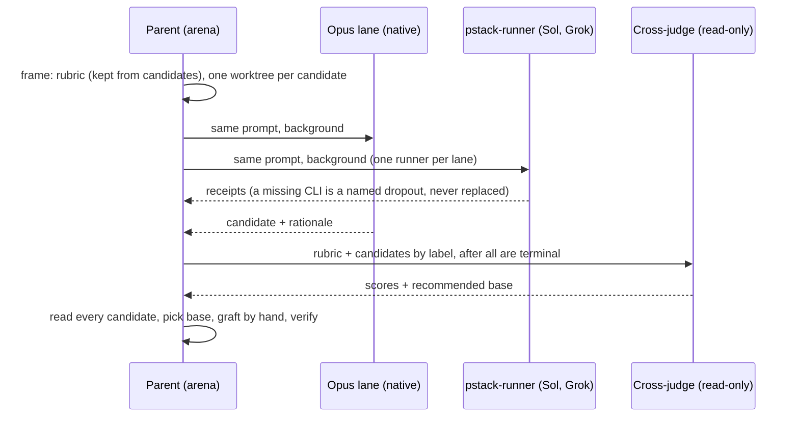

**English** · [中文](open-pstack.zh.md)

# open-pstack (`ericlitman/open-pstack`)

> Studied at commit [`b4c5e3d`](https://github.com/ericlitman/open-pstack/tree/b4c5e3d63318308b7e11f26b2bc156e7793d834a)
> (2026-10-22, Open Pstack 1.16.0, which tracks Cursor's pstack 0.15.29 at [`88d4751`](https://github.com/cursor/plugins/tree/88d47514b82e7c44f00f2b2a72ff6dd12158038c/pstack)).
> Source paths are relative to that repository, and line numbers refer to that commit. Two short forms are used:
> `skills/` means `plugins/pstack/skills/`, and `runner/` means `plugins/pstack/skills/poteto-mode/scripts/runner/`.
> **Fact** means read in source, tested, or observed at runtime. **Interpretation** means my reading of intent.

**Interactive diagrams (Archify, every node links to source):**
[architecture](../diagrams/open-pstack/architecture.html) ·
[execution flow](../diagrams/open-pstack/execution-flow.html) ·
[core abstractions](../diagrams/open-pstack/core-abstractions.html) ·
[context flow](../diagrams/open-pstack/context-flow.html) ·
[memory flow](../diagrams/open-pstack/memory-flow.html) ·
[tool runtime](../diagrams/open-pstack/tool-runtime.html) ·
[agent loop](../diagrams/open-pstack/agent-loop.html) ·
[sub-agent flow](../diagrams/open-pstack/sub-agent-flow.html)

**Minimal reproduction:** [`experiments/open-pstack/`](https://github.com/woaitqs/repo-research/tree/main/experiments/open-pstack)

---

## TL;DR

- **open-pstack has no agent loop of its own.** It is a plugin for Claude Code and Codex: 63 Markdown skills (24 of them principle leaves), 23 playbooks, 27 agent files, one hook and a few Bun scripts. The host harness runs the loop; pstack steers it with prose.
  - It ports Lauren Tan's pstack from Cursor. Against upstream at the sync commit, 50 of the plugin's 273 files are identical, 86 are modified and 137 are new.
  - Almost all of the new code is one thing: an **external runner** that lets a Claude Code session call Codex or Grok (and the reverse) as a separate lane. That is 3,588 lines of TypeScript plus 5,153 lines of tests.
- **The parent owns every route.** A role in the model sheet resolves to a descriptor, `provider:model@effort`. A descriptor for the parent's own provider runs as a native subagent. Every other provider runs through `pstack-runner` (`skills/poteto-mode/references/provider-dispatch.md:27-63`). Children get a finished assignment and are told not to route (`plugins/pstack/agents/pstack-opus-max.md:11`).
- **A runner lane makes exactly one model call and always leaves a receipt.**
  - Before launch it refuses a same-provider lane, an unnormalized pin, an unlisted effort and an unbounded access mode (`runner/registry/index.ts:62-121`).
  - It reserves the output and receipt with `O_EXCL` at mode 0600 (`runner/run.ts:94-129`), scrubs the parent's identity variables (`run.ts:172-186`), and runs a preflight with at most one retry.
  - The answer counts only with model proof: a provider-reported model of the right family, or Codex's pinned argv (`run.ts:543-570, 962-981`).
  - There is no implicit timeout and no fallback (`AGENTS.md:21`).
  - **Verified:** a probe of the real launcher held 20 of 20 claims. With the real Claude and Codex CLIs, 9 scenarios ran 3 times each.
- **"A dropout is not a fallback" is the port's main editorial change.** Upstream's `interrogate` reran a rejected model on its family default or "the closest equivalent". The port deletes that, because a substitute "destroys the meaning of cross-provider agreement" (`skills/interrogate/SKILL.md:32`).
  - **Observed live:** this host's Codex (ChatGPT account, CLI 0.157.1) does not serve the role default `gpt-6.1-sol`. The lane ended `unavailable-model`/69 in 3 of 3 runs, and nothing ran in its place.
- **One typed registry generates the model catalog and the 25 native agent files** (`runner/registry/render.ts`). Upstream-derived skills name roles, never models, and a text scan enforces it (`runner/registry.test.ts:367-380`). A model change therefore edits no upstream-derived line. The design came out of pstack's own `architect` + `arena`, and the orchestrator overruled the cross-judge.
- **Access modes rest on each CLI's sandbox.**
  - A Claude writer runs in Claude Code's Bash sandbox, and the runner denies writes to the linked worktree's shared `.git`.
  - A Codex writer runs in Codex's `workspace-write`.
  - **Verified:** both writers were blocked from `$HOME` (3 of 3 runs each). The Codex writer could write `/tmp` (3/3). With the main repository under `/tmp`, it also wrote into the shared `.git` (3/3).
- **Measured: the prose layer is followed loosely.**
  - The SessionStart hook fired in 27 of 27 headless sessions, and trivial questions were never routed (0/9). Non-trivial tasks entered a pstack skill in only 5 of 18 sessions (Haiku 3/6, Sonnet 0/6, Opus 2/6).
  - With an explicit `/pstack:poteto-mode`, the skill body loaded (+7,251 prompt tokens). Yet 0 of 6 sessions opened the playbook todolist or read the dispatch reference.
  - All three Opus sessions delegated to the generated `pstack-sonnet-low` agent, not the role's default model.
  - These are small tasks in headless mode: evidence, not a benchmark.
- **The repository is built around verification that a model cannot fake.** A pull request merges only after `verify` (tests, types, 15 static invariants) and a `live-gate` status on the exact head SHA (`.mergify.yml:4-14`). That status comes from driving the installed candidate in real Claude Code and Codex sessions, where "a model's claim that something passed never counts" (`.claude/skills/verify-open-pstack/SKILL.md:56`).

## Why This Repository Matters

- It shows a different shape for an "agent": **host harness + skill pack + a few deterministic tools**. There is no runtime to adopt. The pack changes what the model reads and how it delegates, and the harness does the rest.
- It treats **model diversity as a review signal**. `arena`, `architect` and `interrogate` run the same prompt on Opus, Sol and Grok by default (`skills/poteto-mode/references/model-catalog.md:230-234`). The runner exists so those lanes can cross vendor lines from either harness.
- It is a careful example of **porting while tracking an upstream**. Every upstream commit is adopted, adapted or excluded in `UPSTREAM.md`, and a three-way merge script does the mechanical part (`UPSTREAM.md:76-94`). Translation happens at two narrow files instead of in forked skills.
- It engineers for agent contributors: CI, a live gate on the exact head, an automated reviewer, and skills (`correct`, `reflect`) that turn repeated mistakes into checks.

## Repository Snapshot

| Item | Value (fact) |
|---|---|
| Package | Plugin `pstack` 1.16.0 in the `open-pstack` marketplace for Claude Code (`.claude-plugin/marketplace.json`) and Codex (`.agents/plugins/marketplace.json`). MIT. Tracks Cursor pstack 0.15.29 (`UPSTREAM.md:7-13`) |
| Content | 63 skills; 600 KB of skill Markdown in 7,120 lines; 23 playbooks under `poteto-mode/playbooks/`; 24 `principle-*` leaves; 27 agent files (25 generated) |
| Owned code | `runner/`: 3,588 lines of TypeScript, 5,153 lines of tests, 9 provider adapters. Vendored from upstream: `watch-pr`, `orch`, `bootstrap.ts`, `worktree-audit.sh`; `check-plan.mjs` adapted (`NOTICE.md:40`) |
| Toolchain | Bun 1.4.0 (`package.json:4`), Node for `check-plan.mjs`, `gh`, `git` 2.25 or later |
| Against upstream | `plugins/pstack/`: 273 files against upstream's 172. 50 identical, 86 modified (79 Markdown), 137 port-only. Upstream-only: Cursor manifests, the `benny` automations, the `docs/guide/` tutorial, `make-bot-ui` |
| History | 411 commits; the first, on 2026-05-26, imports `michael-denyer/pstack-claude`. The GitHub repository was created on 2026-08-24, and 336 of the commits are from October 2026. 19 releases, 13 of them between 2026-10-11 and 2026-10-21 |
| Activity (2026-10-28) | 531 stars, 86 forks. Issues: 125 closed, 8 open. Pull requests: 83 merged, 32 closed |
| Tests | 505 Bun tests (3,141 assertions), the verifier's 201, and 10 Python release tests. All pass when run serially; 6 fail under `--parallel` on this host for environmental reasons (see [Verification](#verification)) |

## Architecture

The architecture separates **what the model reads** (skills, the model sheet, the generated catalog) from **what deterministic code does** (the runner and its adapters). The parent harness sits between them.



Three facts define the shape:

1. **The plugin has no process of its own.** Two manifests point at one `skills/` tree: `plugins/pstack/.claude-plugin/plugin.json` and `plugins/pstack/.codex-plugin/plugin.json` (`"skills": "./skills/"`, line 20). On Claude Code a SessionStart hook injects a short mandate on `startup|clear|compact` (`plugins/pstack/hooks/hooks.json:3-15`). Codex has no plugin hook runtime, so there it is entered by name (`docs/reference.md:88`).
2. **Translation happens at two files, not in the skills.**
   - `skills/poteto-mode/references/codex-tools.md` maps harness primitives (Claude's `Agent`, `Skill`, `AskUserQuestion` and so on) to Codex.
   - `provider-dispatch.md` and the generated `model-catalog.md` map models and providers.
   - The skills keep Claude tool language plus a one-line pointer (`skills/poteto-mode/SKILL.md:10-12`). `AGENTS.md:5` states the rule: "adapt harness primitives at the existing mapping boundaries instead of forking skills".
3. **Routing belongs to the parent.**
   - The route table has one rule: native for the parent's own provider, the external runner for everything else (`model-catalog.md:63-77`; generated by `runner/registry/render.ts:32-34`).
   - The runner refuses a same-provider lane (`runner/registry/index.ts:74-78`).
   - A generated agent says "Do not choose another model, spawn another agent, or start a pstack workflow" and denies `Agent, Task` (`plugins/pstack/agents/pstack-opus-max.md:6, 11`).

**What is ported and what is owned (fact).** Upstream pstack has no `runner/`. The registry, the 9 adapters, the 25 generated agents, the hook, the Codex mapping, `setup-pstack`'s probe-before-write flow and the verifier are port-authored. The workflow prose (poteto-mode, playbooks, principles, arena, interrogate, swarm and the rest) is upstream's, edited at the lines where it named Cursor primitives or models (`NOTICE.md:9-27, 50-68`).

## Main Execution Flow

There are two flows: a **session** (the model working inside the parent) and an **external lane** (deterministic code). The diagram follows an `interrogate` panel from a Claude Code parent with the default panel: Opus native, Sol and Grok external.



**Session (Claude Code).**

| # | Step | Where (fact) |
|---|---|---|
| 1 | The hook prints the mandate on `startup`, `clear` and `compact` | `plugins/pstack/hooks/hooks.json:3-15`; `hooks/session-start:10-15`; text in `hooks/session-start-context.md:1-11` |
| 2 | The model decides to invoke `pstack:poteto-mode`, or a narrower skill when "the intent is already specific" | `hooks/session-start-context.md:4-6` |
| 3 | The poteto-mode body enters context. Measured: +7,251 prompt tokens over a plain prompt | `skills/poteto-mode/SKILL.md` (150 lines, 20.7 KB) |
| 4 | Match a playbook and open a todolist "whose first items are the matched playbook's steps, copied in verbatim" | `skills/poteto-mode/SKILL.md:122-126` |
| 5 | For each delegation, read the role's sheet line or role default and the dispatch reference | `skills/poteto-mode/SKILL.md:12, 94-98` |
| 6 | Launch native lanes with the subagent primitive and external lanes with `pstack-runner` as background work with retained handles | `provider-dispatch.md:35-63, 79-84` |
| 7 | Wait for every lane before any judging; a judge must not read candidates while they are written | `provider-dispatch.md:105` |
| 8 | Verify on the real surface, then reply under the "Writing the reply" rules | `skills/poteto-mode/SKILL.md:104-116`; `skills/principle-prove-it-works/SKILL.md:9-22` |

**External lane (`pstack-runner`).**

| # | Step | Where (fact) |
|---|---|---|
| 1 | `sh` launcher: unset `BUN_OPTIONS` and `NODE_OPTIONS`, run Bun with `--no-env-file --config=/dev/null` | `runner/pstack-runner:1-4` |
| 2 | Take the start time before importing anything, so `--timeout` counts module loading | `runner/entry.ts:1-3` |
| 3 | Strict argument parsing, then `resolveLane`. A refusal exits 64 before anything is reserved | `runner/cli.ts:42-89, 107-112`; `runner/registry/index.ts:62-121` |
| 4 | Reserve output, receipt, `.stdout` and `.stderr` with `wx` at 0600; roll back only what this attempt created | `runner/run.ts:94-129` |
| 5 | Build the child environment and delete the parent's identity markers | `runner/run.ts:172-186`; `runner/types.ts:1-25` |
| 6 | Find the executable on the child's `PATH`; a missing CLI is `unavailable-cli`/69 | `runner/run.ts:634-714` |
| 7 | For a Claude writer, find the shared git directory to deny; refuse when the cwd is inside it | `runner/run.ts:716-747, 421-508` |
| 8 | Preflight (login and model). One retry, five seconds later, only after `unauthenticated` (Grok only) | `runner/run.ts:783-884`; `runner/providers/grok.ts:91` |
| 9 | Exactly one model execution | `runner/run.ts:893-902` |
| 10 | Classify: cancellation, timeout, provider failure, nonzero exit, malformed output, missing proof, in that order | `runner/run.ts:915-999` |
| 11 | Write the answer only for `complete`, then the receipt | `runner/run.ts:972-1002` |

**Fact:** the launcher never interpolates the prompt into a shell. The parent writes it to a file and passes paths as an argv array (`provider-dispatch.md:46-63`). Claude, Codex and most read-only providers get it on stdin; Grok and Devin read the file.

## Core Abstractions



### Skill, playbook and principle leaf (the content)
- **What it is:** `SKILL.md` files with `name` and `description` frontmatter. `poteto-mode` is the entry point. It holds the triggers, an index of 24 principles and an index of playbooks, and tells the model to read a leaf at `../<name>/SKILL.md` (`skills/poteto-mode/SKILL.md:8, 39-80, 122-150`).
- **Visibility:** the 24 `principle-*` leaves are `user-invocable: false`. A static invariant requires that flag and forbids `disable-model-invocation` on them (`tests/skill-collision-repro.sh:18-34`). **Observed:** Claude Code 2.1.312 lists 39 pstack skills to the model and none of the 24 leaves, so a leaf is reached only by reading its path.
- **Why it exists:** the model sees names and one-line descriptions at all times, and the long text only when the work needs it.

### Model sheet and descriptor
- **Grammar:** `<provider>:<model>@<effort>`, with efforts `low medium high xhigh max ultra default` (`provider-dispatch.md:3-13`). `inherit-parent` and `auto` mean the parent's own model.
- **Storage:** Claude Code writes `<config-home>/pstack-models.md` and one `@` import line in `CLAUDE.md`. Codex mirrors the sheet's exact bytes in a bounded block of `AGENTS.md` (`skills/setup-pstack/SKILL.md:12-26`).
- **Role defaults** are the first-run sheet. Panels use Opus, Sol and Grok; the solo code roles use Sol or Grok (`model-catalog.md:211-235`).
- **Normalization:** a versioned Claude pin such as `claude-opus-5-6` is rewritten in memory to its rolling alias `opus` before routing (`provider-dispatch.md:19-25`). The runner refuses an unnormalized pin (`runner/registry/index.ts:80-84`).

### Registry (`FamilyEntry`, role defaults, released pairs)
- **Responsibility:** the only source of model facts: 17 families, 15 roles and 21 released pairs (`runner/registry/models.ts:6-212`).
- **Typed rules:** a family's provider must be a registered adapter, because `ProviderId` comes from the `ADAPTERS` array (`runner/registry/family.ts:5`). A provider whose effort lives in the model ID must give a map from effort to CLI model, and cannot have predecessors (`family.ts:25-29`).
- **Resolution order:** current row, kept predecessor, rolling-alias revision, unregistered (`runner/registry/index.ts:43-53`). An unregistered pair still runs unchanged; that was an explicit maintainer decision (`docs/plans/2026-10-11-model-provider-registry.md:919`).

### `ProviderAdapter`
- **Interface:** preflight argv and classifier, launch argv, prompt delivery, the access kinds it supports, a parser, a proof rule and an environment policy (`runner/registry/contract.ts:117-150`).
- **What it cannot do:** an adapter has no field for a timeout, a retry of model execution, or another provider. Those are the runner's policy (`docs/plans/2026-10-11-model-provider-registry.md:752-766`).
- **Contract tests:** every adapter runs one suite. The model passes through unchanged, the effort flag disappears for `default`, the prompt is delivered one way only, bounded modes carry no bypass token, and unsupported access is refused (`runner/providers/adapter-suite.ts:49-111`).

### `Lane` and `Access`
- **Branded types:** only `resolveLane` can build a `Lane`, and only `access()` can build an `Access` (`runner/registry/contract.ts:12-49`). Full access exists only as a sandbox setting on a writer (`contract.ts:20-24`), so "full access on a read-only lane" cannot be expressed.
- **Access kinds:** `read-only`, `isolated-write`, and `isolated-write-full-access`, which only Codex supports and only when the sheet opts in (`model-catalog.md:68, 77`).

### `runLane` and `RunnerReceipt`
- **Responsibility:** every policy of one lane: the deadline, cancellation, reservation, environment, preflight, the single model call, classification and proof (`runner/run.ts:619-1083`).
- **Receipt:** `schemaVersion: 1` with status, parent, provider, model, effort, mode, writer sandbox, paths, times, executable, preflight argv/status/evidence, argv, exit code, signal, reported model, proof, session, usage, cost and error (`runner/types.ts:56-93`).
- **Statuses and exit codes:** `complete` 0, `malformed-output` 65, `unavailable-cli` and `unavailable-model` 69, `child-failed` 70, `unauthenticated` 77, `timed-out` 124, `cancelled` 130 (`runner/run.ts:523-541`).

### Generated native agents
- **What they are:** one file per Claude family and effort, `pstack-<family>-<effort>.md`, with `model`, `effort` and `disallowedTools: Agent, Task` (`plugins/pstack/agents/pstack-opus-max.md:1-11`). `render.ts` writes them, and a test fails when a committed file differs (`runner/registry.test.ts:158-215`).
- **Why it exists:** a Claude Code subagent's model and effort come from its definition file, which Claude Code loads at install time. The runtime cannot create them, so they are generated ahead of time (`docs/plans/2026-10-11-model-provider-registry.md:48`).

### Orchestrate store
- **What it is:** a directory outside the repository and the session, `~/.claude/orchestrate/<project-slug>/`, with `units.tsv`, `ledger.tsv`, `frontier.json`, `inbox/`, `gates.md`, `preferences.md` and a derived `status.md` (`skills/poteto-mode/playbooks/orchestrate.md:21-32`).
- **Code:** `orch/store.ts` is byte-identical to upstream. It writes atomically (temp file plus rename) and takes over a lock whose holder process is dead (`skills/poteto-mode/scripts/orch/store.ts:337-442`).

## Agent Loop

**Fact: pstack does not run a loop.** The parent harness runs its own tool loop. pstack contributes three things on top of it:

1. **A procedure.** A playbook's steps become the first todo items, and a skipped step stays in the list with `skip: <reason>` (`skills/poteto-mode/SKILL.md:124`). For a Feature, the steps are: `how`, `architect`, a throughput checkpoint, delegation in a worktree, verification on the real surface, small ordered commits, `interrogate` when contested, and Opening a PR (`skills/poteto-mode/playbooks/feature.md:5-16`).
2. **A delegation policy.**
   - The parent owns the design and reviews every diff (`skills/poteto-mode/SKILL.md:100`).
   - New work goes to a fresh subagent with consolidated scope, because "interrupt-chained resumes silently drop directives" (`:102`).
   - Effort moves one step up for the hardest work and down for routine work, but the family never changes (`:98`).
3. **Stop rules.**
   - Ask the operator only for a call no experiment can settle; prototype an observable fork instead (`:21`).
   - Pause only for irreversible writes (`:82-90`).
   - Verify on the real artifact before declaring done (`skills/principle-prove-it-works/SKILL.md:9-22`).

The deterministic part is the **runner lane**, a small state machine:

```text
resolve ──refused──▶ exit 64 (nothing reserved)
   │
reserve ──clash──▶ exit 64 (existing files untouched)
   │
env + executable ──missing CLI──▶ unavailable-cli 69
   │
preflight ──logged out──▶ (grok: wait 5 s, retry once) ──▶ unauthenticated 77
   │         └─model not listed──▶ unavailable-model 69
model call (once) ──signal──▶ cancelled 130 · ──deadline──▶ timed-out 124
   │                └─exit≠0──▶ child-failed 70 / unavailable-model 69
parse + proof ──bad output or wrong model──▶ malformed-output 65
   │
complete 0 (answer file written)
```

- **Fact:** the precedence is launcher cancellation, then timeout, then provider-reported failure, then nonzero exit, then malformed output, then proof (`docs/plans/2026-10-11-model-provider-registry.md:763`; `runner/run.ts:915-999`).
- **Fact:** `unauthenticated` comes only from the preflight. A login that expires mid-run is `child-failed` and keeps the CLI's text as evidence (`provider-dispatch.md:103`). Probe P13 confirmed it.
- **Interpretation:** the loop pstack wants is "go deep, delegate with a precise brief, verify, review". Its enforcement is prose, so whether it happens depends on the model. The [Verification](#verification) section measures how often it did. The [agent-loop diagram](../diagrams/open-pstack/agent-loop.html) shows the intended loop.

## Context Engineering

Context engineering here is about **what the parent model sees, and when**. pstack never edits a prompt programmatically. It decides which file is in front of the model.



**1. Always in context (observed).**
- On Claude Code the hook injects the mandate. The stream shows `hook_started SessionStart:startup` and a `hook_response` carrying the text (27 of 27 sessions).
- The harness lists each user-invocable skill by name and description: 39 pstack skills, none of the 24 principle leaves.
- A plain Haiku prompt in this setup cost 24,855 prompt tokens. That figure is mostly Claude Code's own system prompt and tool schemas.

**2. On demand (measured).**
- Invoking `/pstack:poteto-mode` raised the first call to 32,106 prompt tokens, so the body adds 7,251 tokens.
- The stream does not echo the expanded body; only the token count shows it arrived.
- Playbooks, principle leaves and dispatch references enter only when the model reads them by path (`skills/poteto-mode/SKILL.md:8, 12, 41, 124`).

**3. The context rules pstack gives the model (fact).**
- "Route bulk to subagents, keep summaries in the main thread" (`skills/principle-guard-the-context-window/SKILL.md:9-12`).
- Use file pointers, not inlined dumps, in every delegation (`skills/poteto-mode/SKILL.md:96`).
- `recall` runs its transcript mining in subagents so raw transcripts stay out of the main thread (`skills/recall/SKILL.md:18`).

**4. External lanes start clean (fact, probed).**
- A Claude lane runs `-p` with:
  - `--setting-sources project` and `--strict-mcp-config`;
  - `--no-session-persistence` and `--disable-slash-commands`;
  - an explicit tool list, and `Agent`, `Task`, `WebSearch`, `WebFetch` denied (`runner/providers/claude.ts:15-25, 108-125`).
- A Codex lane runs `exec --ephemeral` with `plugins`, `multi_agent`, `hooks` and `memories` disabled (`runner/providers/codex.ts:76-97`).
- Neither gets the parent's MCP servers. That is why `why` and `reflect`, which need MCP, stay on `inherit-parent` (`UPSTREAM.md:25`; `skills/setup-pstack/SKILL.md:98`).
- **Measured base cost of a lane:** a Claude Haiku lane's prompt was 9,525 tokens (4,564 cached, 4,959 written to cache). A Codex Luna lane's was 19,192 input tokens, none cached.

**5. Transcripts are read under strict limits (fact).** When `reflect` passes the conversation transcript to reviewers, Claude Code transcripts are searched only in the per-project directory: at most 10 candidates, 500 records, 2 MiB per candidate and 256 KiB per record. Codex transcripts go through a resolver that prints only metadata and a SHA-256, never message text (`skills/poteto-mode/references/codex-tools.md:24-38`).

**Interpretation.** Most of the context budget goes to the host harness, not pstack. pstack's own cost is small until a skill is invoked. The risk is the other way round: the instructions that matter most (open the playbook, read the dispatch rules) sit one file read away, and a model can skip that read. The measurements below show it often does.

## Memory

| Question | Answer (fact unless marked) |
|---|---|
| What is memory? | pstack has no conversational memory. Everything durable is a file: the model sheet, the Orchestrate store, decision trails, skill and check edits, and runner receipts. `recall` rebuilds context from transcripts and "the shared record" on demand |
| Where is it stored? | Sheet: `<config-home>/pstack-models.md` plus the import or mirror block (`skills/setup-pstack/SKILL.md:12-26`). Store: `~/.claude/orchestrate/<slug>/` (`playbooks/orchestrate.md:23`). Trail: `decisions.tsv` in the work dir, local by default (`skills/show-me-your-work/SKILL.md:43-47`) |
| Who writes it? | `setup-pstack` writes the sheet. The Orchestrate coordinator writes through the `orch` CLI, one writer per file. `show-me-your-work/scripts/log.sh` appends trail rows. `reflect` and `correct` edit skills and checks in the repository |
| What gates a write? | Setup probes every assigned family's exact pair first, and "a failed probe writes nothing". It snapshots both targets, reads them back and restores on mismatch (`skills/setup-pstack/SKILL.md:73, 114`). `reflect` waits for explicit approval (`skills/reflect/SKILL.md:38-40`). `correct` must "prove each check fails on a real past mistake" (`skills/correct/SKILL.md:26`) |
| Who reads it back? | Every dispatch reads the sheet. A coordinator after a restart rereads the standing orders and `units.tsv` and reattaches work by PR and branch (`playbooks/orchestrate.md:103`). Future agents read edited skills |
| Staleness | Ledger verdicts are keyed by PR and head SHA, so "a new head SHA voids the row" (`playbooks/orchestrate.md:91`). Sheets with an older Claude pin are normalized in memory and reported stale once per run (`provider-dispatch.md:21-23`) |
| Explicit or implicit? | Explicit. Nothing is distilled in the background. Lessons become skill edits only through `reflect` (with approval) or checks through `correct` |

**Four things that are easy to confuse:**

```text
Transcript        the harness's own record (~/.claude/projects/..., Codex rollouts). pstack reads it; it does not write it.
Context           what one model call carries: harness prompt + mandate + skill list + whatever was read.
Model sheet       operator configuration: which provider, model and effort each role uses.
Program store     Orchestrate's files outside the repo: units, ledger, inbox, standing orders, derived status.
```

**Fact: the store treats completions as queue events.** A finished subagent becomes an `orch inbox push`, and the coordinator drains in batches at four points instead of reviewing inline (`playbooks/orchestrate.md:72-77`). Liveness is checked from the ledger, `units.tsv`, `gh` and pushed branches; "transcript mtime is not liveness" (`:97`).

## Tools

- **No model-facing tools are added.** pstack ships scripts the model runs through the shell: `pstack-runner`, `orch`, `watch-pr`, `check-plan.mjs`, `worktree-audit.sh`, `show-me-your-work/scripts/log.sh` and `resolve-codex-transcript` (`skills/poteto-mode/references/codex-tools.md:103-105`).
- **Tool names are mapped, not wrapped.** One table maps Claude actions to Codex: `Agent` to `spawn_agent`, the todolist to `update_plan`, `AskUserQuestion` to plain text, file edits to `apply_patch` (`codex-tools.md:40-57`). Claude built-ins named in skills (`run`, `verify`, `loop`) get Codex substitutes (`codex-tools.md:92-101`).
- **MCP:** in the parent, "Use any MCP tool" for reversible work (`skills/poteto-mode/SKILL.md:84`). External lanes get none.
- **Waiting is a documented skill.**
  - Claude Code's foreground Bash call stops at ten minutes. So long lanes run as `run_in_background` tasks, and a subagent waits in single calls of at most 540 seconds (`codex-tools.md:78-86`).
  - Those windows "are never a lane or runner deadline" (`:85`).
- **Structural checks the model is told to run:** `check-plan.mjs` checks a multi-phase plan's skeleton, its verification sentence and its punctuation, and the playbook says to fix every line it prints (`skills/poteto-mode/playbooks/multi-phase-plan.md:10`; `skills/poteto-mode/scripts/check-plan.mjs:7-10, 698`). `log.sh` cleans trail cells and prefixes `=`, `+`, `-` and `@` (`skills/show-me-your-work/SKILL.md:37`).
- **Not traced in depth:** `watch-pr` (a PR watcher of about 2,400 non-test lines with WAITING, READY and BLOCKED verdicts), `worktree-audit.sh`, and the upstream sync scripts.

## Runtime / Sandbox

**Where reasoning ends and execution begins** (fact):

| Step | Owner | Code |
|---|---|---|
| choose the playbook, the role and the effort | parent model, from prose | `skills/poteto-mode/SKILL.md:94-102` |
| map role to descriptor, descriptor to route | parent model, reading the sheet and the catalog | `provider-dispatch.md:27-42` |
| validate, reserve, scrub, preflight, launch, classify | `pstack-runner` (deterministic) | `runner/run.ts:619-1083` |
| confine the lane's tools and writes | each provider CLI's own permission mode and sandbox | `runner/providers/*.ts` |
| judge the result | parent model, after every lane is terminal | `skills/arena/SKILL.md:27-41`; `skills/interrogate/SKILL.md:36-47` |

**Access modes by provider (fact, from the adapters).**

| Provider | `read-only` | `isolated-write` | Child environment |
|---|---|---|---|
| claude | `--permission-mode plan`; tools `Read,Grep,Glob,Bash`; edits denied | `acceptEdits` plus the Bash sandbox: `allowUnsandboxedCommands: false`, `failIfUnavailable: true`, `denyWrite` on the shared `.git` | inherited; a writer loses `GIT_*` |
| codex | `--sandbox read-only` | `workspace-write`, or `danger-full-access` when the sheet opts in | inherited |
| grok | auto mode + `read-only` sandbox | auto mode + `workspace` sandbox | allowlist plus `GROK_*`, `XAI_*` |
| devin, opencode, dsh, amp, agy, cursor | read-only only | refused before launch | allowlist |

**Identity scrubbing (fact, probed).**
- For every provider, the runner deletes the parent's identity markers: four for Claude Code and seven for Codex (`runner/types.ts:1-25`).
- Allowlist providers get 21 fixed names plus a few prefixes (`runner/providers/shared.ts:4-27`).
- **Finding (P20):** for an inherited environment, only those fixed names are removed. A Claude Code 2.1.312 parent also exports `CLAUDE_CODE_ENTRYPOINT`, `CLAUDE_CODE_MESSAGING_SOCKET`, `CLAUDE_CODE_MESSAGING_TOKEN`, `CLAUDE_PID` and `CLAUDE_EFFORT`, and all five reached a Codex lane.

**Measured with the real CLIs (3 runs each).**
- A read-only Claude lane asked to `touch` a file answered that plan mode blocked it, and no file appeared (R5).
- A read-only Codex lane got "filesystem denied" (R7).
- **Claude writer in a linked worktree (R6):** writes to the shared `.git` and to `$HOME` failed with "operation not permitted" (3/3), and so did writes to `/tmp` (3/3).
- **Codex writer (R8):** the cwd write succeeded and `$HOME` was denied (3/3), but `/tmp` was writable (3/3). That is Codex's documented default writable root.
- **Codex writer with the main repository under `/tmp` (R9):** the lane wrote into the shared `.git` (3/3). The adapter does not ask for the shared-`.git` deny (`runner/providers/codex.ts:75`). Codex's own `.git` protection does not cover a linked worktree's shared directory, and `/tmp` is a writable root. With the main checkout under `$HOME`, as usual, R8 shows such a write is blocked.

**Interpretation.** The runner does not build a sandbox. It picks the bounded mode each vendor offers, adds the one rule it can express (Claude's `denyWrite`), and refuses providers whose writers it measured as unbounded (Devin, agy, Cursor: `model-catalog.md:112, 181, 199`). That is honest engineering: the provider notes are long lists of measured CLI behaviours. But the boundary is only as strong as each CLI's default policy, and the defaults differ.

## Sub-Agents / Workflow



- **Two kinds of subagent.**
  - Generated **model lanes**: `pstack-<family>-<effort>` on Claude, `spawn_agent` with model and effort on Codex, or a runner process. None of them may nest or reroute.
  - **`poteto-agent`**: a general helper that preloads `pstack:poteto-mode` through the `skills` frontmatter (`plugins/pstack/agents/poteto-agent.md:4-10`). It is only for `inherit-parent`, `auto` or an unconfigured helper (`skills/poteto-mode/SKILL.md:94`).
- **Panel skills share one contract.** Each reads its role line or role default, starts every lane in one fan-out phase, counts only complete and model-proven lanes, records dropouts, and judges after all lanes are terminal.

| Skill | Shape | Default lanes (role defaults) | Judgment |
|---|---|---|---|
| `arena` | N candidates, then a cross-judge, pick a base, graft | Opus, Sol, Grok; judge from the same pool, a different provider preferred | the parent scores each rubric criterion and compares with the judge (`skills/arena/SKILL.md:10-49`) |
| `architect` | arena over a type and module sketch, "design it twice" | Opus, Sol, Grok | screen against design red flags; prefer the deeper interface (`skills/architect/SKILL.md:28-40`) |
| `interrogate` | one read-only reviewer per model | Opus, Sol, Grok | findings from 2+ models rank highest; four buckets; no auto-apply (`skills/interrogate/SKILL.md:8, 36-47`) |
| `swarm` | partitions or races with a declared selection rule | Grok workers | a result missing its SHAs is respawned once, then recorded as a gap; a gap is not a pass (`skills/swarm/SKILL.md:21-42`) |
| `how` | 2–4 explorer angles, then one explainer | Grok explorer, Opus explainer | read-only (`skills/how/SKILL.md:10-27`) |
| `why`, `reflect` | parallel investigators or lenses, then a synthesizer | `inherit-parent`, because they need MCP | `reflect` waits for approval (`skills/reflect/SKILL.md:10-40`) |

- **Orchestrate scales the same rules to a program.**
  - Roles: a coordinator that never writes code, sub-coordinators per track, and workers.
  - A rolling window of about ten in-flight children, and a ten-field brief pasted into every spawn (`skills/poteto-mode/playbooks/orchestrate.md:15-58`).
  - A unit's verifier runs on a different model family from its worker (`:17`).
- **Observed:** in 6 explicit headless `/pstack:poteto-mode` sessions on a small feature task:
  - Opus delegated to `pstack-sonnet-low` in the foreground 3 of 3 times.
  - Sonnet spawned a background `poteto-agent` once, then ended its turn "waiting on its notification". The headless session closed before the delegate finished, and the fixture was left unchanged.
  - This is the same lost-report failure the [letta-code study](letta-code.md) found for one-shot sub-agents.

## Important Source Files

| File | Why it matters |
|---|---|
| `plugins/pstack/hooks/hooks.json`, `hooks/session-start-context.md` | the auto-fire mandate (Claude Code only) |
| `skills/poteto-mode/SKILL.md` | the entry skill: triggers, principles index, autonomy, delegation, reply rules, playbook index |
| `skills/poteto-mode/references/provider-dispatch.md` | the hand-written dispatch rules: descriptors, normalization, routes, access modes, success, dropouts |
| `skills/poteto-mode/references/model-catalog.md` | generated: model matrix, kept predecessors, routes, provider notes, role defaults |
| `skills/poteto-mode/references/codex-tools.md` | Claude-to-Codex primitive mapping, config homes, transcript limits, waits |
| `runner/run.ts` | every lane policy: reservation, environment, deadline, cancellation, preflight, single call, proof, receipt |
| `runner/registry/contract.ts`, `index.ts`, `models.ts`, `providers.ts`, `render.ts` | the adapter contract, lane resolution, model data, provider list, generator |
| `runner/providers/*.ts` | per-CLI argv, preflight, parsing and measured quirks |
| `runner/registry.test.ts`, `runner/providers/adapter-suite.ts` | drift test, role-pointer text scan, module boundaries, adapter contract |
| `skills/setup-pstack/SKILL.md` | probe-before-write configuration, snapshot and readback |
| `skills/{arena,architect,interrogate,swarm,how}/SKILL.md` | the panel workflows |
| `skills/poteto-mode/playbooks/orchestrate.md`, `scripts/orch/store.ts` | long-running programs and their store |
| `UPSTREAM.md`, `CHANGES.md`, `NOTICE.md` | the sync contract, the adaptation ledger and provenance |
| `docs/plans/2026-10-11-model-provider-registry.md` | the registry design, made with pstack's own `architect` |
| `AGENTS.md`, `.mergify.yml`, `.claude/skills/verify-open-pstack/` | the merge policy and the live gate |

## 5+ Implementation Decisions Worth Learning From

### 1. A dropout is not a fallback
- **What they did:** every failure path ends the lane with a named status and a receipt (`provider-dispatch.md:92-105`).
  - No retry of model execution. At most one preflight retry, only after `unauthenticated` (`runner/run.ts:794-827`).
  - No weaker model and no other provider (`AGENTS.md:21`).
  - Panels continue with N-1 and name the dropout (`skills/arena/SKILL.md:25`). The port removed upstream's fallback to a family default or the closest valid slug (upstream `interrogate`, Step 3).
- **Problem solved:** a cross-model panel's value is that different models agreed. A silent substitute turns "Opus and Sol both flagged line 5" into "Opus flagged it twice", and nobody can tell.
- **Evidence:** this host's Codex does not serve `gpt-6.1-sol`. Every run of that lane ended `unavailable-model`/69 with the provider's own refusal text in the receipt, and no answer file (R4, 3/3). Codex itself printed "Defaulting to fallback metadata", but the server refused the model and the runner reported it as it was.
- **Trade-offs:** the default panel quietly becomes a two-model panel on accounts that cannot use Sol. Only the synthesis note says so. Setup's probes catch this before the first run (`skills/setup-pstack/SKILL.md:73`).
- **Reuse:** make "which model actually answered" part of the result. Treat a missing model as data to report, not a gap to fill.

### 2. The parent owns the route; the child gets a finished assignment
- **What they did:**
  - Only the top-level parent maps a descriptor to a route (`provider-dispatch.md:27-33`).
  - Nested processes inherit environment markers but "must not use them for routing".
  - The runner strips those markers from every child (`runner/run.ts:172-186`).
  - Generated agents deny `Agent` and `Task`.
  - Same-provider runner calls are refused.
- **Problem solved:** without this, a child could detect "I am in Codex", reroute, and recurse, or two layers could each apply their own fallbacks.
- **Trade-offs:**
  - The parent model must do the routing correctly from prose, and in the measured sessions it often did not read the routing rules (see [Verification](#verification)).
  - The fixed identity list misses newer Claude Code variables (P20).
- **Reuse:** decide routes in one place, pass the decision down as data, and make the child unable to reroute rather than told not to.

### 3. One typed registry, generated prose, and role pointers
- **What they did:**
  - Families, role defaults and the provider list live in TypeScript (`runner/registry/models.ts`, `providers.ts`).
  - `render.ts` writes `model-catalog.md` and the 25 agent files, and a test fails on any drift (`runner/registry.test.ts:158-215`).
  - Upstream-derived skills name a role and link to its role default, and a text scan rejects any descriptor or versioned model name in hand-written Markdown (`registry.test.ts:329-380`).
- **Problem solved:** before this, adding a provider touched about 12 files and changing a default model about 15. Each edit to an upstream-derived line conflicted on the next Cursor sync (`docs/plans/2026-10-11-model-provider-registry.md:34-50`).
- **How it was decided:** with pstack itself.
  - `architect` ran an arena of Opus (native), Sol (runner, 1,397,736 ms) and Grok (runner, 996,601 ms). All three proposed the same shape.
  - A Sol cross-judge preferred Sol's candidate (25/30 against 23 for Opus). The orchestrator kept the Opus candidate as the base. It grafted a private sidecar directory and per-adapter `launch.supports` from Sol, and the `Access.sandbox` field and a shared adapter test suite from Grok (`docs/plans/2026-10-11-model-provider-registry.md:858-897`).
- **Trade-offs:** a generated file sits beside hand-written ones, and the parent reads two files per dispatch. The design doc lists these explicitly (`:898-905`).
- **Reuse:** when a model must read facts, generate the Markdown from code and test the generated bytes. Keep prose pointing at names, not values.

### 4. Model proof in every receipt
- **What they did:**
  - A complete lane needs either a provider-reported model that matches the request, or, for CLIs that never report one (Codex, OpenCode and others), the pinned argv as declared evidence (`runner/run.ts:543-570`).
  - Rolling aliases are checked by family: `opus` must come back as `claude-opus-<digits>` (`runner/providers/claude.ts:51-54`).
- **Evidence:**
  - Probe P10: a lane asked for `opus` whose CLI reported `claude-sonnet-5-5` ended `malformed-output` and kept no answer.
  - Real runs: `claude-haiku-5-5` was proven by provider report, `sonnet` came back as `claude-sonnet-5-5`, and Codex lanes recorded `pinned-argv` (R1–R3, 3/3 each).
- **Reuse:** any multi-model system should record what it asked for and what answered, and refuse to count a mismatch.

### 5. Receipt-always lane I/O with one absolute deadline
- **What they did:**
  - Output, receipt and stream sidecars are reserved with `wx` at 0600 and never overwritten (`runner/run.ts:60-64, 94-129`).
  - `--timeout` is optional and, when given, counts from wrapper entry across every phase (`entry.ts:1-3`; `run.ts:1010`). Long waits are re-armed in chunks under 2^31 ms (`run.ts:294-306`).
  - Cancellation through the retained handle sends the signal to the live child and keeps a `cancelled` receipt (`run.ts:142-211`).
- **Evidence:**
  - P7: an existing receipt was left byte-identical, with exit 64.
  - P14: a 1.2 s preflight and a 6 s model call under `--timeout 2.5` ended `timed-out` at 2,506 ms with the preflight `passed`.
  - P15: SIGTERM produced `cancelled`/130 and kept the partial stdout in the sidecar.
  - P18: a 12 s call with no `--timeout` completed.
- **Trade-offs:**
  - "No implicit timeout" means a hung CLI hangs the lane until a person cancels it. The design accepts that, because real implementation lanes "can run for 90 minutes or much longer" (`provider-dispatch.md:86`).
  - The runner does not kill a provider's process tree, only the direct child (`provider-dispatch.md:103`).
- **Reuse:** reserve every artifact before work starts, make the receipt the only success signal, and make deadlines explicit and absolute.

### 6. Per-provider environment policy, measured CLI by CLI
- **What they did:**
  - Claude and Codex inherit the environment. Every other provider gets an allowlist, and some get a run-owned config directory that disables their host rules, MCP and web tools (for example `runner/providers/devin.ts:7-22`).
  - The provider notes record measured behaviours down to "an `.npmrc` `node-options` ran repository code" for Cursor's language-server worker (`model-catalog.md:208`).
- **Problem solved:** each vendor CLI loads different ambient configuration. A read-only lane is only read-only if that configuration cannot widen it.
- **Trade-offs:**
  - The notes are a manual, version-pinned measurement effort; they will drift as CLIs change.
  - Inherited providers still pass every non-identity variable.
- **Reuse:** treat each external agent CLI as untrusted ambient configuration. Allowlist its environment, give it a private config home, and write down what you measured, with the version.

### 7. Translate at two narrow boundaries and keep an upstream ledger
- **What they did:**
  - Skills stay upstream-shaped. Harness names resolve through `codex-tools.md`, models through `provider-dispatch.md` (`AGENTS.md:5`).
  - Every upstream commit gets an adopt, adapt or exclude decision in `UPSTREAM.md`, with reasons (`UPSTREAM.md:17-56`).
  - `upstream-audit.py` and `upstream-merge.py` copy unchanged files and three-way merge the rest (`UPSTREAM.md:80-87`).
- **Why it is interesting:** the port has diverged deliberately (no fallback, three-model panels, Sol kept for the solo code roles), yet it can still take upstream's prose changes mechanically.
- **Reuse:** if you fork a prompt library, put every adaptation behind one or two mapping files and keep a per-commit decision ledger.

### 8. Verification that a model cannot fake
- **What they did:**
  - Mergify queues a pull request only with `verify` (tests, types, static invariants) and `live-gate` on the exact head SHA (`.mergify.yml:4-14`).
  - The `verify-open-pstack` skill installs the exact candidate in real Claude Code and Codex sessions. It asserts on the native stream, the commands that ran and the files written, and "a model's claim that something passed never counts" (`.claude/skills/verify-open-pstack/SKILL.md:46-56`).
  - The same idea is offered to users: `create-verification-skill`, `correct` (prove each new check fails on a real past mistake) and `check-plan.mjs`.
- **Trade-offs:** each release needs real sessions in both harnesses and the operator's logins, and the gate is a status that a person's machine publishes.
- **Reuse:** for agent-facing artifacts, the strongest test is an assertion over a real session's tool calls and file effects, pinned to the exact candidate.

### 9. Progressive disclosure, with the principles off the menu
- **What they did:** the mandate is 11 lines, and the skill list carries names and descriptions only. The 24 principle leaves are hidden from both lists, and poteto-mode names them by title so the model reads only the ones a decision needs. It must then "cite only principles whose leaf SKILL.md you read this session" (`skills/poteto-mode/SKILL.md:16`).
- **Trade-offs:** measured below, the model often skips the reads that hold the procedure.
- **Reuse:** hide reference material from menus; point to it by path from the one entry skill; require the model to cite what it read.

## Minimal Reproduction

[`experiments/open-pstack/`](https://github.com/woaitqs/repo-research/tree/main/experiments/open-pstack) is `minipstack`, a stdlib-only Python package of about 1,360 lines plus a 190-line demo. It reproduces the **architecture**, not the skill content: a registry, generated catalog, parent-owned routes, a receipt-bearing runner with no fallback, fan-out with dropouts, probe-before-write setup, a program store, and progressive disclosure.

| minipstack | reproduces |
|---|---|
| `registry.py` | families, kept predecessors, rolling aliases; `resolve_lane` refuses same-provider lanes, unnormalized pins, unlisted efforts and unsupported access kinds |
| `adapters.py` | Claude, Codex, Grok and a read-only-only Devin: argv, preflight classification, parsing, model proof, environment policy |
| `runner.py` | exclusive 0600 reservation, identity scrubbing, one preflight retry only after `unauthenticated`, one model call, one absolute deadline, cancellation that signals the child, status precedence, exit codes |
| `render.py` | generated catalog and agent files, drift check with the write command, text scan for descriptors in prose |
| `dispatch.py` | parent-owned routes; all lanes start together; a barrier before judging; dropouts never substituted; `interrogate` agreement by cited line |
| `sheet.py` | normalization, validation (writer roles on read-only providers), probe-before-write, snapshot, readback and restore, byte-identical reruns |
| `orch.py` | single-writer store, atomic writes, dead-holder lock takeover, ledger keyed by PR and head SHA, inbox drain, derived status |
| `skills.py` | startup context = mandate + listed names; bodies on invoke; principle leaves hidden and resolved by path |

The demo (`./run.sh demo`) walks through 10 scenes and checks 12 claims. `python3 mutation_check.py` injects 21 architectural regressions one at a time.

## Verification

All commands ran on this session's host: macOS (Darwin 25.5), Bun 1.4.0, Node 24.12, git 2.50.1, Python 3.14, Claude Code 2.1.312 and Codex CLI 0.157.1.

**1. Upstream tests (pinned commit, `bun install --frozen-lockfile`).**

```bash
bun run test        # CI's command (bun test --parallel): 499 pass, 6 fail
bun test --timeout 60000 bootstrap orch watch-pr runner check-plan resolve-codex-transcript
                    # serial: 505 pass, 0 fail, 3,141 assertions
bun run typecheck   # tsc --strict on three projects: pass
bun run static      # manifests + 15 static invariants: pass (includes the verifier's 201 tests)
python3 scripts/release_test.py   # 10 tests OK
```

Each parallel-mode failure was traced to this host and re-run with the cause removed:

| Failing test(s) | Cause | Evidence |
|---|---|---|
| 5 `orch` frontier tests | Bun's 5 s per-test timeout. The test builds a git stack with about 20 `git` spawns, and process spawns are slow on this host (`git init` plus 5 commits took 2.65 s wall at 13% CPU). When the timeout fired, cleanup deleted the temp repo under the running helper, causing the follow-on "not a git repository" errors | `bun test orch --timeout 60000`: 17/17 pass |
| `runLane` "spends one explicit deadline across preflight and model execution" | a 1,200 ms fake preflight against a 1,500 ms deadline leaves a 300 ms margin, which parallel load exceeded | alone: 3/3 pass |

**2. Runtime probe of the real launcher** ([`upstream_probe/probe_runner.py`](https://github.com/woaitqs/repo-research/blob/main/experiments/open-pstack/upstream_probe/probe_runner.py), scripted `claude`/`codex`/`grok`/`devin`, no network): **20/20 held.**

| Probe | Claim | Result |
|---|---|---|
| P1 | a same-provider lane is refused before anything is reserved | held: exit 64, no receipt, 0 CLI calls |
| P2 | an allowlist provider gets only allowed variables | held: `CLAUDECODE`, the parent session id, `OPENAI_API_KEY`, AWS secrets and `GIT_DIR` dropped; `XAI_*`, `GROK_*` kept |
| P3 | an inherited provider loses only identity markers; a writer also loses `GIT_*` | held |
| P4 | read-only Claude argv: plan mode, project-only settings, strict MCP, no persistence, denied tools, no bypass token | held |
| P5 | a Claude writer in a linked worktree gets the Bash sandbox with `denyWrite` on the shared `.git` | held |
| P6 | a writer whose cwd is inside the shared `.git` is refused before preflight | held: exit 70, 0 CLI calls |
| P7 | an existing receipt is never overwritten; reserved files are 0600 | held |
| P8 | a model not listed by the preflight is a dropout; the model never runs | held: exit 69, preflight only |
| P9 | Grok's preflight retries once, 5 s later, only after `unauthenticated` | held: 5.09 s gap; evidence keeps both attempts |
| P10 | `opus` answered by a Sonnet revision is `malformed-output` | held |
| P11 | `opus` answered by `claude-opus-5-5` is proven by provider report | held |
| P12 | Codex is proven by pinned argv; the lane is ephemeral with plugins, multi_agent, hooks and memories disabled | held |
| P13 | an auth error after the preflight is `child-failed`, not `unauthenticated` | held |
| P14 | `--timeout` is one deadline across preflight and model | held: 2,506 ms, preflight `passed`, SIGTERM |
| P15 | SIGTERM to the launcher reaches the child and keeps a `cancelled` receipt and partial stdout | held |
| P16 | an unnormalized Claude pin is refused | held |
| P17 | a read-only-only provider refuses a writer before launch | held |
| P18 | no implicit timeout: a 12 s call completes | held |
| P19 | exit 0 with unparseable output is `malformed-output` | held |
| P20 | only the fixed identity list is removed from an inherited environment | held: 5 other `CLAUDE*` variables, including `CLAUDE_CODE_MESSAGING_TOKEN`, reached Codex |

**3. The real launcher with the real CLIs** ([`real_model/run_real_runner.py`](https://github.com/woaitqs/repo-research/blob/main/experiments/open-pstack/real_model/run_real_runner.py), operator logins, 3 runs). Claude lanes cost $0.063 in total; Codex reports no cost.

| Scenario | Result (3 runs) |
|---|---|
| R1 `claude:claude-haiku-5-5@low`, read-only, from a Codex parent | 3/3 complete; provider report `claude-haiku-5-5`; the exact marker returned; about $0.001 per lane |
| R2 `claude:sonnet@low` (rolling alias) | 3/3 complete; receipt keeps `sonnet`, reports `claude-sonnet-5-5` |
| R3 `codex:gpt-6-luna@low`, read-only, from a Claude parent | 3/3 complete; `pinned-argv` |
| R4 `codex:gpt-6.1-sol@low` (the role default) | 3/3 `unavailable-model`/69: "The 'gpt-6.1-sol' model is not supported when using Codex with a ChatGPT account." No answer, no substitute |
| R5 read-only Claude lane asked to create a file | not created, 3/3 |
| R6 Claude writer in a linked worktree: cwd, shared `.git`, `$HOME`, `/tmp` | `.git`, `$HOME` and `/tmp` blocked 3/3. The cwd write landed 2/3: in run 2 Haiku chained all four commands into one Bash call, Claude Code asked for approval, which headless mode cannot give, and the model declined to split the call. Nothing was written, and the receipt still said `complete` |
| R7 read-only Codex lane asked to create a file | not created, 3/3 |
| R8 Codex writer: cwd, `$HOME`, `/tmp` | cwd 3/3; `$HOME` blocked 3/3; `/tmp` written 3/3 |
| R9 Codex writer, linked worktree, main repository under `/tmp` | wrote into the shared `.git` 3/3 |

**4. The plugin in real Claude Code sessions.**

*Routing* ([`real_model/run_plugin_session.py`](https://github.com/woaitqs/repo-research/blob/main/experiments/open-pstack/real_model/run_plugin_session.py)).
- **Setup:** `claude -p --plugin-dir <clone>/plugins/pstack --setting-sources project`, so only this plugin and the built-ins load. Fresh fixture repository. Edits, Bash and sub-agents disallowed, so nothing changes (27/27 unchanged). 3 models × 3 prompts × 3 runs, $1.98.
- **What counts as routed:** any pstack skill invoked through the Skill tool. For the bug prompt, the mandate allows `pstack:tdd` directly.

| Prompt | Haiku | Sonnet | Opus |
|---|---|---|---|
| hook fired | 9/9 | 9/9 | 9/9 |
| reproducible bug + test | 0/3 | 0/3 | 1/3 (`tdd`) |
| small feature with edge cases + tests | 3/3 (`poteto-mode`) | 0/3 | 1/3 (`poteto-mode`) |
| one-sentence git question (should not route) | 0/3 | 0/3 | 0/3 |

*Follow-through* ([`real_model/run_explicit_session.py`](https://github.com/woaitqs/repo-research/blob/main/experiments/open-pstack/real_model/run_explicit_session.py)).
- **Setup:**
  - `/pstack:poteto-mode` with the feature task, in a throwaway fixture.
  - Edits accepted; Bash in Claude Code's sandbox with auto-allow.
  - Capped at 30 turns and $1.50 each; none hit a cap.
  - 3 Sonnet and 3 Opus sessions, $2.20 in total.
- **Results:**
  - The first call carried 34.7k prompt tokens in every session, so the skill body was present.
  - 0/6 read a playbook, opened a todolist, read `provider-dispatch.md` or the catalog, read a principle leaf, or called `pstack-runner`.
  - Opus 3/3 delegated to the native `pstack-sonnet-low` agent in the foreground. That is a different family from the role default (Grok for `feature, refactoring`), chosen without reading the sheet or the catalog. Two Opus runs ended with a commit on the fixture's primary checkout.
  - Sonnet did the work itself 2/3. Once it spawned a background `poteto-agent` and ended its turn waiting for a notification that headless mode never delivers.
  - All six final replies followed "Writing the reply": no long dashes and no section headers.
  - Claude Code 2.1.312 does not list a todo tool among its 25 initial tools (it is deferred behind `ToolSearch`), so the todolist instruction needs one extra step on this version.

**What this shows and doesn't:** the hook, the skill listing and the skill loading work as designed. Routing and the procedure inside the skill depend on the model, and on this host, in headless mode, on small tasks, they were mostly skipped. Interactive sessions, larger tasks and other harness versions may behave differently. These are 33 sessions, not a benchmark.

**5. Reproduction.**

```bash
cd experiments/open-pstack && ./run.sh
# [1/4] venv + pip install -e .[test]   [2/4] wheel minipstack-0.1.0   [3/4] 40 passed   [4/4] demo 12/12 PASS
python3 mutation_check.py        # 21/21 architectural regressions killed
PYTHONPATH=src python3 real_model/run_mini_real.py --runs 3   # two real interrogate panels per run
```

The mutation check injects one regression at a time into a copy of `src/`, and each one must fail at least one test:
- a same-provider lane runs, or an unnormalized pin runs;
- identity markers leak, or the allowlist inherits everything;
- a receipt is truncated, or an answer counts without proof;
- an unlisted model still runs, or a model-phase auth error becomes `unauthenticated`;
- each phase gets a fresh timeout, or cancellation never signals the child;
- the shared `.git` deny is dropped;
- a failed lane counts, lanes run serially, or a single model's finding counts as agreement;
- setup writes after a failed probe, or leaves a half-written state;
- the ledger answers for any head;
- a dead lock holder blocks the store;
- drift goes unnoticed, descriptors appear in prose, or principle leaves are listed.

The check needed two rounds:
- **One mutation survived the first round (20/21):** "descriptors may appear in prose". The test's sample line held both a descriptor and a versioned model name, so the scan still flagged that line for the name. The test now plants one of each on separate lines and expects two hits.
- **Two timing tests had thin margins:** the deadline test and the fan-out test. Under load they failed for unrelated mutations, which hid what each kill really proved. Both were widened.

On a quiet machine, the final run killed 21/21, each by the test written for it.

The real-model panel ([`real_model/run_mini_real.py`](https://github.com/woaitqs/repo-research/blob/main/experiments/open-pstack/real_model/run_mini_real.py), 3 runs) drives `minipstack` against the same CLIs. Each run has two `interrogate` panels over a diff with a planted off-by-one: `percentile(values, 100)` reads one past the end, on line 7.
- **Claude parent:** Haiku native and Codex Luna through the runner. Two more lanes cannot run here: Codex Sol (this account's Codex does not serve it) and Grok (no CLI on this host).
- **Codex parent:** Haiku and the `sonnet` alias through the runner, and Luna native.

| Check | Result |
|---|---|
| the Claude-parent panel counts Haiku and Luna and nothing else | 3/3 |
| Sol is `unavailable-model` and Grok is `unavailable-cli`: named dropouts, never substituted | 3/3 |
| Luna is proven by pinned argv; Haiku and `sonnet` by provider report (`sonnet` served as `claude-sonnet-5-5`) | 3/3 |
| the Codex-parent panel counts all three lanes | 3/3 |
| the planted defect (line 7) is in the agreement map | 6/6 panels |

Single-model findings changed from run to run (lines 2 to 5). The agreement map is what separated the planted defect from them. Once it also held line 3, which Haiku and Sonnet both raised: `p` is not range-checked. The runner's Claude lanes cost $0.07 in total. See [`real_model/mini_results.json`](https://github.com/woaitqs/repo-research/blob/main/experiments/open-pstack/real_model/mini_results.json).

The first run of this panel found a bug in the reproduction, not in the CLIs. `minipstack` parsed only the first line of `claude auth status --json`, and the real CLI prints that JSON over several lines. So every Claude lane from the Codex parent ended `unauthenticated`, 3/3. The runner reported this as a named dropout and substituted nothing, as designed. The 40 tests had passed because the scripted CLI printed one line. The fix decodes the whole value, as upstream does (`providers/claude.ts:43-49`), and the scripted CLI now pretty-prints too. With the old parser, 8 tests fail.

**6. Diagrams.** All 8 Archify diagrams passed `finalize --quality showcase --repo-root <clone>`: schema validation, verified delivery, the strict provenance check and a headless-Chrome browser check. Their screenshots were inspected by eye. See [`assets/open-pstack/archify/README.md`](https://github.com/woaitqs/repo-research/blob/main/assets/open-pstack/archify/README.md).

**Known limitations of the verification:**
- Only the Claude and Codex CLIs exist on this host. Grok, Devin, OpenCode, dsh, Amp, agy and Cursor lanes were checked with scripted CLIs only, and their provider notes were read, not re-measured.
- The plugin never ran with Codex as its parent harness. Codex-parent behaviour (`spawn_agent`, the `AGENTS.md` mirror block) was read in source. The reproduction's Codex-parent panel calls the real Codex CLI, but only stands in for its routing.
- The live gate itself (`verify.sh run`) was not run: it publishes to the target's pull requests.
- `watch-pr`, the Shipping and Autopilot playbooks, and the upstream sync scripts were read only in part.

## What I Would Reuse

1. **Receipts with model proof for every external model call**, and a status taxonomy where a dropout is never a fallback.
2. **Parent-owned routing passed down as data**, with children structurally unable to reroute (no nesting tools, scrubbed identity).
3. **A typed registry that generates the Markdown a model reads**, plus a drift test and a text scan that keeps model names out of prose.
4. **Exclusive, private, receipt-always I/O and one absolute, optional deadline.**
5. **Per-CLI environment allowlists and private config homes**, with measured behaviour written next to the argv.
6. **Two narrow translation files and a per-commit upstream ledger** for any forked prompt library.
7. **Live gates that assert on real sessions**, never on a model's self-report.
8. Things I would change:
   - strip every `CLAUDE*` and `CODEX_*` variable for inherited children, not a fixed list;
   - deny the shared `.git` for Codex writers too, or refuse a Codex writer whose main repository sits under a writable root;
   - move "which route and which model" out of prose. A small resolver command could answer it and log it, but setup currently forbids "a runtime resolver" (`skills/setup-pstack/SKILL.md:8`);
   - make the todolist step robust to harnesses that defer the todo tool;
   - make background delegation fail loudly in headless mode, where no completion notice arrives.

## Limitations / Open Questions

- **Routing adherence:** the mandate routed 5 of 18 non-trivial headless sessions. Is that expected for headless use, and how does it compare interactively? The maintainers' own live gate checks that the hook fires and a skill loads, not how often a model routes.
- **Procedure adherence:** with poteto-mode explicitly loaded, no session opened the playbook or read the dispatch rules. The procedure is enforced only by prose, although pstack's own principle says to encode a repeated rule "as a lint, metadata flag, runtime check, or script instead of more text" (`skills/principle-encode-lessons-in-structure/SKILL.md:3`). It is unclear which procedural rules the maintainers expect to hold without a check.
- **Codex writer and the shared `.git`** (R9): intended reliance on Codex's roots, or a gap? *Not filed.*
- **Identity markers** (P20): the fixed list predates Claude Code's newer `CLAUDE_CODE_*` variables. Whether a messaging token in a Codex lane matters depends on what that token grants. *Not investigated.*
- **`--disable hooks` on Codex:** the Codex child still parsed the operator's `~/.codex/hooks.json` (it logged "clamping Interrupt hook timeout"). Whether those hooks ran was not measured.
- **The role default on ChatGPT-account Codex:** `gpt-6.1-sol` was refused on this account. Setup's probe would catch it, but the README's default panel assumes it.
- **Not traced in depth:** `watch-pr`, Babysit, Shipping and the Autopilots, `check-plan.mjs` internals, the Windows hook wrapper, and the read-only providers' adapters beyond Devin.

## Further Reading

- Source: [ericlitman/open-pstack @ b4c5e3d](https://github.com/ericlitman/open-pstack/tree/b4c5e3d63318308b7e11f26b2bc156e7793d834a), especially `docs/reference.md`, `UPSTREAM.md`, `AGENTS.md`, and the registry design in `docs/plans/2026-10-11-model-provider-registry.md`.
- Upstream: [cursor/plugins/pstack @ 88d4751](https://github.com/cursor/plugins/tree/88d47514b82e7c44f00f2b2a72ff6dd12158038c/pstack) and its guide in `pstack/docs/guide/`.
- Earlier ports named in the reference: [michael-denyer/pstack-claude](https://github.com/michael-denyer/pstack-claude) (this repository's history starts from it).
- Companion studies in this series:
  - [deepagents](deepagents.md), [OpenHands](openhands.md), [openai-agents-python](openai-agents-python.md) and [letta-code](letta-code.md) each own an agent loop.
  - open-pstack owns none. It shapes a host's loop with skills, and adds deterministic code only where a model must not decide: the runner. Its one-shot background-delegate loss mirrors letta-code's.
