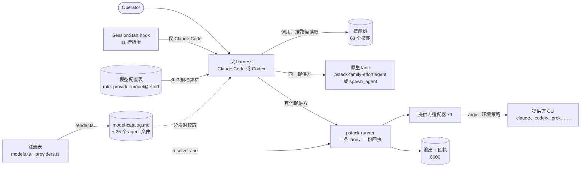
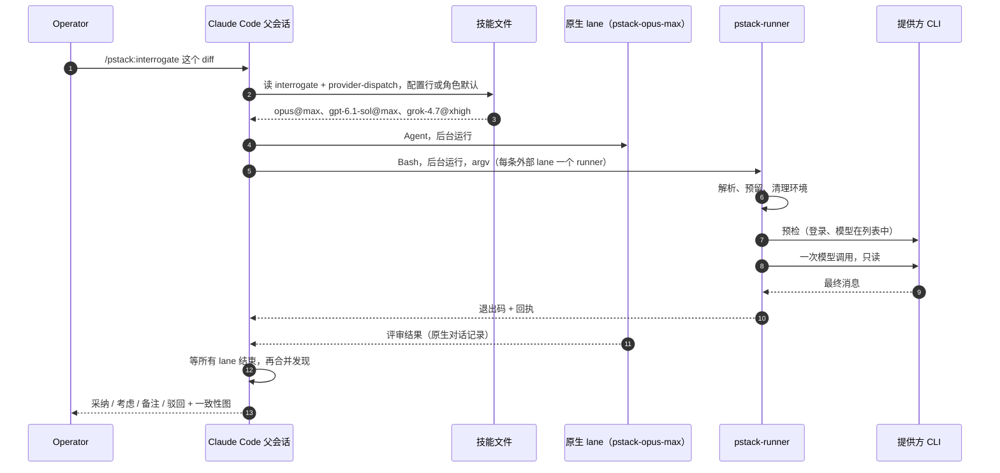
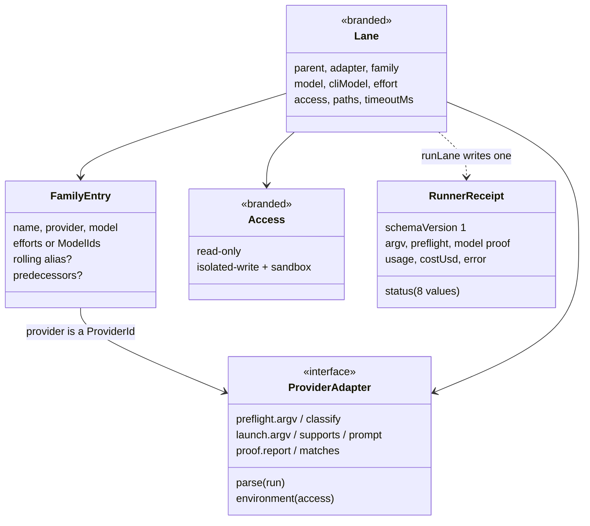
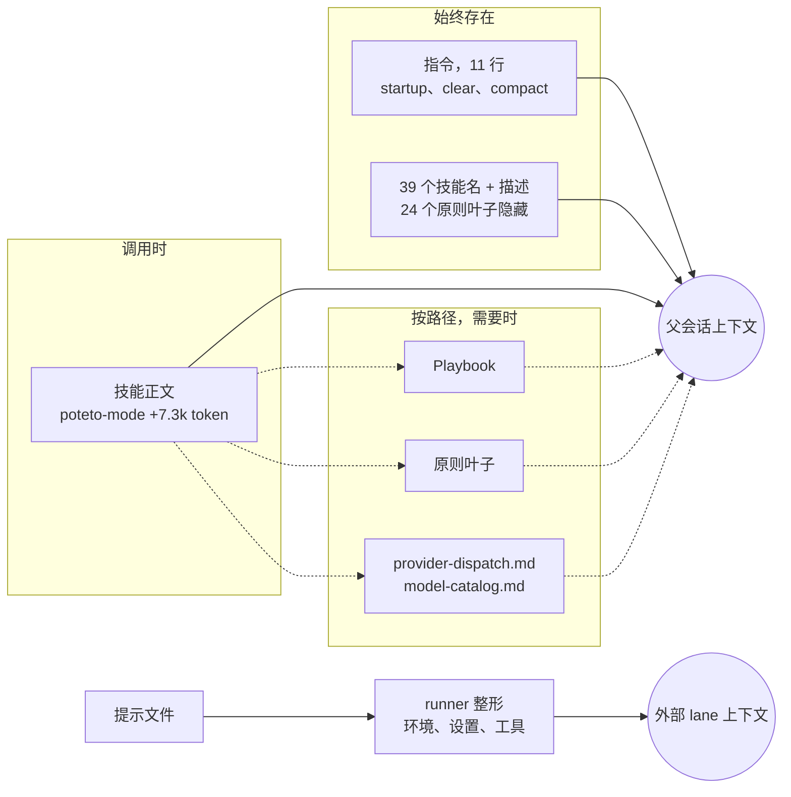
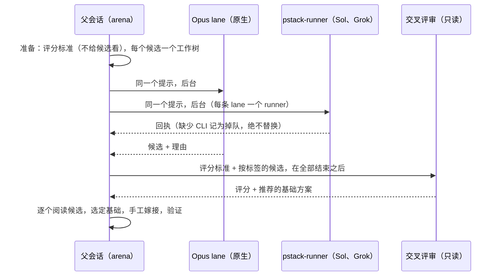

[English](open-pstack.md) · **中文**

# open-pstack（`ericlitman/open-pstack`）

> 研究基于提交 [`b4c5e3d`](https://github.com/ericlitman/open-pstack/tree/b4c5e3d63318308b7e11f26b2bc156e7793d834a)
> （2026-10-22，Open Pstack 1.16.0，跟踪 Cursor pstack 0.15.29，即 [`88d4751`](https://github.com/cursor/plugins/tree/88d47514b82e7c44f00f2b2a72ff6dd12158038c/pstack)）。
> 下文的源码路径都相对于该仓库根目录，行号对应这个提交。用到两个简写：
> `skills/` 指 `plugins/pstack/skills/`，`runner/` 指 `plugins/pstack/skills/poteto-mode/scripts/runner/`。
> **事实**指在源码中读到、经测试证实或在运行时观察到的内容；**解读**是我对作者意图的理解。

**交互式图表（Archify，每个节点都链接到源码）：**
[架构](../diagrams/open-pstack/architecture.html) ·
[执行流程](../diagrams/open-pstack/execution-flow.html) ·
[核心抽象](../diagrams/open-pstack/core-abstractions.html) ·
[上下文流](../diagrams/open-pstack/context-flow.html) ·
[记忆流](../diagrams/open-pstack/memory-flow.html) ·
[工具运行时](../diagrams/open-pstack/tool-runtime.html) ·
[Agent 循环](../diagrams/open-pstack/agent-loop.html) ·
[子 Agent 流程](../diagrams/open-pstack/sub-agent-flow.html)

（图表与英文版共用，图中文字为英文。）

**最小复现：** [`experiments/open-pstack/`](https://github.com/woaitqs/repo-research/tree/main/experiments/open-pstack)

---

## 摘要（TL;DR）

- **open-pstack 自己没有 agent 循环。** 它是 Claude Code 和 Codex 的一个插件：63 个 Markdown 技能（skill，其中 24 个是原则叶子），23 个 playbook，27 个 agent 文件，一个 hook 和几个 Bun 脚本。循环由宿主 harness 运行，pstack 用文字去引导它。
  - 它把 Lauren Tan 在 Cursor 上的 pstack 移植过来。和同步点的上游相比，插件的 273 个文件里有 50 个完全相同、86 个有改动、137 个是新增的。
  - 新代码几乎全是同一样东西：一个**外部 runner**，让 Claude Code 会话把 Codex 或 Grok 当作独立的 lane 来调用（反过来也一样）。它有 3,588 行 TypeScript，外加 5,153 行测试。
- **每条路由都由父会话决定。** 模型配置表（model sheet）里的一个角色解析成一个描述符 `provider:model@effort`。描述符的提供方与父会话相同，就作为原生子 agent 运行；其他提供方一律走 `pstack-runner`（`skills/poteto-mode/references/provider-dispatch.md:27-63`）。子 agent 拿到的是已经定好的任务分配，并被明确告知不许自己选路由（`plugins/pstack/agents/pstack-opus-max.md:11`）。
- **runner 的每条 lane 只调用一次模型，并且总会留下一份回执（receipt）。**
  - 启动前，它会拒绝同提供方的 lane、未规范化的版本固定、未列出的 effort，以及无边界的访问模式（`runner/registry/index.ts:62-121`）。
  - 它用 `O_EXCL` 以 0600 权限预留输出文件和回执（`runner/run.ts:94-129`），清除父会话的身份变量（`run.ts:172-186`），预检（preflight）最多重试一次。
  - 答案只有带模型证明才算数：提供方报告的模型属于所请求的家族，或者 Codex 的固定 argv（`run.ts:543-570, 962-981`）。
  - 没有隐式超时，也没有降级（`AGENTS.md:21`）。
  - **已验证：** 对真实启动器的探针，20 条论断全部成立。用真实的 Claude 和 Codex CLI，9 个场景各跑了 3 次。
- **"掉队不是降级"（a dropout is not a fallback）是这次移植最主要的编辑改动。** 上游的 `interrogate` 在模型被拒时，会改用家族默认模型或"最接近的等价模型"重跑。移植版删掉了这条，理由是替身会"破坏跨提供方一致意见的意义"（`skills/interrogate/SKILL.md:32`）。
  - **线上观察：** 本机的 Codex（ChatGPT 账号，CLI 0.157.1）不提供角色默认的 `gpt-6.1-sol`。这条 lane 3 次全部以 `unavailable-model`/69 结束，也没有任何模型顶替。
- **一个带类型的注册表生成模型目录和 25 个原生 agent 文件**（`runner/registry/render.ts`）。来自上游的技能只写角色名，从不写模型名，并由文本扫描强制执行（`runner/registry.test.ts:367-380`）。所以换一个模型，不需要改任何来自上游的行。这个设计是用 pstack 自己的 `architect` + `arena` 做出来的，而且主持者否决了交叉评审的推荐。
- **访问模式依靠各个 CLI 自己的沙箱。**
  - Claude 写入 lane 运行在 Claude Code 的 Bash 沙箱里，runner 额外禁止写入链接工作树（linked worktree）共享的 `.git`。
  - Codex 写入 lane 运行在 Codex 的 `workspace-write` 模式里。
  - **已验证：** 两种写入 lane 都写不了 `$HOME`（各 3/3）。Codex 写入 lane 能写 `/tmp`（3/3）。当主仓库位于 `/tmp` 下时，它还能写进共享的 `.git`（3/3）。
- **实测：文字层的指令被遵守得很松。**
  - 27 个无界面（headless）会话里，SessionStart hook 每次都触发，简单问题一次也没被路由（0/9）。但非简单任务只有 5/18 进入了 pstack 技能（Haiku 3/6，Sonnet 0/6，Opus 2/6）。
  - 显式输入 `/pstack:poteto-mode` 时，技能正文确实加载了（提示词多出 7,251 个 token）。但 6 个会话里没有一个按 playbook 建立待办列表，也没有一个读过分发规则文档。
  - 3 个 Opus 会话全部委托给了生成的 `pstack-sonnet-low` agent，而不是角色默认的模型。
  - 这些都是无界面模式下的小任务：是证据，不是基准测试。
- **整个仓库围绕"模型没法造假的验证"来组织。** 一个 PR 只有在 `verify`（测试、类型检查、15 条静态不变量）通过，并且精确 head SHA 上有 `live-gate` 状态后才会合并（`.mergify.yml:4-14`）。这个状态来自在真实的 Claude Code 和 Codex 会话里驱动已安装的候选版本，其中"模型声称通过了，永远不算数"（`.claude/skills/verify-open-pstack/SKILL.md:56`）。

## 为什么值得研究（Why This Repository Matters）

- 它展示了另一种"agent"的形态：**宿主 harness + 技能包 + 少量确定性工具**。不需要接入任何运行时。技能包改变模型读到什么、怎么委托，其余交给 harness。
- 它把**模型多样性当作评审信号**。`arena`、`architect` 和 `interrogate` 默认把同一个提示同时交给 Opus、Sol 和 Grok（`skills/poteto-mode/references/model-catalog.md:230-234`）。runner 的存在，就是为了让这些 lane 能从任一 harness 跨越厂商边界。
- 它是**一边移植、一边跟踪上游**的认真范例。上游的每个提交都在 `UPSTREAM.md` 里被标记为采纳、改编或排除，三方合并脚本完成机械部分（`UPSTREAM.md:76-94`）。翻译集中在两个很窄的文件里，而不是分叉出各自的技能。
- 它为 agent 贡献者做了工程化：CI、针对精确 head 的线上门禁、自动评审，以及把反复出现的错误变成检查的技能（`correct`、`reflect`）。

## 仓库概况（Repository Snapshot）

| 项目 | 值（事实） |
|---|---|
| 包 | 插件 `pstack` 1.16.0，属于 `open-pstack` 市场，同时面向 Claude Code（`.claude-plugin/marketplace.json`）和 Codex（`.agents/plugins/marketplace.json`）。MIT 协议。跟踪 Cursor pstack 0.15.29（`UPSTREAM.md:7-13`） |
| 内容 | 63 个技能；技能 Markdown 共 600 KB、7,120 行；`poteto-mode/playbooks/` 下 23 个 playbook；24 个 `principle-*` 叶子；27 个 agent 文件（25 个是生成的） |
| 自有代码 | `runner/`：3,588 行 TypeScript，5,153 行测试，9 个提供方适配器。从上游原样引入：`watch-pr`、`orch`、`bootstrap.ts`、`worktree-audit.sh`；`check-plan.mjs` 有改编（`NOTICE.md:40`） |
| 工具链 | Bun 1.4.0（`package.json:4`），`check-plan.mjs` 用 Node，`gh`，`git` 2.25 及以上 |
| 与上游对比 | `plugins/pstack/` 有 273 个文件，上游 172 个。50 个相同，86 个有改动（其中 79 个 Markdown），137 个仅移植版有。仅上游有的：Cursor 清单、`benny` 自动化、`docs/guide/` 教程、`make-bot-ui` |
| 历史 | 411 个提交；第一个提交（2026-05-26）导入了 `michael-denyer/pstack-claude`。GitHub 仓库创建于 2026-08-24，其中 336 个提交来自 2026 年 10 月。19 个版本，其中 13 个发布于 2026-10-11 到 2026-10-21 之间 |
| 活跃度（2026-10-28） | 531 star，86 fork。Issue：125 个已关闭，8 个开放。PR：83 个已合并，32 个已关闭 |
| 测试 | 505 个 Bun 测试（3,141 个断言），验证器自己的 201 个测试，以及 10 个 Python 发布测试。串行运行全部通过；在本机用 `--parallel` 运行有 6 个因环境原因失败（见[验证](#验证verification)） |

## 架构（Architecture）

这套架构把**模型读到的东西**（技能、模型配置表、生成的模型目录）和**确定性代码做的事**（runner 及其适配器）分开，父 harness 位于两者之间。



三个事实决定了它的形态：

1. **插件没有自己的进程。** 两个清单指向同一棵 `skills/` 树：`plugins/pstack/.claude-plugin/plugin.json` 和 `plugins/pstack/.codex-plugin/plugin.json`（`"skills": "./skills/"`，第 20 行）。在 Claude Code 上，一个 SessionStart hook 在 `startup|clear|compact` 时注入一段简短指令（`plugins/pstack/hooks/hooks.json:3-15`）。Codex 没有插件 hook 运行时，所以在 Codex 上要按名字进入（`docs/reference.md:88`）。
2. **翻译集中在两个文件，不在技能里。**
   - `skills/poteto-mode/references/codex-tools.md` 把 harness 原语（Claude 的 `Agent`、`Skill`、`AskUserQuestion` 等）映射到 Codex。
   - `provider-dispatch.md` 和生成的 `model-catalog.md` 负责模型与提供方的映射。
   - 技能本身保留 Claude 的工具说法，只加一行指向说明（`skills/poteto-mode/SKILL.md:10-12`）。`AGENTS.md:5` 写明了规则："在已有的映射边界上适配 harness 原语，而不是分叉技能"。
3. **路由属于父会话。**
   - 路由表只有一条规则：父会话自己的提供方走原生，其他一律走外部 runner（`model-catalog.md:63-77`；由 `runner/registry/render.ts:32-34` 生成）。
   - runner 拒绝同提供方的 lane（`runner/registry/index.ts:74-78`）。
   - 生成的 agent 写着"不要选择别的模型、不要再启动 agent、不要启动 pstack 工作流"，并禁用 `Agent, Task`（`plugins/pstack/agents/pstack-opus-max.md:6, 11`）。

**哪些是移植的，哪些是自有的（事实）。** 上游 pstack 没有 `runner/`。注册表、9 个适配器、25 个生成的 agent、hook、Codex 映射、`setup-pstack` 的"先探测后写入"流程以及验证器，都是移植版自己写的。工作流文字（poteto-mode、playbook、原则、arena、interrogate、swarm 等）来自上游，只在提到 Cursor 原语或模型名的行上做了修改（`NOTICE.md:9-27, 50-68`）。

## 主要执行流程（Main Execution Flow）

这里有两条流程：一条是**会话**（模型在父会话里工作），一条是**外部 lane**（确定性代码）。下图跟随一次从 Claude Code 父会话发起的 `interrogate` 评审，使用默认组合：Opus 原生，Sol 和 Grok 外部。



**会话（Claude Code）。**

| # | 步骤 | 位置（事实） |
|---|---|---|
| 1 | hook 在 `startup`、`clear` 和 `compact` 时打印指令 | `plugins/pstack/hooks/hooks.json:3-15`；`hooks/session-start:10-15`；正文在 `hooks/session-start-context.md:1-11` |
| 2 | 模型决定调用 `pstack:poteto-mode`，或在"意图已经很具体"时调用更窄的技能 | `hooks/session-start-context.md:4-6` |
| 3 | poteto-mode 的正文进入上下文。实测：比普通提示多 7,251 个提示 token | `skills/poteto-mode/SKILL.md`（150 行，20.7 KB） |
| 4 | 匹配一个 playbook，建立待办列表，"前几项是匹配到的 playbook 步骤，逐字复制" | `skills/poteto-mode/SKILL.md:122-126` |
| 5 | 每次委托前，读角色的配置行或角色默认值，以及分发规则文档 | `skills/poteto-mode/SKILL.md:12, 94-98` |
| 6 | 原生 lane 用子 agent 原语启动，外部 lane 用 `pstack-runner` 启动，都作为保留句柄的后台任务 | `provider-dispatch.md:35-63, 79-84` |
| 7 | 等所有 lane 结束后才评判；评审者不得在候选结果还在写入时读取它们 | `provider-dispatch.md:105` |
| 8 | 在真实界面上验证，然后按"Writing the reply"的规则回复 | `skills/poteto-mode/SKILL.md:104-116`；`skills/principle-prove-it-works/SKILL.md:9-22` |

**外部 lane（`pstack-runner`）。**

| # | 步骤 | 位置（事实） |
|---|---|---|
| 1 | `sh` 启动器：清除 `BUN_OPTIONS` 和 `NODE_OPTIONS`，以 `--no-env-file --config=/dev/null` 运行 Bun | `runner/pstack-runner:1-4` |
| 2 | 在导入任何模块之前记录开始时间，这样 `--timeout` 也计入模块加载时间 | `runner/entry.ts:1-3` |
| 3 | 严格解析参数，然后 `resolveLane`。被拒绝时以 64 退出，什么都不预留 | `runner/cli.ts:42-89, 107-112`；`runner/registry/index.ts:62-121` |
| 4 | 以 `wx`、0600 预留输出、回执、`.stdout` 和 `.stderr`；失败时只回滚本次创建的文件 | `runner/run.ts:94-129` |
| 5 | 构造子进程环境，删除父会话的身份标记 | `runner/run.ts:172-186`；`runner/types.ts:1-25` |
| 6 | 在子进程的 `PATH` 上查找可执行文件；找不到 CLI 即 `unavailable-cli`/69 | `runner/run.ts:634-714` |
| 7 | 对 Claude 写入 lane，找出要禁写的共享 git 目录；若 cwd 就在其中则拒绝 | `runner/run.ts:716-747, 421-508` |
| 8 | 预检（登录与模型）。只在 `unauthenticated` 之后、5 秒后重试一次（仅 Grok） | `runner/run.ts:783-884`；`runner/providers/grok.ts:91` |
| 9 | 只执行一次模型调用 | `runner/run.ts:893-902` |
| 10 | 分类顺序：取消、超时、提供方报告的失败、非零退出、输出格式错误、缺少证明 | `runner/run.ts:915-999` |
| 11 | 只有 `complete` 时才写答案文件，然后写回执 | `runner/run.ts:972-1002` |

**事实：** 启动器从不把提示词拼进 shell 命令。父会话把提示写进文件，再以 argv 数组传路径（`provider-dispatch.md:46-63`）。Claude、Codex 和多数只读提供方从 stdin 读提示，Grok 和 Devin 读文件。

## 核心抽象（Core Abstractions）



### 技能、playbook 与原则叶子（内容层）
- **是什么：** 带 `name` 和 `description` frontmatter 的 `SKILL.md` 文件。`poteto-mode` 是入口，包含触发条件、24 条原则的索引和 playbook 索引，并告诉模型到 `../<name>/SKILL.md` 去读叶子（`skills/poteto-mode/SKILL.md:8, 39-80, 122-150`）。
- **可见性：** 24 个 `principle-*` 叶子都标了 `user-invocable: false`。一条静态不变量要求必须有这个标记，并禁止它们带 `disable-model-invocation`（`tests/skill-collision-repro.sh:18-34`）。**观察：** Claude Code 2.1.312 向模型列出 39 个 pstack 技能，24 个叶子一个也不在列，所以叶子只能通过读取路径来到达。
- **为什么存在：** 模型始终只看到名字和一行描述，长文本只在工作需要时才进入上下文。

### 模型配置表与描述符
- **语法：** `<provider>:<model>@<effort>`，effort 取 `low medium high xhigh max ultra default`（`provider-dispatch.md:3-13`）。`inherit-parent` 和 `auto` 表示用父会话自己的模型。
- **存储：** Claude Code 写 `<config-home>/pstack-models.md`，并在 `CLAUDE.md` 里加一行 `@` 导入。Codex 把配置表的原始字节镜像到 `AGENTS.md` 中一个有边界标记的块里（`skills/setup-pstack/SKILL.md:12-26`）。
- **角色默认值**就是首次运行时的配置表。评审组合用 Opus、Sol 和 Grok；单人写代码的角色用 Sol 或 Grok（`model-catalog.md:211-235`）。
- **规范化：** 像 `claude-opus-5-6` 这样带版本号的 Claude 固定版本，会在路由前于内存中改写成滚动别名 `opus`（`provider-dispatch.md:19-25`）。runner 拒绝没有规范化的版本固定（`runner/registry/index.ts:80-84`）。

### 注册表（`FamilyEntry`、角色默认值、已发布组合）
- **职责：** 模型事实的唯一来源：17 个家族、15 个角色、21 个已发布组合（`runner/registry/models.ts:6-212`）。
- **类型规则：** 家族的提供方必须是已注册的适配器，因为 `ProviderId` 来自 `ADAPTERS` 数组（`runner/registry/family.ts:5`）。effort 体现在模型 ID 里的提供方，必须给出从 effort 到 CLI 模型的映射，而且不能有前代模型（`family.ts:25-29`）。
- **解析顺序：** 当前行、保留的前代、滚动别名的修订版、未注册（`runner/registry/index.ts:43-53`）。未注册的组合照样原样运行，这是维护者明确做出的决定（`docs/plans/2026-10-11-model-provider-registry.md:919`）。

### `ProviderAdapter`
- **接口：** 预检的 argv 与分类器、启动 argv、提示的传递方式、支持的访问类型、解析器、证明规则和环境策略（`runner/registry/contract.ts:117-150`）。
- **它做不到的事：** 适配器没有任何字段能设置超时、重试模型调用或换用其他提供方。这些都是 runner 的策略（`docs/plans/2026-10-11-model-provider-registry.md:752-766`）。
- **契约测试：** 每个适配器都要跑同一套测试。模型名原样传递；`default` 时 effort 参数消失；提示只用一种方式传递；有边界的模式里没有绕过权限的 token；不支持的访问类型会被拒绝（`runner/providers/adapter-suite.ts:49-111`）。

### `Lane` 与 `Access`
- **品牌类型（branded type）：** 只有 `resolveLane` 能构造 `Lane`，只有 `access()` 能构造 `Access`（`runner/registry/contract.ts:12-49`）。完全访问只作为写入 lane 的一个沙箱设置存在（`contract.ts:20-24`），所以"只读 lane 上的完全访问"根本无法表达。
- **访问类型：** `read-only`、`isolated-write`，以及 `isolated-write-full-access`。最后一种只有 Codex 支持，并且要配置表明确开启（`model-catalog.md:68, 77`）。

### `runLane` 与 `RunnerReceipt`
- **职责：** 一条 lane 的全部策略：截止时间、取消、预留、环境、预检、唯一一次模型调用、分类和证明（`runner/run.ts:619-1083`）。
- **回执：** `schemaVersion: 1`，包含状态、父会话、提供方、模型、effort、模式、写入沙箱、路径、时间、可执行文件、预检的 argv/状态/证据、argv、退出码、信号、报告的模型、证明、会话、用量、成本和错误（`runner/types.ts:56-93`）。
- **状态与退出码：** `complete` 0，`malformed-output` 65，`unavailable-cli` 和 `unavailable-model` 69，`child-failed` 70，`unauthenticated` 77，`timed-out` 124，`cancelled` 130（`runner/run.ts:523-541`）。

### 生成的原生 agent
- **是什么：** 每个 Claude 家族的每个 effort 对应一个文件 `pstack-<family>-<effort>.md`，包含 `model`、`effort` 和 `disallowedTools: Agent, Task`（`plugins/pstack/agents/pstack-opus-max.md:1-11`）。由 `render.ts` 写出；已提交的文件与渲染结果不同时，测试就会失败（`runner/registry.test.ts:158-215`）。
- **为什么存在：** Claude Code 子 agent 的模型和 effort 来自它的定义文件，而这些文件在安装插件时加载，运行时无法生成，所以只能提前生成（`docs/plans/2026-10-11-model-provider-registry.md:48`）。

### Orchestrate 存储
- **是什么：** 一个位于仓库和会话之外的目录 `~/.claude/orchestrate/<project-slug>/`，包含 `units.tsv`、`ledger.tsv`、`frontier.json`、`inbox/`、`gates.md`、`preferences.md`，以及派生出来的 `status.md`（`skills/poteto-mode/playbooks/orchestrate.md:21-32`）。
- **代码：** `orch/store.ts` 与上游逐字节相同。它原子地写文件（临时文件加 rename），并在持锁进程已死时接管锁（`skills/poteto-mode/scripts/orch/store.ts:337-442`）。

## Agent 循环（Agent Loop）

**事实：pstack 不运行循环。** 父 harness 运行它自己的工具循环。pstack 在其上补充三样东西：

1. **一套流程。** playbook 的步骤成为最前面的待办项，被跳过的步骤也要留在列表里，写上 `skip: <reason>`（`skills/poteto-mode/SKILL.md:124`）。以 Feature 为例，步骤是：`how`、`architect`、吞吐检查点、在工作树里委托实现、在真实界面上验证、拆成有序的小提交、设计有争议时做 `interrogate`、最后开 PR（`skills/poteto-mode/playbooks/feature.md:5-16`）。
2. **一套委托策略。**
   - 父会话负责设计，并审查每一份 diff（`skills/poteto-mode/SKILL.md:100`）。
   - 新工作交给一个新的子 agent，带上合并后的完整范围，因为"靠中断串起来的恢复会悄悄丢掉指令"（`:102`）。
   - 最难的工作把 effort 调高一级，常规工作调低，但模型家族永远不变（`:98`）。
3. **停止规则。**
   - 只有实验也解决不了的决定才去问操作者；能通过运行观察到的分歧，就做原型（`:21`）。
   - 只在不可逆的写操作前暂停（`:82-90`）。
   - 宣布完成前，要在真实产物上验证（`skills/principle-prove-it-works/SKILL.md:9-22`）。

确定性的部分是 **runner lane**，一个很小的状态机：

```text
resolve ──拒绝──▶ exit 64（什么都没预留）
   │
reserve ──冲突──▶ exit 64（已有文件不动）
   │
env + executable ──缺少 CLI──▶ unavailable-cli 69
   │
preflight ──未登录──▶（grok：等 5 秒，重试一次）──▶ unauthenticated 77
   │         └─模型不在列表中──▶ unavailable-model 69
model call（一次）──信号──▶ cancelled 130 · ──截止时间──▶ timed-out 124
   │                └─退出码≠0──▶ child-failed 70 / unavailable-model 69
parse + proof ──输出错误或模型不对──▶ malformed-output 65
   │
complete 0（写出答案文件）
```

- **事实：** 优先级依次是启动器取消、超时、提供方报告的失败、非零退出、输出格式错误、模型证明（`docs/plans/2026-10-11-model-provider-registry.md:763`；`runner/run.ts:915-999`）。
- **事实：** `unauthenticated` 只来自预检。运行中途过期的登录记为 `child-failed`，并把 CLI 的文字作为证据保留（`provider-dispatch.md:103`）。探针 P13 证实了这一点。
- **解读：** pstack 想要的循环是"先深入、用精确的说明委托、验证、评审"。它靠文字来执行，所以是否发生取决于模型。[验证](#验证verification)一节测量了实际发生的频率。[Agent 循环图](../diagrams/open-pstack/agent-loop.html)画的是设计中的循环。

## 上下文工程（Context Engineering）

这里的上下文工程关心的是**父会话的模型在什么时候看到什么**。pstack 从不以编程方式修改提示词，它只决定哪个文件出现在模型面前。



**1. 始终在上下文中（观察）。**
- 在 Claude Code 上，hook 注入那段指令。流式输出里能看到 `hook_started SessionStart:startup`，以及一个带着正文的 `hook_response`（27 个会话全部如此）。
- harness 按名字和描述列出每个用户可调用的技能：39 个 pstack 技能，24 个原则叶子一个都没有。
- 在这个配置下，一个普通的 Haiku 提示花了 24,855 个提示 token。这个数字大部分是 Claude Code 自己的 system prompt 和工具 schema。

**2. 按需加载（实测）。**
- 调用 `/pstack:poteto-mode` 后，第一次调用的提示升到 32,106 个 token，所以正文增加了 7,251 个 token。
- 流式输出不会回显展开后的正文；只有 token 数能说明它确实到达了。
- playbook、原则叶子和分发规则文档，只有模型按路径读取时才会进入上下文（`skills/poteto-mode/SKILL.md:8, 12, 41, 124`）。

**3. pstack 交给模型的上下文规则（事实）。**
- "把大块内容交给子 agent，主线程只留摘要"（`skills/principle-guard-the-context-window/SKILL.md:9-12`）。
- 每次委托都用文件指针，不要内联整段内容（`skills/poteto-mode/SKILL.md:96`）。
- `recall` 把挖掘对话记录的工作放在子 agent 里，原始记录不进主线程（`skills/recall/SKILL.md:18`）。

**4. 外部 lane 从干净的状态开始（事实，已探测）。**
- Claude lane 以 `-p` 运行，并带上：
  - `--setting-sources project` 和 `--strict-mcp-config`；
  - `--no-session-persistence` 和 `--disable-slash-commands`；
  - 一份明确的工具列表，并禁用 `Agent`、`Task`、`WebSearch`、`WebFetch`（`runner/providers/claude.ts:15-25, 108-125`）。
- Codex lane 以 `exec --ephemeral` 运行，禁用 `plugins`、`multi_agent`、`hooks` 和 `memories`（`runner/providers/codex.ts:76-97`）。
- 两者都拿不到父会话的 MCP 服务器。这也是需要 MCP 的 `why` 和 `reflect` 保持 `inherit-parent` 的原因（`UPSTREAM.md:25`；`skills/setup-pstack/SKILL.md:98`）。
- **一条 lane 的基础成本（实测）：** Claude Haiku lane 的提示是 9,525 个 token（4,564 个命中缓存，4,959 个写入缓存）。Codex Luna lane 是 19,192 个输入 token，没有命中缓存。

**5. 读取对话记录有严格限制（事实）。** `reflect` 把对话记录交给评审者时，Claude Code 的记录只在当前项目的目录里查找：最多 10 个候选、500 条记录、每个候选 2 MiB、每条记录 256 KiB。Codex 的记录通过一个解析器查找，它只打印元数据和 SHA-256，从不输出消息正文（`skills/poteto-mode/references/codex-tools.md:24-38`）。

**解读。** 上下文预算的大头花在宿主 harness 上，而不是 pstack。在调用技能之前，pstack 自身的开销很小。风险在另一边：最关键的指令（打开 playbook、读分发规则）都隔着一次文件读取，而模型可以跳过这次读取。下面的测量显示，它经常跳过。

## 记忆（Memory）

| 问题 | 回答（除标注外都是事实） |
|---|---|
| 什么是记忆？ | pstack 没有对话式记忆。所有持久的东西都是文件：模型配置表、Orchestrate 存储、决策记录、对技能和检查的修改，以及 runner 回执。`recall` 按需从对话记录和"共享记录"中重建上下文 |
| 存在哪里？ | 配置表：`<config-home>/pstack-models.md`，加上导入行或镜像块（`skills/setup-pstack/SKILL.md:12-26`）。存储：`~/.claude/orchestrate/<slug>/`（`playbooks/orchestrate.md:23`）。决策记录：工作目录里的 `decisions.tsv`，默认不提交（`skills/show-me-your-work/SKILL.md:43-47`） |
| 谁来写？ | `setup-pstack` 写配置表。Orchestrate 的协调者通过 `orch` CLI 写，每个文件只有一个写入者。`show-me-your-work/scripts/log.sh` 追加记录行。`reflect` 和 `correct` 修改仓库里的技能和检查 |
| 写入前有什么关卡？ | setup 先探测每个已分配家族的确切组合，"探测失败就什么都不写"。它为两个目标文件做快照，写完再读回比对，不一致就恢复（`skills/setup-pstack/SKILL.md:73, 114`）。`reflect` 等待明确批准（`skills/reflect/SKILL.md:38-40`）。`correct` 必须"证明每个检查都会在一个真实的历史错误上失败"（`skills/correct/SKILL.md:26`） |
| 谁读回？ | 每次分发都读配置表。重启后的协调者重新读取常设指令和 `units.tsv`，按 PR 和分支重新接上进行中的工作（`playbooks/orchestrate.md:103`）。之后的 agent 读到修改过的技能 |
| 过时 | 账本的结论按 PR 和 head SHA 记录，所以"新的 head SHA 会让这一行作废"（`playbooks/orchestrate.md:91`）。带旧 Claude 固定版本的配置表会在内存中规范化，并在每次运行中报告一次已过时（`provider-dispatch.md:21-23`） |
| 显式还是隐式？ | 显式。没有任何后台提炼。教训只有经过 `reflect`（需批准）才会成为技能修改，经过 `correct` 才会成为检查 |

**四个容易混淆的概念：**

```text
对话记录（Transcript）   harness 自己的记录（~/.claude/projects/...、Codex rollout）。pstack 读它，但不写它。
上下文（Context）        一次模型调用携带的内容：harness 提示 + 指令 + 技能列表 + 已读取的文件。
模型配置表（Model sheet） 操作者的配置：每个角色用哪个提供方、模型和 effort。
程序存储（Program store） Orchestrate 在仓库之外的文件：单元、账本、收件箱、常设指令、派生的状态。
```

**事实：存储把"完成"当作队列事件。** 一个子 agent 完成后变成一次 `orch inbox push`，协调者在四个时间点批量处理，而不是当场审查（`playbooks/orchestrate.md:72-77`）。是否存活要看账本、`units.tsv`、`gh` 和已推送的分支；"对话记录的修改时间不代表存活"（`:97`）。

## 工具（Tools）

- **没有新增面向模型的工具。** pstack 提供的是模型通过 shell 运行的脚本：`pstack-runner`、`orch`、`watch-pr`、`check-plan.mjs`、`worktree-audit.sh`、`show-me-your-work/scripts/log.sh` 和 `resolve-codex-transcript`（`skills/poteto-mode/references/codex-tools.md:103-105`）。
- **工具名做映射，不做封装。** 一张表把 Claude 的动作映射到 Codex：`Agent` 对应 `spawn_agent`，待办列表对应 `update_plan`，`AskUserQuestion` 改为纯文本提问，文件编辑对应 `apply_patch`（`codex-tools.md:40-57`）。技能里提到的 Claude 内置技能（`run`、`verify`、`loop`）也给出了 Codex 上的替代（`codex-tools.md:92-101`）。
- **MCP：** 在父会话里，可逆的工作"可以用任何 MCP 工具"（`skills/poteto-mode/SKILL.md:84`）。外部 lane 一个也没有。
- **等待也是写成文档的技能。**
  - Claude Code 的前台 Bash 调用十分钟就会被截断。所以长时间运行的 lane 以 `run_in_background` 任务运行，子 agent 每次最多等待 540 秒（`codex-tools.md:78-86`）。
  - 这些等待窗口"永远不是 lane 或 runner 的截止时间"（`:85`）。
- **要求模型运行的结构检查：** `check-plan.mjs` 检查多阶段计划的骨架、验证语句和标点，playbook 要求修好它打印的每一行（`skills/poteto-mode/playbooks/multi-phase-plan.md:10`；`skills/poteto-mode/scripts/check-plan.mjs:7-10, 698`）。`log.sh` 会清理记录单元格，并给以 `=`、`+`、`-`、`@` 开头的内容加前缀（`skills/show-me-your-work/SKILL.md:37`）。
- **没有深入追踪：** `watch-pr`（一个约 2,400 行非测试代码的 PR 监视器，结论分 WAITING、READY 和 BLOCKED）、`worktree-audit.sh` 和上游同步脚本。

## 运行时 / 沙箱（Runtime / Sandbox）

**推理在哪里结束、执行从哪里开始**（事实）：

| 步骤 | 负责方 | 代码 |
|---|---|---|
| 选择 playbook、角色和 effort | 父会话的模型，依据文字 | `skills/poteto-mode/SKILL.md:94-102` |
| 把角色映射成描述符、把描述符映射成路由 | 父会话的模型，读取配置表和模型目录 | `provider-dispatch.md:27-42` |
| 校验、预留、清理、预检、启动、分类 | `pstack-runner`（确定性） | `runner/run.ts:619-1083` |
| 限制 lane 的工具和写入 | 各个提供方 CLI 自己的权限模式和沙箱 | `runner/providers/*.ts` |
| 评判结果 | 父会话的模型，在所有 lane 结束之后 | `skills/arena/SKILL.md:27-41`；`skills/interrogate/SKILL.md:36-47` |

**各提供方的访问模式（事实，取自适配器）。**

| 提供方 | `read-only` | `isolated-write` | 子进程环境 |
|---|---|---|---|
| claude | `--permission-mode plan`；工具 `Read,Grep,Glob,Bash`；禁止编辑 | `acceptEdits` 加 Bash 沙箱：`allowUnsandboxedCommands: false`、`failIfUnavailable: true`，对共享 `.git` 设 `denyWrite` | 继承；写入 lane 去掉 `GIT_*` |
| codex | `--sandbox read-only` | `workspace-write`，配置表开启时为 `danger-full-access` | 继承 |
| grok | auto 模式 + `read-only` 沙箱 | auto 模式 + `workspace` 沙箱 | 白名单，加 `GROK_*`、`XAI_*` |
| devin、opencode、dsh、amp、agy、cursor | 只支持只读 | 启动前拒绝 | 白名单 |

**身份标记清理（事实，已探测）。**
- 对每个提供方，runner 都会删除父会话的身份标记：Claude Code 4 个，Codex 7 个（`runner/types.ts:1-25`）。
- 白名单提供方只拿到 21 个固定名字和少数几个前缀（`runner/providers/shared.ts:4-27`）。
- **发现（P20）：** 对继承环境的提供方，只删除这份固定名单。Claude Code 2.1.312 的父会话还导出 `CLAUDE_CODE_ENTRYPOINT`、`CLAUDE_CODE_MESSAGING_SOCKET`、`CLAUDE_CODE_MESSAGING_TOKEN`、`CLAUDE_PID` 和 `CLAUDE_EFFORT`，这 5 个都到达了 Codex lane。

**用真实 CLI 测得的结果（各 3 次）。**
- 只读的 Claude lane 被要求 `touch` 一个文件时，回答说 plan 模式阻止了它，文件也确实没有出现（R5）。
- 只读的 Codex lane 得到"filesystem denied"（R7）。
- **链接工作树里的 Claude 写入 lane（R6）：** 写共享 `.git` 和 `$HOME` 都以"operation not permitted"失败（3/3），写 `/tmp` 也失败（3/3）。
- **Codex 写入 lane（R8）：** 写 cwd 成功，`$HOME` 被拒（3/3），但 `/tmp` 可写（3/3）。这是 Codex 文档中默认的可写根目录。
- **主仓库位于 `/tmp` 下的 Codex 写入 lane（R9）：** 这条 lane 写进了共享的 `.git`（3/3）。适配器没有请求禁写共享 `.git`（`runner/providers/codex.ts:75`）。Codex 自己对 `.git` 的保护不覆盖链接工作树的共享目录，而 `/tmp` 是一个可写根目录。当主检出像通常那样位于 `$HOME` 下时，R8 显示这种写入会被拦住。

**解读。** runner 并不自己构建沙箱。它选用每个厂商提供的有边界模式，补上它能表达的那一条规则（Claude 的 `denyWrite`），并拒绝那些实测写入无边界的提供方（Devin、agy、Cursor：`model-catalog.md:112, 181, 199`）。这是诚实的工程做法：提供方说明是一长串实测的 CLI 行为。但边界只有各 CLI 的默认策略那么强，而各家的默认策略并不相同。

## 子 Agent / 工作流（Sub-Agents / Workflow）



- **两类子 agent。**
  - 生成的**模型 lane**：Claude 上的 `pstack-<family>-<effort>`，Codex 上带模型和 effort 的 `spawn_agent`，或者一个 runner 进程。它们都不能嵌套，也不能改路由。
  - **`poteto-agent`**：通用助手，通过 `skills` frontmatter 预加载 `pstack:poteto-mode`（`plugins/pstack/agents/poteto-agent.md:4-10`）。它只用于 `inherit-parent`、`auto` 或未配置的助手（`skills/poteto-mode/SKILL.md:94`）。
- **评审类技能遵守同一份契约。** 每个技能都读取自己的角色配置行或角色默认值，在同一个扇出阶段启动所有 lane，只计入已完成且有模型证明的 lane，记录掉队，等所有 lane 结束后再评判。

| 技能 | 形态 | 默认 lane（角色默认值） | 评判方式 |
|---|---|---|---|
| `arena` | N 个候选，然后交叉评审，选基础方案，再嫁接 | Opus、Sol、Grok；评审者来自同一池，优先选不同提供方 | 父会话逐条按评分标准打分，再与评审者对比（`skills/arena/SKILL.md:10-49`） |
| `architect` | 在类型与模块草图上跑 arena，"设计两遍" | Opus、Sol、Grok | 对照设计红线筛查；偏好更深的接口（`skills/architect/SKILL.md:28-40`） |
| `interrogate` | 每个模型一个只读评审者 | Opus、Sol、Grok | 2 个以上模型都提出的发现排在最前；分四类；不自动应用（`skills/interrogate/SKILL.md:8, 36-47`） |
| `swarm` | 分区或竞赛，事先声明选择规则 | Grok 工作者 | 缺少 SHA 的结果重派一次，然后记为缺口；缺口不算通过（`skills/swarm/SKILL.md:21-42`） |
| `how` | 2–4 个探索角度，然后一个讲解者 | Grok 探索，Opus 讲解 | 只读（`skills/how/SKILL.md:10-27`） |
| `why`、`reflect` | 并行调查者或视角，然后一个汇总者 | `inherit-parent`，因为需要 MCP | `reflect` 等待批准（`skills/reflect/SKILL.md:10-40`） |

- **Orchestrate 把同样的规则放大到一个项目。**
  - 角色：从不写代码的协调者，每条主线一个子协调者，以及工作者。
  - 大约 10 个子任务的滚动窗口，以及一份 10 个字段的任务说明，每次派生都粘贴进去（`skills/poteto-mode/playbooks/orchestrate.md:15-58`）。
  - 一个单元的验证者与它的工作者使用不同的模型家族（`:17`）。
- **观察：** 在 6 个显式调用 `/pstack:poteto-mode` 的无界面会话里（任务是一个小功能）：
  - Opus 3 次都在前台委托给了 `pstack-sonnet-low`。
  - Sonnet 有一次在后台启动了 `poteto-agent`，然后结束了这一轮，"等待它的通知"。无界面会话在委托完成前就关闭了，测试仓库没有任何改动。
  - 这和 [letta-code 研究](letta-code.zh.md)中一次性子 agent 的报告丢失是同一类问题。

## 重要源码文件（Important Source Files）

| 文件 | 为什么重要 |
|---|---|
| `plugins/pstack/hooks/hooks.json`、`hooks/session-start-context.md` | 自动触发的指令（仅 Claude Code） |
| `skills/poteto-mode/SKILL.md` | 入口技能：触发条件、原则索引、自主权、委托、回复规则、playbook 索引 |
| `skills/poteto-mode/references/provider-dispatch.md` | 手写的分发规则：描述符、规范化、路由、访问模式、成功条件、掉队 |
| `skills/poteto-mode/references/model-catalog.md` | 生成的：模型矩阵、保留的前代、路由、提供方说明、角色默认值 |
| `skills/poteto-mode/references/codex-tools.md` | Claude 到 Codex 的原语映射、配置目录、对话记录的读取限制、等待规则 |
| `runner/run.ts` | lane 的全部策略：预留、环境、截止时间、取消、预检、唯一一次调用、证明、回执 |
| `runner/registry/contract.ts`、`index.ts`、`models.ts`、`providers.ts`、`render.ts` | 适配器契约、lane 解析、模型数据、提供方列表、生成器 |
| `runner/providers/*.ts` | 每个 CLI 的 argv、预检、解析和实测的怪癖 |
| `runner/registry.test.ts`、`runner/providers/adapter-suite.ts` | 漂移测试、角色指针的文本扫描、模块边界、适配器契约 |
| `skills/setup-pstack/SKILL.md` | 先探测后写入的配置流程，快照与读回 |
| `skills/{arena,architect,interrogate,swarm,how}/SKILL.md` | 评审类工作流 |
| `skills/poteto-mode/playbooks/orchestrate.md`、`scripts/orch/store.ts` | 长期运行的项目及其存储 |
| `UPSTREAM.md`、`CHANGES.md`、`NOTICE.md` | 同步契约、改编记录和来源说明 |
| `docs/plans/2026-10-11-model-provider-registry.md` | 注册表的设计，用 pstack 自己的 `architect` 做出 |
| `AGENTS.md`、`.mergify.yml`、`.claude/skills/verify-open-pstack/` | 合并策略与线上门禁 |

## 值得借鉴的 5+ 个实现决策（5+ Implementation Decisions Worth Learning From）

### 1. 掉队不是降级
- **做法：** 每条失败路径都以一个有名字的状态和一份回执结束 lane（`provider-dispatch.md:92-105`）。
  - 不重试模型调用。预检最多重试一次，而且只在 `unauthenticated` 之后（`runner/run.ts:794-827`）。
  - 不换更弱的模型，也不换提供方（`AGENTS.md:21`）。
  - 评审组合以 N-1 继续，并写明谁掉队了（`skills/arena/SKILL.md:25`）。移植版删除了上游改用家族默认值或最接近有效型号的降级逻辑（上游 `interrogate` 的第 3 步）。
- **解决的问题：** 跨模型评审的价值在于不同模型达成了一致。一个悄无声息的替身，会把"Opus 和 Sol 都指出了第 5 行"变成"Opus 指出了两次"，而且没人看得出来。
- **证据：** 本机的 Codex 不提供 `gpt-6.1-sol`。这条 lane 每次都以 `unavailable-model`/69 结束，回执里有提供方自己的拒绝原文，也没有答案文件（R4，3/3）。Codex 自己打印了"Defaulting to fallback metadata"，但服务端拒绝了这个模型，runner 如实报告了这一点。
- **代价：** 对用不了 Sol 的账号，默认的评审组合会悄悄变成两个模型，只有汇总说明里会提到。setup 的探测会在第一次运行前发现这个问题（`skills/setup-pstack/SKILL.md:73`）。
- **借鉴：** 让"实际是哪个模型回答的"成为结果的一部分。把缺失的模型当作需要报告的数据，而不是需要填补的空缺。

### 2. 路由由父会话决定，子 agent 拿到的是定好的任务
- **做法：**
  - 只有顶层父会话把描述符映射成路由（`provider-dispatch.md:27-33`）。
  - 嵌套的进程会继承环境标记，但"不得用它们来路由"。
  - runner 会从每个子进程中去掉这些标记（`runner/run.ts:172-186`）。
  - 生成的 agent 禁用 `Agent` 和 `Task`。
  - 对同一提供方调用 runner 会被拒绝。
- **解决的问题：** 否则子 agent 可能发现"我在 Codex 里"就改路由、递归下去，或者两层各自施加自己的降级。
- **代价：**
  - 父会话的模型必须从文字中正确完成路由，而在实测会话中它常常没去读路由规则（见[验证](#验证verification)）。
  - 固定的身份名单漏掉了较新的 Claude Code 变量（P20）。
- **借鉴：** 只在一个地方决定路由，把决定作为数据向下传，让子 agent 无法改路由，而不只是被告知不要改。

### 3. 一个带类型的注册表、生成的文字和角色指针
- **做法：**
  - 家族、角色默认值和提供方列表都写在 TypeScript 里（`runner/registry/models.ts`、`providers.ts`）。
  - `render.ts` 写出 `model-catalog.md` 和 25 个 agent 文件，任何漂移都会让测试失败（`runner/registry.test.ts:158-215`）。
  - 来自上游的技能只写角色名，并链接到它的角色默认值；文本扫描会拒绝手写 Markdown 中的任何描述符或带版本号的模型名（`registry.test.ts:329-380`）。
- **解决的问题：** 在这之前，加一个提供方要改大约 12 个文件，改一个默认模型要改大约 15 个，而且每次修改来自上游的行，都会在下次与 Cursor 同步时冲突（`docs/plans/2026-10-11-model-provider-registry.md:34-50`）。
- **怎么定下来的：** 用 pstack 自己。
  - `architect` 跑了一个由 Opus（原生）、Sol（runner，1,397,736 ms）和 Grok（runner，996,601 ms）组成的 arena。三者提出了同样的整体结构。
  - Sol 交叉评审更偏好 Sol 的候选（30 分里 25 分，Opus 23 分）。主持者仍以 Opus 的候选为基础。它从 Sol 的候选嫁接了私有的旁路目录和每个适配器的 `launch.supports`，从 Grok 的候选嫁接了 `Access.sandbox` 字段和一套共享的适配器测试（`docs/plans/2026-10-11-model-provider-registry.md:858-897`）。
- **代价：** 生成的文件与手写文件放在一起，父会话每次分发要读两个文件。设计文档明确列出了这些代价（`:898-905`）。
- **借鉴：** 当模型需要读取某些事实时，用代码生成 Markdown，并测试生成的字节。让文字指向名字，而不是具体的值。

### 4. 每份回执都带模型证明
- **做法：**
  - 一条完成的 lane 需要两者之一：提供方报告的模型与请求相符；或者对从不报告模型的 CLI（Codex、OpenCode 等），以固定的 argv 作为声明的证据（`runner/run.ts:543-570`）。
  - 滚动别名按家族检查：`opus` 必须以 `claude-opus-<数字>` 的形式返回（`runner/providers/claude.ts:51-54`）。
- **证据：**
  - 探针 P10：请求 `opus`、CLI 却报告 `claude-sonnet-5-5` 的 lane，以 `malformed-output` 结束，不保留答案。
  - 真实运行：`claude-haiku-5-5` 由提供方报告证明，`sonnet` 返回为 `claude-sonnet-5-5`，Codex lane 记录为 `pinned-argv`（R1–R3，各 3/3）。
- **借鉴：** 任何多模型系统都应该记录"请求的是什么、回答的是谁"，并拒绝计入不一致的结果。

### 5. 总有回执的 lane 读写，加上一个绝对截止时间
- **做法：**
  - 输出、回执和流的旁路文件都以 `wx`、0600 预留，永不覆盖（`runner/run.ts:60-64, 94-129`）。
  - `--timeout` 是可选的；给出时，从包装脚本入口开始计时，覆盖所有阶段（`entry.ts:1-3`；`run.ts:1010`）。长时间等待按小于 2^31 ms 的分段重新设置（`run.ts:294-306`）。
  - 通过保留的句柄取消时，信号会发给仍在运行的子进程，并留下一份 `cancelled` 回执（`run.ts:142-211`）。
- **证据：**
  - P7：已有的回执逐字节保持不变，退出码 64。
  - P14：在 `--timeout 2.5` 下，1.2 秒的预检加 6 秒的模型调用，于 2,506 ms 以 `timed-out` 结束，预检状态为 `passed`。
  - P15：SIGTERM 产生 `cancelled`/130，并在旁路文件中保留了部分 stdout。
  - P18：没有 `--timeout` 时，一次 12 秒的调用正常完成。
- **代价：**
  - "没有隐式超时"意味着卡住的 CLI 会让 lane 一直卡着，直到有人取消。设计接受这一点，因为真实的实现 lane "可能运行 90 分钟甚至更久"（`provider-dispatch.md:86`）。
  - runner 不会杀掉提供方的整个进程树，只处理直接的子进程（`provider-dispatch.md:103`）。
- **借鉴：** 在工作开始前预留所有产物，让回执成为唯一的成功信号，让截止时间明确且绝对。

### 6. 按提供方区分的环境策略，逐个 CLI 实测
- **做法：**
  - Claude 和 Codex 继承环境。其他提供方都用白名单，有的还会得到一个专属的配置目录，用来关闭它们的宿主规则、MCP 和联网工具（例如 `runner/providers/devin.ts:7-22`）。
  - 提供方说明记录了实测的行为，细到"一个 `.npmrc` 的 `node-options` 运行了仓库代码"（Cursor 的语言服务器 worker，`model-catalog.md:208`）。
- **解决的问题：** 每个厂商的 CLI 会加载不同的环境配置。只读 lane 只有在这些配置无法放宽它时，才真正是只读的。
- **代价：**
  - 这些说明是人工的、绑定版本的测量工作，CLI 一变就会过时。
  - 继承环境的提供方仍会收到所有非身份变量。
- **借鉴：** 把每个外部 agent CLI 都当作不可信的环境配置。用白名单限制它的环境，给它一个专属的配置目录，并把测到的结果连同版本号写下来。

### 7. 在两个窄边界上翻译，并维护上游账本
- **做法：**
  - 技能保持上游的样子。harness 名称通过 `codex-tools.md` 解析，模型通过 `provider-dispatch.md` 解析（`AGENTS.md:5`）。
  - 上游的每个提交都在 `UPSTREAM.md` 中得到一个采纳、改编或排除的决定，并附理由（`UPSTREAM.md:17-56`）。
  - `upstream-audit.py` 和 `upstream-merge.py` 复制未改动的文件，并对其余文件做三方合并（`UPSTREAM.md:80-87`）。
- **为什么有意思：** 移植版有意地分叉了（没有降级、三模型评审组合、单人写代码的角色保留 Sol），却仍能机械地接收上游的文字修改。
- **借鉴：** 如果你分叉了一个提示词库，把所有改编集中在一两个映射文件后面，并按提交维护决策账本。

### 8. 模型无法造假的验证
- **做法：**
  - Mergify 只在 `verify`（测试、类型、静态不变量）和精确 head SHA 上的 `live-gate` 都通过时，才把 PR 放进合并队列（`.mergify.yml:4-14`）。
  - `verify-open-pstack` 技能在真实的 Claude Code 和 Codex 会话里安装这个确切的候选版本。它对原生输出流、实际运行的命令和写出的文件做断言，"模型声称通过了，永远不算数"（`.claude/skills/verify-open-pstack/SKILL.md:46-56`）。
  - 同样的思路也提供给用户：`create-verification-skill`、`correct`（证明每个新检查都会在一个真实的历史错误上失败）和 `check-plan.mjs`。
- **代价：** 每次发布都需要在两个 harness 里跑真实会话，并使用操作者的登录；门禁是由某个人的机器发布的一个状态。
- **借鉴：** 对面向 agent 的产物，最强的测试是对真实会话中的工具调用和文件效果做断言，并固定到确切的候选版本。

### 9. 渐进式披露，并让原则不出现在菜单里
- **做法：** 指令只有 11 行，技能列表只有名字和描述。24 个原则叶子在两个列表里都看不到，poteto-mode 按标题点名它们，让模型只读决策需要的那几条。之后它必须"只引用本次会话中读过其叶子 SKILL.md 的原则"（`skills/poteto-mode/SKILL.md:16`）。
- **代价：** 如下文实测所示，模型经常跳过那些承载流程的读取。
- **借鉴：** 把参考材料藏在菜单之外；从唯一的入口技能按路径指向它；要求模型引用它读过的内容。

## 最小复现（Minimal Reproduction）

[`experiments/open-pstack/`](https://github.com/woaitqs/repo-research/tree/main/experiments/open-pstack) 是 `minipstack`，一个只用标准库的 Python 包，约 1,360 行，外加一个 190 行的演示。它复现的是**架构**，不是技能内容：注册表、生成的模型目录、父会话决定的路由、带回执且不降级的 runner、带掉队的扇出、先探测后写入的配置、程序存储，以及渐进式披露。

| minipstack | 复现内容 |
|---|---|
| `registry.py` | 家族、保留的前代、滚动别名；`resolve_lane` 拒绝同提供方 lane、未规范化的固定版本、未列出的 effort 和不支持的访问类型 |
| `adapters.py` | Claude、Codex、Grok，以及只支持只读的 Devin：argv、预检分类、解析、模型证明、环境策略 |
| `runner.py` | 0600 独占预留、身份清理、只在 `unauthenticated` 之后的一次预检重试、一次模型调用、一个绝对截止时间、会通知子进程的取消、状态优先级与退出码 |
| `render.py` | 生成的模型目录与 agent 文件、给出写入命令的漂移检查、对文字中描述符的文本扫描 |
| `dispatch.py` | 父会话决定的路由；所有 lane 同时启动；评判前的屏障；掉队绝不替换；`interrogate` 按引用的行号判定一致 |
| `sheet.py` | 规范化、校验（只读提供方上的写入角色）、先探测后写入、快照、读回与恢复、字节一致的重复运行 |
| `orch.py` | 单写入者存储、原子写、接管死进程持有的锁、按 PR 和 head SHA 记录的账本、收件箱批量处理、派生状态 |
| `skills.py` | 启动时的上下文 = 指令 + 列出的名字；调用时加载正文；原则叶子隐藏，并按路径解析 |

演示（`./run.sh demo`）走过 10 个场景，检查 12 条论断。`python3 mutation_check.py` 逐个注入 21 种架构回归。

## 验证（Verification）

所有命令都在本次会话的机器上运行：macOS（Darwin 25.5）、Bun 1.4.0、Node 24.12、git 2.50.1、Python 3.14、Claude Code 2.1.312 和 Codex CLI 0.157.1。

**1. 上游测试（固定提交，`bun install --frozen-lockfile`）。**

```bash
bun run test        # CI 的命令（bun test --parallel）：499 通过，6 失败
bun test --timeout 60000 bootstrap orch watch-pr runner check-plan resolve-codex-transcript
                    # 串行：505 通过，0 失败，3,141 个断言
bun run typecheck   # 对三个项目执行 tsc --strict：通过
bun run static      # 清单 + 15 条静态不变量：通过（包括验证器的 201 个测试）
python3 scripts/release_test.py   # 10 个测试 OK
```

并行模式下的每个失败都追溯到了本机环境，并在去掉原因后重跑：

| 失败的测试 | 原因 | 证据 |
|---|---|---|
| 5 个 `orch` frontier 测试 | Bun 每个测试 5 秒的超时。测试用约 20 次 `git` 调用搭建一个 git 栈，而本机启动进程很慢（`git init` 加 5 次提交耗时 2.65 秒，CPU 占用 13%）。超时触发后，清理逻辑在辅助函数还在运行时删除了临时仓库，于是出现后续的"not a git repository"错误 | `bun test orch --timeout 60000`：17/17 通过 |
| `runLane`"spends one explicit deadline across preflight and model execution" | 1,200 ms 的假预检对 1,500 ms 的截止时间，只留 300 ms 余量，并行负载下超出 | 单独运行：3/3 通过 |

**2. 对真实启动器的运行时探针**（[`upstream_probe/probe_runner.py`](https://github.com/woaitqs/repo-research/blob/main/experiments/open-pstack/upstream_probe/probe_runner.py)，脚本化的 `claude`/`codex`/`grok`/`devin`，无网络）：**20/20 成立。**

| 探针 | 论断 | 结果 |
|---|---|---|
| P1 | 同提供方 lane 在预留任何东西之前就被拒绝 | 成立：退出码 64，无回执，0 次 CLI 调用 |
| P2 | 白名单提供方只拿到允许的变量 | 成立：`CLAUDECODE`、父会话 id、`OPENAI_API_KEY`、AWS 密钥和 `GIT_DIR` 被去掉；`XAI_*`、`GROK_*` 保留 |
| P3 | 继承环境的提供方只去掉身份标记；写入 lane 还去掉 `GIT_*` | 成立 |
| P4 | 只读 Claude 的 argv：plan 模式、仅项目设置、严格 MCP、不持久化、禁用工具、无绕过 token | 成立 |
| P5 | 链接工作树中的 Claude 写入 lane 获得 Bash 沙箱，并对共享 `.git` 设 `denyWrite` | 成立 |
| P6 | cwd 位于共享 `.git` 内的写入 lane 在预检前被拒绝 | 成立：退出码 70，0 次 CLI 调用 |
| P7 | 已有的回执永不被覆盖；预留的文件权限为 0600 | 成立 |
| P8 | 预检列表里没有的模型算掉队；模型从未运行 | 成立：退出码 69，只有预检 |
| P9 | Grok 的预检只在 `unauthenticated` 之后、5 秒后重试一次 | 成立：间隔 5.09 秒；证据保留两次尝试 |
| P10 | 请求 `opus` 却由 Sonnet 修订版回答，记为 `malformed-output` | 成立 |
| P11 | 请求 `opus`、由 `claude-opus-5-5` 回答，靠提供方报告证明 | 成立 |
| P12 | Codex 靠固定 argv 证明；lane 为临时模式，禁用 plugins、multi_agent、hooks 和 memories | 成立 |
| P13 | 预检之后的认证错误记为 `child-failed`，而不是 `unauthenticated` | 成立 |
| P14 | `--timeout` 是覆盖预检与模型的同一个截止时间 | 成立：2,506 ms，预检 `passed`，SIGTERM |
| P15 | 发给启动器的 SIGTERM 会到达子进程，并保留 `cancelled` 回执和部分 stdout | 成立 |
| P16 | 未规范化的 Claude 固定版本被拒绝 | 成立 |
| P17 | 只读提供方在启动前拒绝写入 lane | 成立 |
| P18 | 没有隐式超时：12 秒的调用正常完成 | 成立 |
| P19 | 退出码为 0 但输出无法解析，记为 `malformed-output` | 成立 |
| P20 | 继承的环境里只去掉固定的身份名单 | 成立：另外 5 个 `CLAUDE*` 变量（包括 `CLAUDE_CODE_MESSAGING_TOKEN`）到达了 Codex |

**3. 真实启动器配合真实 CLI**（[`real_model/run_real_runner.py`](https://github.com/woaitqs/repo-research/blob/main/experiments/open-pstack/real_model/run_real_runner.py)，使用操作者已有的登录，3 次运行）。Claude lane 共花费 0.063 美元；Codex 不报告成本。

| 场景 | 结果（3 次） |
|---|---|
| R1 `claude:claude-haiku-5-5@low`，只读，Codex 父会话 | 3/3 完成；提供方报告 `claude-haiku-5-5`；原样返回标记；每条 lane 约 0.001 美元 |
| R2 `claude:sonnet@low`（滚动别名） | 3/3 完成；回执保留 `sonnet`，报告为 `claude-sonnet-5-5` |
| R3 `codex:gpt-6-luna@low`，只读，Claude 父会话 | 3/3 完成；`pinned-argv` |
| R4 `codex:gpt-6.1-sol@low`（角色默认值） | 3/3 `unavailable-model`/69："The 'gpt-6.1-sol' model is not supported when using Codex with a ChatGPT account."没有答案，没有替身 |
| R5 只读 Claude lane 被要求创建文件 | 3/3 未创建 |
| R6 链接工作树中的 Claude 写入 lane：cwd、共享 `.git`、`$HOME`、`/tmp` | `.git`、`$HOME` 和 `/tmp` 3/3 被拦截。写 cwd 成功 2/3：第 2 次运行中，Haiku 把四条命令串成了一次 Bash 调用，Claude Code 请求批准，而无界面模式无法给出批准，模型也拒绝拆分调用。结果什么都没写，回执却仍然是 `complete` |
| R7 只读 Codex lane 被要求创建文件 | 3/3 未创建 |
| R8 Codex 写入 lane：cwd、`$HOME`、`/tmp` | cwd 3/3；`$HOME` 3/3 被拦截；`/tmp` 3/3 被写入 |
| R9 Codex 写入 lane，链接工作树，主仓库在 `/tmp` 下 | 3/3 写进了共享 `.git` |

**4. 插件在真实 Claude Code 会话中的表现。**

*路由*（[`real_model/run_plugin_session.py`](https://github.com/woaitqs/repo-research/blob/main/experiments/open-pstack/real_model/run_plugin_session.py)）。
- **设置：** `claude -p --plugin-dir <clone>/plugins/pstack --setting-sources project`，因此只加载这个插件和内置项。每次用全新的测试仓库。禁止编辑、Bash 和子 agent，所以什么都不会改变（27/27 未改变）。3 个模型 × 3 个提示 × 3 次，共 1.98 美元。
- **怎样算路由：** 通过 Skill 工具调用了任意一个 pstack 技能。对于 bug 提示，指令允许直接调用 `pstack:tdd`。

| 提示 | Haiku | Sonnet | Opus |
|---|---|---|---|
| hook 触发 | 9/9 | 9/9 | 9/9 |
| 可复现的 bug + 测试 | 0/3 | 0/3 | 1/3（`tdd`） |
| 带边界情况的小功能 + 测试 | 3/3（`poteto-mode`） | 0/3 | 1/3（`poteto-mode`） |
| 一句话的 git 问题（不应路由） | 0/3 | 0/3 | 0/3 |

*执行到底*（[`real_model/run_explicit_session.py`](https://github.com/woaitqs/repo-research/blob/main/experiments/open-pstack/real_model/run_explicit_session.py)）。
- **设置：**
  - 在一个一次性的测试仓库里，用小功能任务调用 `/pstack:poteto-mode`。
  - 编辑会被接受；Bash 在 Claude Code 的沙箱里自动放行。
  - 每个会话上限 30 轮、1.50 美元，没有一个触及上限。
  - 3 个 Sonnet 和 3 个 Opus 会话，共 2.20 美元。
- **结果：**
  - 每个会话的第一次调用都带有 34.7k 个提示 token，说明技能正文都在。
  - 0/6 读了 playbook、建立了待办列表、读了 `provider-dispatch.md` 或模型目录、读了原则叶子，或调用了 `pstack-runner`。
  - Opus 3/3 在前台委托给了原生的 `pstack-sonnet-low` agent。这与角色默认值（`feature, refactoring` 用 Grok）不是同一个家族，而且是在没读配置表和模型目录的情况下选的。有两个 Opus 会话最后在测试仓库的主检出上提交了代码。
  - Sonnet 有 2/3 自己完成了工作。另一次它在后台启动了 `poteto-agent`，然后结束本轮去等待通知，而无界面模式永远不会送来这个通知。
  - 6 个最终回复都遵守了"Writing the reply"的规则：没有长破折号，也没有小节标题。
  - Claude Code 2.1.312 的 25 个初始工具里没有待办工具（它被延迟到 `ToolSearch` 之后才加载），所以在这个版本上，建立待办列表的指令需要多走一步。

**这说明了什么、没说明什么：** hook、技能列表和技能加载都按设计工作。路由以及技能内部的流程取决于模型；在本机、无界面模式、小任务的条件下，它们大多被跳过了。交互式会话、更大的任务和其他 harness 版本可能表现不同。这是 33 个会话，不是基准测试。

**5. 复现。**

```bash
cd experiments/open-pstack && ./run.sh
# [1/4] venv + pip install -e .[test]   [2/4] wheel minipstack-0.1.0   [3/4] 40 passed   [4/4] demo 12/12 PASS
python3 mutation_check.py        # 21/21 种架构回归被发现
PYTHONPATH=src python3 real_model/run_mini_real.py --runs 3   # 每次运行两个真实的 interrogate 评审组合
```

变异检查每次向 `src/` 的副本注入一种回归，每一种都必须让至少一个测试失败：
- 同提供方 lane 能运行，或未规范化的固定版本能运行；
- 身份标记泄漏，或白名单继承了全部环境；
- 回执被截断，或答案在没有证明时被计入；
- 未列出的模型仍然运行，或模型阶段的认证错误变成 `unauthenticated`；
- 每个阶段都重新计时，或取消从不通知子进程；
- 共享 `.git` 的禁写被去掉；
- 失败的 lane 被计入，lane 串行运行，或单个模型的发现被算作一致；
- setup 在探测失败后仍写入，或留下写了一半的状态；
- 账本对任何 head 都给出结论；
- 已死的锁持有者永久阻塞存储；
- 漂移没被发现、文字里出现描述符，或原则叶子被列了出来。

这项检查跑了两轮：
- **第一轮有一种变异存活（20/21）：** 「文字里可以出现描述符」。测试的样例行里同时有一个描述符和一个带版本号的模型名，所以扫描仍会因为模型名标出这一行。现在测试把两者分别放在两行，并要求命中两次。
- **两个计时测试的余量太小：** 截止时间测试和并行启动测试。在负载下，它们会因为不相关的变异而失败，掩盖了每次「被发现」到底证明了什么。两者都放宽了。

在空闲的机器上，最后一轮发现了 21/21，每一种都由为它编写的测试发现。

真实模型评审组合（[`real_model/run_mini_real.py`](https://github.com/woaitqs/repo-research/blob/main/experiments/open-pstack/real_model/run_mini_real.py)，3 次运行）用同样的 CLI 驱动 `minipstack`。每次运行两个 `interrogate` 评审组合，审查同一个埋了差一错误的 diff：`percentile(values, 100)` 在第 7 行越界读了一位。
- **Claude 父进程：** Haiku 走原生，Codex Luna 走 runner。另有两条 lane 在本机跑不了：Codex Sol（这个账号的 Codex 不提供它）和 Grok（本机没有 CLI）。
- **Codex 父进程：** Haiku 和 `sonnet` 别名走 runner，Luna 走原生。

| 检查项 | 结果 |
|---|---|
| Claude 父进程的评审组合只计入 Haiku 和 Luna | 3/3 |
| Sol 为 `unavailable-model`，Grok 为 `unavailable-cli`：都是具名掉线，从不替换 | 3/3 |
| Luna 由固定 argv 证明；Haiku 和 `sonnet` 由提供方报告证明（`sonnet` 实际由 `claude-sonnet-5-5` 回答） | 3/3 |
| Codex 父进程的评审组合三条 lane 全部计入 | 3/3 |
| 埋下的缺陷（第 7 行）进入一致性列表 | 6/6 个评审组合 |

单个模型的发现每次都不同（第 2 到 5 行），把埋下的缺陷和它们区分开的正是一致性列表。有一次列表里还多了第 3 行，Haiku 和 Sonnet 都提出了：`p` 没有做范围检查。runner 上的 Claude lane 总共花费 0.07 美元。见 [`real_model/mini_results.json`](https://github.com/woaitqs/repo-research/blob/main/experiments/open-pstack/real_model/mini_results.json)。

这个评审组合第一次运行时，发现的是复现里的 bug，不是 CLI 的问题。`minipstack` 只解析 `claude auth status --json` 输出的第一行，而真实 CLI 会把这段 JSON 分成多行打印。于是 Codex 父进程下的每条 Claude lane 都以 `unauthenticated` 结束，3/3。runner 按设计把它记为具名掉线，没有任何替换。40 个测试之前能通过，是因为脚本化的 CLI 只打印一行。修复后像上游一样解析整个值（`providers/claude.ts:43-49`），脚本化的 CLI 也改成了多行打印。换回旧的解析方式，有 8 个测试失败。

**6. 图表。** 8 张 Archify 图都通过了 `finalize --quality showcase --repo-root <clone>`：schema 校验、可验证交付、严格的来源检查，以及无界面 Chrome 浏览器检查。截图都经人工查看。见 [`assets/open-pstack/archify/README.md`](https://github.com/woaitqs/repo-research/blob/main/assets/open-pstack/archify/README.md)。

**验证的已知局限：**
- 本机只有 Claude 和 Codex 两个 CLI。Grok、Devin、OpenCode、dsh、Amp、agy 和 Cursor 的 lane 只用脚本化的 CLI 检查过，它们的提供方说明是读过而没有重新测量。
- 插件从未以 Codex 作为父 harness 运行过。Codex 父会话的行为（`spawn_agent`、`AGENTS.md` 镜像块）只在源码中读过。复现里的 Codex 父进程评审组合虽然调用了真实的 Codex CLI，但只是模拟它的路由。
- 线上门禁本身（`verify.sh run`）没有运行：它会向目标仓库的 PR 发布内容。
- `watch-pr`、Shipping 和 Autopilot 类 playbook，以及上游同步脚本只读了一部分。

## 我会复用什么（What I Would Reuse）

1. **每次外部模型调用都带模型证明的回执**，以及一套"掉队绝不是降级"的状态分类。
2. **由父会话决定、作为数据下传的路由**，让子 agent 在结构上无法改路由（没有嵌套工具，身份已清理）。
3. **一个生成模型所读 Markdown 的带类型注册表**，加上漂移测试，以及把模型名挡在文字之外的文本扫描。
4. **独占、私有、总有回执的读写，以及一个绝对且可选的截止时间。**
5. **按 CLI 设置的环境白名单和专属配置目录**，并把实测行为写在 argv 旁边。
6. **两个窄翻译文件，加上按提交记录的上游账本**，适用于任何分叉出来的提示词库。
7. **对真实会话做断言的线上门禁**，永远不依赖模型的自我报告。
8. 我会改的地方：
   - 对继承环境的子进程，清除所有 `CLAUDE*` 和 `CODEX_*` 变量，而不是一份固定名单；
   - 对 Codex 写入 lane 也禁写共享 `.git`，或者当主仓库位于可写根目录下时拒绝 Codex 写入 lane；
   - 把"走哪条路由、用哪个模型"从文字里移出来。一个小的解析命令就能回答并记录下来，但 setup 目前禁止"运行时解析器"（`skills/setup-pstack/SKILL.md:8`）；
   - 让待办列表这一步不依赖 harness 是否延迟加载待办工具；
   - 在无界面模式下（没有完成通知会到达），让后台委托明确地失败。

## 局限与开放问题（Limitations / Open Questions）

- **路由的遵守程度：** 在无界面会话里，指令只把 5/18 个非简单任务路由进了 pstack。这对无界面使用来说是预期的吗？交互式使用下又如何？维护者自己的线上门禁检查的是 hook 是否触发、技能是否加载，而不是模型路由的频率。
- **流程的遵守程度：** 即使显式加载了 poteto-mode，也没有一个会话打开 playbook 或读取分发规则。流程只靠文字执行，而 pstack 自己的原则说，应该把重复出现的规则写成"lint、元数据标记、运行时检查或脚本，而不是更多文字"（`skills/principle-encode-lessons-in-structure/SKILL.md:3`）。不清楚维护者期望哪些流程规则在没有检查的情况下也能成立。
- **Codex 写入 lane 与共享 `.git`**（R9）：是有意依赖 Codex 的可写根目录，还是一个漏洞？*未提交 issue。*
- **身份标记**（P20）：固定名单早于 Claude Code 较新的 `CLAUDE_CODE_*` 变量。一个消息 token 出现在 Codex lane 里是否要紧，取决于这个 token 能做什么。*未深入调查。*
- **Codex 上的 `--disable hooks`：** Codex 子进程仍然解析了操作者的 `~/.codex/hooks.json`（它记录了"clamping Interrupt hook timeout"）。那些 hook 是否真的运行，没有测量。
- **ChatGPT 账号 Codex 上的角色默认值：** 这个账号拒绝了 `gpt-6.1-sol`。setup 的探测能发现这一点，但 README 中的默认评审组合假定它可用。
- **没有深入追踪：** `watch-pr`、Babysit、Shipping 和 Autopilot、`check-plan.mjs` 的内部实现、Windows 下的 hook 包装器，以及除 Devin 之外的只读提供方适配器。

## 延伸阅读（Further Reading）

- 源码：[ericlitman/open-pstack @ b4c5e3d](https://github.com/ericlitman/open-pstack/tree/b4c5e3d63318308b7e11f26b2bc156e7793d834a)，尤其是 `docs/reference.md`、`UPSTREAM.md`、`AGENTS.md`，以及 `docs/plans/2026-10-11-model-provider-registry.md` 中的注册表设计。
- 上游：[cursor/plugins/pstack @ 88d4751](https://github.com/cursor/plugins/tree/88d47514b82e7c44f00f2b2a72ff6dd12158038c/pstack) 及其 `pstack/docs/guide/` 中的指南。
- 参考文档提到的早期移植：[michael-denyer/pstack-claude](https://github.com/michael-denyer/pstack-claude)（本仓库的历史从它开始）。
- 本系列的其他研究：
  - [deepagents](deepagents.zh.md)、[OpenHands](openhands.zh.md)、[openai-agents-python](openai-agents-python.zh.md) 和 [letta-code](letta-code.zh.md) 都拥有自己的 agent 循环。
  - open-pstack 一个都没有。它用技能塑造宿主的循环，只在不能让模型决定的地方加入确定性代码，也就是 runner。它在一次性模式下丢失后台委托报告的问题，与 letta-code 相同。
